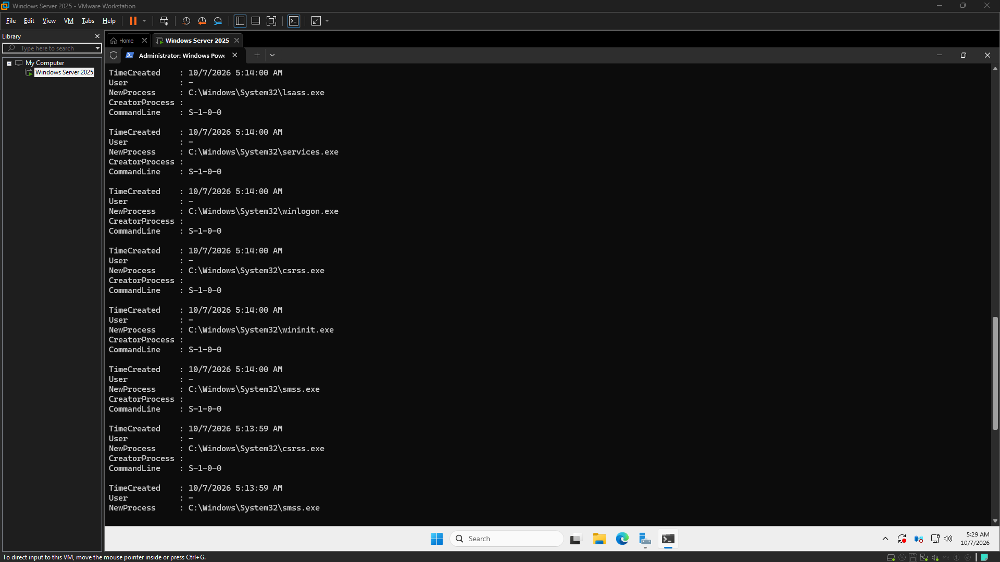
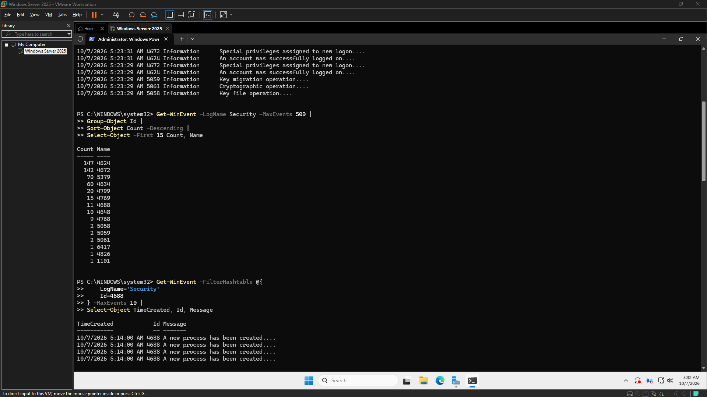
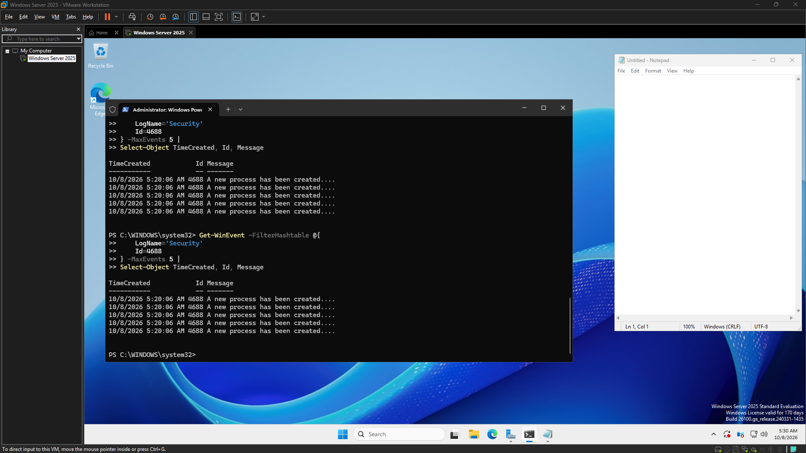
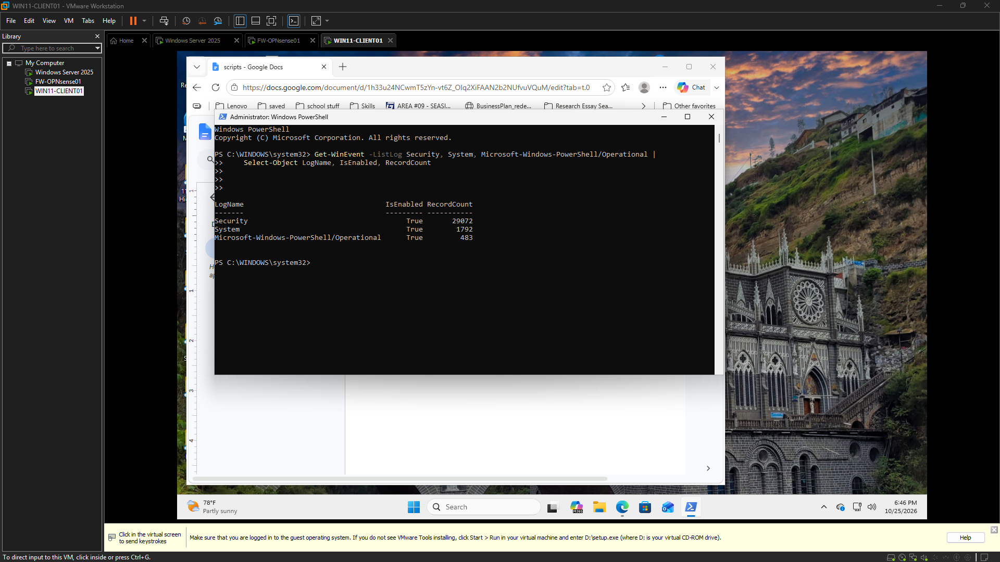
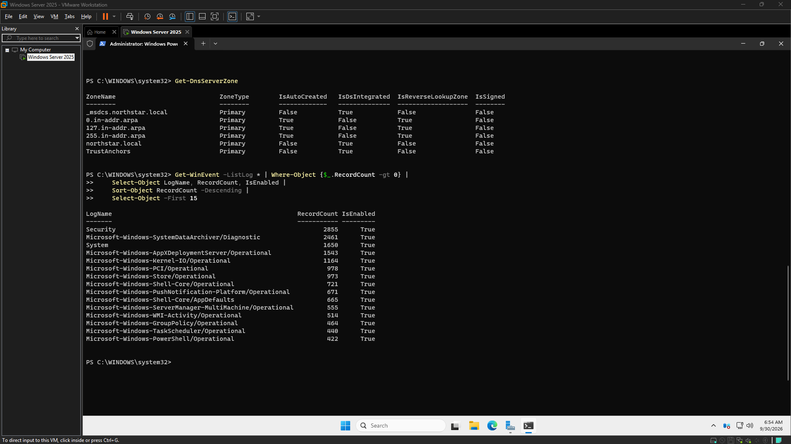

# CyberOps-Sandbox

Status: In progress

## Project story
Here is a concise project summary for 'CyberOps-Sandbox', reflecting its ongoing status.

---

# CyberOps-Sandbox: Building a Centralized Security Monitoring Environment

## 1. Project Story

The **CyberOps-Sandbox** project is actively establishing a dedicated, robust virtual environment for centralized security monitoring, designed to provide hands-on experience and demonstrate practical cyber operations capabilities. The project initiated by provisioning a foundational Ubuntu Server within VMware, strategically integrating it into a segmented virtual network (OPNsense LAN via VMnet2).

Currently, the primary focus is on the crucial deployment of **Wazuh**, a leading open-source security platform, to serve as the core Security Information and Event Management (SIEM) solution. This involves meticulous selection and installation of the correct Ubuntu Server version (24.04.5 LTS) to ensure optimal compatibility and stability for Wazuh. Once Wazuh is operational, the sandbox will enable comprehensive security telemetry collection, baseline establishment, and incident analysis, laying the groundwork for advanced cyber defense practices.

## 2. Key Achievements

*   **Foundational Server Provisioning:** Successfully provisioned and configured an Ubuntu Server virtual machine in VMware, establishing the essential operating system foundation for the security monitoring solution.
*   **Network Segmentation & Integration:** Seamlessly integrated the server into a segmented virtual network (OPNsense LAN via VMnet2), ensuring proper isolation and controlled communication crucial for security operations.
*   **Remote Administration Enabled:** Established and verified remote SSH access from the host machine to the Ubuntu Server, streamlining management and configuration tasks.
*   **Critical OS Version Alignment:** Through proactive compatibility review, identified and prepared for the correct Ubuntu Server 24.04.5 LTS version necessary for a stable Wazuh deployment, avoiding potential issues with an initially considered newer release.
*   **Initial Setup Challenge Resolution:** Demonstrated effective problem-solving by navigating and resolving initial setup challenges, including forgotten login credentials via recovery mode and adapting to host resource constraints for VM memory allocation.
*   **Wazuh Deployment Readiness:** Progressed to the point of acquiring necessary Wazuh components (e.g., signing key) and preparing the VM for the all-in-one Wazuh installation, signifying readiness for the core SIEM deployment phase.

## 3. Lessons Learned

*   **Pre-emptive Version Compatibility is Key:** The importance of thoroughly verifying operating system compatibility with target applications (Wazuh) *before* deployment became evident, as an initial incorrect Ubuntu version choice necessitated an OS replacement, highlighting the value of upfront planning.
*   **Systematic Troubleshooting & Recovery:** Encountering and successfully resolving issues like forgotten login credentials reinforced the necessity of methodical troubleshooting and leveraging system recovery mechanisms.
*   **Iterative Resource Allocation:** Acknowledged that initial conservative VM resource allocations, driven by host limitations, require ongoing review and potential adjustment as project requirements and performance demands evolve, particularly with the introduction of resource-intensive applications like Wazuh.
*   **Distinguishing ISO vs. Booted OS:** Learned the critical distinction between an attached ISO and the *actually booted* operating system version to ensure correct configurations and avoid future deployment roadblocks.

## 4. Next Steps

*   Complete the Ubuntu Server 24.04.5 LTS installation and verification on the virtual machine.
*   Proceed with the all-in-one deployment and configuration of the Wazuh Manager, Indexer, and Dashboard.
*   Validate Wazuh services are fully operational, accessible, and ready for agent enrollment.
*   Begin ingesting security telemetry from various endpoints and establishing initial monitoring baselines within Wazuh.
*   Continuously review and potentially increase VM memory allocation based on Wazuh performance and host resource availability.

## 5. Proof Points

**Project Logs:**
*   `2026-11-03.md`: Documents the successful provisioning of the Ubuntu Server, its integration into the segmented network, establishment of SSH access, and initial configuration.
*   `2026-11-04.md`: Details the proactive compatibility review, the identification and procurement of the correct Ubuntu Server 24.04.5 LTS for Wazuh, and the ongoing preparatory steps for the Wazuh deployment.

**Screenshot Captions (Evidencing foundational work and future intent):**
*   **Foundational Setup:** "Ubuntu Storage Configuration," "Ubuntu Username Recovery after forgetting," "Ubuntu Server First Login," "Ubuntu SSH Service Running"
*   **Security Monitoring Objectives:** "Endpoint Baseline Initial Audit," "Security Log Baseline," "Telemetry Visibility Gap," "Process Creation Telemetry," "Security Event Distribution," "CyberOps Baseline v0.1" (Indicating the strategic intent to build comprehensive security monitoring and analysis capabilities).

## Project timeline
### 2026-11-04 • 05:49 to 06:19
- Goal
Deploy Wazuh all-in-one on Ubuntu Server and establish the centralized monitoring foundation.

- Definition of Done
Ubuntu is prepared for Wazuh deployment, Wazuh all-in-one installation completes successfully, Manage, indexer, and dashboard services are operational, Required service ports and network access are verified, Dashboard is accessible from the physical Windows host, or any remaining access blocker is identified and documented.

- Goal Achieved
❌ No

Summary:
Reviewed Ubuntu 26.04.1 compatibility with the Wazuh deployment, verified the Wazuh signing key, identified Ubuntu Server 24.04 LTS as the documented installation target, obtained the Ubuntu Server 24.04.5 ISO, prepared the existing virtual machine for OS replacement.

Tasks Completed:
Reviewed Ubuntu 26.04.1 compatibility with the Wazuh deployment, verified the Wazuh signing key, identified Ubuntu Server 24.04 LTS as the documented installation target, obtained the Ubuntu Server 24.04.5 ISO, prepared the existing virtual machine for OS replacement.

Issues Encountered:
The initial Ubuntu version selection introduced an avoidable compatibility detour, distinguishing between the ISO attached to the VM and the operating system actually booted, confirming the appropriate Wazuh installation path.

Next Steps:
Need to finish Ubuntu 26.04.5 LTS iso swap to finish Wazuh installation

Notes:

- Working Story
None

- Friction and AI Gaps
The initial Ubuntu version selection introduced an avoidable compatibility detour, distinguishing between the ISO attached to the VM and the operating system actually booted, confirming the appropriate Wazuh installation path.

- What the AI Missed
None

- AI Peer Review
Status: Approved
Reviewer: human
Reviewed At: 2026-11-04 06:22:23
Reviewer Notes: Keep the existing VM hardware configuration. Confirm Ubuntu 24.04.5 is actually installed before proceeding with Wazuh.

- Duration
30 minutes (Planned: 45 minutes)

- Notes
Existing VM configuration: 4 vCPU, 8 GB RAM, 50 GB virtual disk, VMnet2 network. Wazuh signing key was downloaded successfully.
### 2026-11-03 • 05:57 to 06:34
- Goal
Deploy and establish the Ubuntu Server foundation for centralized security monitoring.

- Definition of Done
The session is complete when Ubuntu Server is installed and operational, the VM has a working network connection, resource allocation is documented, and the environment is ready for Wazuh installation.

- Goal Achieved
✅ Yes

Summary:
A dedicated Ubuntu Server 26.04.1 LTS virtual machine has been successfully provisioned in VMware, establishing a foundational Linux server for centralized security monitoring. The VM was integrated into the existing segmented OPNsense LAN, with core system configuration, network validation, and remote administration capabilities established. This prepares the environment for future Wazuh deployment without requiring a rebuild of existing infrastructure.

Tasks Completed:
*   Provisioned a dedicated Ubuntu Server 26.04.1 LTS virtual machine in VMware.
*   Configured the VM with 2 CPU cores, 4 GB RAM, and a 50 GB virtual disk.
*   Integrated the VM into the existing OPNsense LAN via VMnet2.
*   Completed the Ubuntu installation process.
*   Successfully performed an account recovery and password reset.
*   Updated all system packages to the latest versions.
*   Verified hostname and network configuration (IP address, subnet mask).
*   Confirmed gateway connectivity and external internet access.
*   Validated DNS resolution.
*   Enabled the OpenSSH Server.
*   Established successful remote SSH access from the physical Windows host.

Issues Encountered:
*   Initial Ubuntu login failed due to an incorrect or forgotten password, necessitating entry into recovery mode to identify the existing account and perform a password reset.
*   Conservative VM memory allocation was required due to initial host resource availability constraints.

Next Steps:
*   Proceed with the installation and configuration of Wazuh on the newly provisioned Ubuntu server.
*   Review host resource availability to potentially increase VM memory allocation if performance bottlenecks are observed or future requirements demand it.

Notes:
*   The current VM memory allocation of 4 GB is functional but was influenced by host resource limitations. Performance should be monitored during Wazuh deployment and operation, and memory adjusted as needed to ensure optimal security monitoring performance.
*   The successful integration into the OPNsense LAN through VMnet2 ensures proper network segmentation and controlled communication for the security monitoring solution.

- Working Story
Establishing a dedicated Linux server foundation for centralized security monitoring, integrating the new server into the existing segmented virtual network, validating connectivity and remote administration, preparing the environment for Wazuh deployment without rebuilding existing infrastructure.

- Friction and AI Gaps
The Ubuntu login initially failed because the configured password was incorrect or had been forgotten, requiring recovery mode to identify the existing account and reset its password. Initial host resource availability also required conservative VM memory allocation.

- What the AI Missed
None

- AI Peer Review
Status: Approved
Reviewer: human
Reviewed At: 2026-11-03 06:35:12
Reviewer Notes: Ubuntu Server installation and baseline validation were completed successfully. The server is operational and accessible remotely from the physical Windows host. Network connectivity, DNS resolution, package updates, and SSH functionality were verified.

- Duration
36 minutes (Planned: 40 minutes)

- Notes
Hostname: ubuntu-siem01, operating system: Ubuntu 26.04.1 LTS, kernel: Linux 7.0.0-42-generic, architecture: x86_64, network interface: ens33, IPv4 address: 192.168.20.131/24, gateway: 192.168.20.1, VM network: VMnet2, VM allocation: 2 CPU cores, 4 GB RAM, 50 GB disk, SSH service: enabled and active, remote access: verified from Windows PowerShell.
### 2026-10-26 • 05:52 to 06:38
- Goal
Validate practical SIEM deployment options for CyberOps Sandbox, establish the available hosting resources and constraints, select a feasible Wazuh deployment approach, prepare the Week 2 implementation starting point.

- Definition of Done
Confirm usable host disk capacity and current memory constraints, identify existing VMware VM resource allocations and relevant network connectivity, select a practical SIEM hosting approach, document unresolved dependencies and the first implementation milestone.

- Goal Achieved
✅ Yes

Summary:
Significant progress was made in establishing foundational infrastructure and planning for the development of security operations capabilities. Key activities included reviewing existing network infrastructure, confirming baseline checks, establishing remaining Month 1 tasks, and planning for Wazuh deployment. The primary constraint identified is limited host memory, which requires further evaluation before proceeding with new installations.

Tasks Completed:
*   Reviewed the existing OPNsense virtual firewall and segmented network infrastructure.
*   Confirmed completion of Windows endpoint and event-log baseline checks.
*   Established the remaining Month 1 foundation tasks.
*   Planned Ubuntu Server deployment and Wazuh installation.
*   Defined the first Month 2 milestone: collecting and investigating genuine Windows endpoint telemetry.

Issues Encountered:
*   Available host memory is a significant deployment constraint. A previous check indicated approximately 4.9 GB available while lab VMs were running, which necessitates a thorough evaluation of Wazuh resource allocation prior to installation to ensure stable operation.

Next Steps:
*   Evaluate Wazuh resource requirements and optimize host memory allocation.
*   Proceed with Ubuntu Server deployment.
*   Install and configure Wazuh.
*   Begin collecting and investigating genuine Windows endpoint telemetry to meet the Month 2 milestone.

Notes:
The project is transitioning from building and validating foundational infrastructure to developing practical security operations capabilities. There is a strong emphasis on leveraging real telemetry for evidence-based investigations within a reproducible environment.

- Working Story
The transition from building and validating foundational infrastructure to developing practical security operations capabilities, with an emphasis on real telemetry, evidence-based investigation, and a reproducible environment.

- Friction and AI Gaps
Available host memory is the main deployment constraint. The previous check showed approximately 4.9 GB available while the lab VMs were running, so Wazuh resource allocation needs to be evaluated before installation.

- What the AI Missed
None

- AI Peer Review
Status: Approved
Reviewer: human
Reviewed At: 2026-10-26 06:39:06
Reviewer Notes: Month 1 is substantially established at the infrastructure level. Remaining work includes evaluating available resources and installing Ubuntu Server. Month 2 begins with SIEM deployment, Windows endpoint integration, telemetry validation, and the first investigation.

- Duration
45 minutes (Planned: 45 minutes)

- Notes
The target is to align the Month 1 checkpoint with the final week of October and begin Month 2 during the first week of November. The schedule is flexible if deployment requires additional troubleshooting.
### 2026-10-25 • 18:32 to 18:48
- Goal
Establish the current CyberOps infrastructure baseline and identify the technical prerequisites for the November SIEM build, verify host resources, confirm existing VM and network state, identify blockers before installing anything.

- Definition of Done
Record available host RAM and disk capacity, identify the relevant VMware VMs and their current resource allocations, confirm the intended Windows endpoint and server roles, establish whether a Wazuh deployment is feasible without unnecessary lab changes.

- Goal Achieved
✅ Yes

Summary:
Initial validation of the existing lab infrastructure was performed to establish an evidence-based starting point for the November CyberOps SIEM and detection engineering work. This involved reviewing network baselines, verifying endpoint network identity and connectivity, and confirming the status of core Windows event logging sources on a target workstation. A key finding was the absence of dedicated endpoint telemetry agents, identifying telemetry collection as the next critical technical milestone. No system or network configuration changes were made, preserving the existing infrastructure.

Tasks Completed:
*   Reviewed the existing OPNsense WAN, LAN, and SERVERS network baseline.
*   Verified WIN11-CLIENT01 network identity and connectivity configuration.
*   Confirmed WIN11-CLIENT01 endpoint IPv4 address (192.168.20.165) with gateway (192.168.20.1).
*   Checked for existing Wazuh and Sysmon service installations on the endpoint; neither were found.
*   Verified Windows Security logging is enabled (29,072 records observed).
*   Verified Windows System logging is enabled (1,792 records observed).
*   Verified Windows PowerShell Operational logging is enabled (483 records observed).
*   Established that elevated PowerShell privileges are required for inspecting the Security log.
*   Made no system or network configuration changes to the existing environment.

Issues Encountered:
*   Initial attempts to inspect the Windows Security log via PowerShell failed due to insufficient privileges, necessitating elevation.
*   The endpoint's operating system identification differed from the expected Windows 11 designation.
*   Available host memory is constrained while the existing virtual machines are running, potentially impacting future resource allocation for SIEM components.

Next Steps:
*   Deploy and configure endpoint telemetry agents (e.g., Wazuh, Sysmon) on WIN11-CLIENT01.
*   Further investigate the discrepancy in the endpoint's reported operating system identification.
*   Address host memory constraints to ensure adequate resources for upcoming SIEM and detection engineering tools.

Notes:
This initial validation effort successfully confirmed the foundational status of the lab environment prior to new deployments. The existing infrastructure, including network configuration, was preserved without modification. Confirmation of active Windows event sources provides a baseline for initial detection capabilities, pending the deployment of advanced telemetry agents.

- Working Story
Validated the existing lab before deployment, confirmed available Windows event sources, identified endpoint telemetry collection as the next technical milestone, preserved existing infrastructure, established an evidence-based starting point for the November CyberOps SIEM and detection engineering work.

- Friction and AI Gaps
Initial Security log inspection failed because PowerShell lacked sufficient privileges, endpoint operating system identification differed from the expected Windows 11 designation, available host memory is constrained while the existing virtual machines are running.

- What the AI Missed
None

- AI Peer Review
Status: Approved
Reviewer: human
Reviewed At: 2026-10-25 18:49:34
Reviewer Notes: The endpoint's reported OS identity is Windows 10 Pro 26H2, build 26300.9711, despite its WIN11-CLIENT01 hostname. Preserve the existing configuration and investigate further only if OS compatibility becomes a real blocker. Wazuh and Sysmon installation status remains unconfirmed beyond the initial service-name checks.

- Duration
16 minutes (Planned: 20 minutes)

- Notes
### 2026-10-11 • 10:55 to 11:07
- Goal
Preserve and verify existing CyberOps documentation and repository state, passively inspect the existing VMware/Windows Server environment, identify Project 1 capabilities that Project 2 can reuse, document the handover and CyberOps resumption point.

- Definition of Done
Existing NS-DC01 environment is inspected without modifying or testing it

- Goal Achieved
✅ Yes

Summary:
Current efforts focused on establishing a verified baseline configuration for NS-DC01, documenting its existing state, and identifying reusable administrative assets from Project 1. This foundational work is crucial for preparing the environment for Project 2, with a strong emphasis on preserving current capabilities and avoiding premature changes.

Tasks Completed:
*   Verified and documented the configuration of NS-DC01, confirming it runs Windows Server 2025.
*   Confirmed the presence and configuration of Active Directory Domain Services (AD DS) and DNS roles on NS-DC01.
*   Documented the `northstar.local` domain and its associated network settings.
*   Confirmed VMware NAT network mode is in use for the environment.
*   Identified existing Project 1 administration and PowerShell capabilities with potential for reuse in future projects.
*   Reviewed the high-level scope and requirements for Project 2.

Issues Encountered:
None

Next Steps:
*   Continue analysis of Project 2 requirements against the established baseline to identify integration points and potential impact.
*   Further evaluate the identified reusable Project 1 administrative and PowerShell capabilities for direct application or adaptation in Project 2.
*   Develop a preliminary design or plan for Project 2 that leverages the existing environment without introducing breaking changes.

Notes:
The primary focus of this phase was to meticulously document and understand the current state of the environment, particularly NS-DC01, without making any modifications. This ensures a stable baseline is established before initiating Project 2 activities. A key guiding principle is to preserve existing capabilities and assets from Project 1 wherever possible, streamlining future efforts. This preparatory work is essential for a smooth transition into Project 2 planning and implementation.

- Working Story
Preserving existing capabilities, establishing the baseline, preparing for Project 2 without changing the environment.

- Friction and AI Gaps
None

- What the AI Missed
None

- AI Peer Review
Status: Approved
Reviewer: human
Reviewed At: 2026-10-11 11:09:12
Reviewer Notes: NS-DC01 uses 192.168.148.10/24, gateway 192.168.148.2, loopback DNS, VMware NAT, workstation Group Policy application remains unverified.

- Duration
12 minutes (Planned: 60 minutes)

- Notes
### 2026-10-08 • 05:19 to 05:30
- Goal
Generate a small amount of intentional, benign activity on NS-DC01 and determine how that activity appears in Windows security telemetry.

- Definition of Done
NS-DC01 is accessible, One or two controlled administrative actions are performed, Resulting Windows events are queried, At least one event can be associated with an action you intentionally performed, You understand the basic relationship: Action ↓ Windows records event ↓ PowerShell retrieves event ↓ Analyst investigates

- Goal Achieved
✅ Yes

Summary:
An initial experimental session was conducted within the CyberOps Sandbox on NS-DC01 to evaluate the reliability of existing Windows Security telemetry in observing intentional, simple process and file activities. The session established that the current Security log configuration does not reliably expose the tested activities, identifying significant visibility gaps. This work underscores a hands-on, experimental methodology focused on understanding and improving telemetry from the ground up, treating failures to observe expected activity as critical engineering findings.

Tasks Completed:
*   Tested the ability of existing Windows Security telemetry to observe intentional process and simple file creation/removal activities on NS-DC01.
*   Attempted to observe `Notepad.exe` process creation using Event ID 4688 within the Windows Security log.
*   Confirmed that the current Windows Security log configuration does not reliably expose the simple process/file activity tested.

Issues Encountered:
*   **Conceptual Clarity:** Initial struggle to clearly define "telemetry" until directly linked to observable Windows events, and differentiating between an event occurring versus an activity being reliably observable.
*   **Interpretation Bias:** Initial tendency to misinterpret ambient events as direct evidence of specific test activity rather than requiring explicit observations.
*   **Audit Policy Oversight:** Initially assumed that simple folder creation/removal would inherently generate useful Security events without first verifying configured audit policies for such activity.
*   **Event ID 4688 Misinterpretation:**
    *   The test for `Notepad.exe` via Event ID 4688 did not produce the expected observation, necessitating the interpretation of a negative result instead of a successful detection.
    *   Initially overemphasized the mere existence of Event ID 4688, failing to adequately consider the specific audit policy configurations required for comprehensive process visibility.
    *   Experienced issues with incorrect `Properties[]` indexes during earlier field extraction attempts for Event ID 4688, leading to misleading field labels and values.
*   **Focus on Success vs. Gaps:** Initial tendency to focus too heavily on finding successful event detections, rather than recognizing that the failure to observe an expected action is itself a valuable telemetry finding that highlights a visibility gap.

Next Steps:
*   Investigate and implement necessary audit policy changes on NS-DC01 to ensure reliable observation of basic process creation (e.g., Event ID 4688) and relevant file system activities.
*   Re-run tests after audit policy adjustments to confirm improved telemetry visibility and validate expected event generation.
*   Document specific audit policies and event IDs identified as crucial for observing common adversary techniques within the environment.

Notes:
This experimental session is foundational to the CyberOps Sandbox's development, emphasizing a hands-on, iterative construction methodology:
*   **Experimental Build-Out:** The sandbox is being built from the ground up by performing controlled activities, observing what the environment actually sees, identifying visibility gaps, and then improving the environment based on empirical evidence.
*   **Learning Through Experimentation:** Prioritizing hands-on construction and learning through controlled experiments over deploying pre-built SOC stacks.
*   **Leveraging Existing Infrastructure:** Utilizing existing Windows infrastructure, PowerShell, and Windows Event Logs as the initial investigation tools.
*   **Valuing Negative Results:** Explicitly treating the distinction between activity occurring and activity being observable, and recognizing visibility gaps as legitimate and crucial engineering findings.
*   **Telemetry-First Approach:** Building towards robust detection capabilities by first understanding, improving, and validating the underlying telemetry sources.
*   **Transparent Documentation:** A commitment to documenting both successful discoveries and encountered challenges/mistakes as part of the continuous learning and improvement process.

- Working Story
The CyberOps Sandbox is being built experimentally from the ground up: perform controlled activity, observe what the environment can actually see, identify visibility gaps, and then improve the environment based on evidence, Hands-on construction rather than a prebuilt SOC stack, Learning through controlled experimentation, Existing infrastructure being reused as the foundation, PowerShell and Windows Event Logs as the first investigation tools, The distinction between activity occurring and activity being observable, Treating negative results and visibility gaps as legitimate engineering findings, Building toward detection by first understanding and improving telemetry, Documentation of both discoveries and mistakes

- Friction and AI Gaps
The concept of telemetry initially wasn't clear until it was connected directly to the Windows events being observed, It was initially tempting to interpret events occurring around the test activity as evidence that the activity caused them, Understanding the difference between an event existing and a particular activity being reliably observable was the main conceptual challenge, The Event ID 4688 test did not produce the expected Notepad observation, requiring interpretation of a negative result rather than a successful detection

- What the AI Missed
The session initially assumed that simple folder creation/removal might produce useful Security events without first establishing whether the configured audit policies covered that activity, - The AI initially treated the existence of Event ID 4688 as stronger evidence of process visibility than was warranted, - The earlier 4688 field extraction used incorrect Properties[] indexes, producing misleading field labels/values, - The AI initially focused too heavily on finding a successful event rather than recognizing that failure to observe an expected action is itself a valuable telemetry finding

- AI Peer Review
Status: Approved
Reviewer: human
Reviewed At: 2026-10-08 05:34:39
Reviewer Notes: The current Security Event Log is not yet sufficient for reliable process/file activity visibility. Must understand Windows Auditing behavior before adding new security tooling.

- Duration
11 minutes (Planned: 15 minutes)

- Notes
Important terminology learned Telemetry: observable information generated by a system that can be used to understand and investigate activity, Important investigation lesson Correlation ≠ causation, An event occurring at approximately the same time as an action does not prove that the action caused the event
### 2026-10-07 • 05:12 to 05:17
- Goal
Establish the documentation foundation for the existing Northstar environment.

- Definition of Done
Document the existing state of NS-DC01, Windows Server, Active Directory, DNS, Network foundation, Current virtualization environment

- Goal Achieved
❌ No

Summary:
The previous work session has been deemed unsatisfactory and requires a complete re-execution. No tasks from this session can be considered successfully completed at this time.

Tasks Completed:
None

Issues Encountered:
The recently completed work session requires a full redo due to unsatisfactory outcomes.

Next Steps:
Re-execute the entire session to achieve the desired results.

Notes:
*   No specific struggles were encountered during the initial attempt, despite the need for re-work.
*   No discrepancies or errors related to AI tools were identified.
*   No particular emphasis or narrative is required for this update.

- Working Story
None

- Friction and AI Gaps
None

- What the AI Missed
None

- AI Peer Review
Status: Approved
Reviewer: human
Reviewed At: 2026-10-07 05:18:06
Reviewer Notes: 

- Duration
4 minutes (Planned: 20 minutes)

- Notes

## Screenshot – Process Creation Telemetry

## Screenshot – Security Event Distribution

---

## Session – 05:22 to 05:37
- Goal
Establish what security telemetry Northstar already has

- Definition of Done
NS-DC01 is confirmed operational., Existing DNS/event-log baseline is acknowledged rather than recreated., Windows Security Event Log is inspected., Recent security events are identified., At least one useful event type is recognized for future investigation.

- Goal Achieved
✅ Yes

Summary:
The current phase of the CyberOps Sandbox development focused on incrementally building security operational capabilities from existing Windows infrastructure, specifically NS-DC01. This involved establishing the available security telemetry and confirming that Windows Security Event Logs are a queryable data source for investigations, aligning with a hands-on learning approach rather than deploying a pre-configured SOC solution.

Tasks Completed:
*   Identified existing security telemetry on NS-DC01.
*   Confirmed that Windows Security Event Logs can be queried as an investigation data source.

Issues Encountered:
*   Initial lack of clarity regarding the practical definition of "telemetry."
*   Misconception that an additional infrastructure baseline was required, despite previous baselining.
*   Ongoing learning challenges related to understanding Windows Event IDs and their provided information.
*   Difficulty experienced in extracting useful fields from Event ID 4688.

Next Steps:
(No specific next steps were provided in the rough notes.)

Notes:
The overarching strategy for the CyberOps Sandbox is to build it incrementally from an existing Windows infrastructure foundation. This approach is designed to foster learning security operations through direct investigation of the environment, contrasting with the installation of a prebuilt SOC stack.
AI did not miss or misinterpret any information provided.

- Working Story
Built the CyberOps Sandbox incrementally from an existing Windows infrastructure foundation, learning security operations by directly investigating the environment rather than installing a prebuilt SOC stack.

- Friction and AI Gaps
Initially unclear what "telemetry" meant in practical terms, the session initially appeared to require another infrastructure baseline even though the environment had already been baselined previously, understanding Windows Event IDs and what information they provide is still new, extracting useful fields from Event ID 4688 was less straightforward than expected.

- What the AI Missed
None

- AI Peer Review
Status: Approved
Reviewer: human
Reviewed At: 2026-10-07 05:38:34
Reviewer Notes: 

- Duration
14 minutes (Planned: 10 minutes)

- Notes
### 2026-09-30 • 06:46 to 06:55
- Goal
Baseline the Existing Northstar Environment

- Definition of Done
all information, specs and working information is gathered

- Goal Achieved
✅ Yes

Summary:
Initial project baselining activities have been completed, with key specifications documented.

Tasks Completed:
* Noted baseline specifications for the project.

Issues Encountered:
No issues or significant struggles were encountered during this period.

Next Steps:
Next steps are not detailed in the current notes. Further planning will be required to define upcoming tasks.

Notes:
No additional notes were provided for this update.

- Working Story
None

- Friction and AI Gaps
None

- What the AI Missed
None

- AI Peer Review
Status: Approved
Reviewer: human
Reviewed At: 2026-09-30 06:58:14
Reviewer Notes: Host OS: Windows 11 Home, build 26200

- Duration
9 minutes (Planned: 180 minutes)

- Notes
Gaming PC: your primary Windows host for the Help Desk Lab / future homelab

## Screenshots and proof
### Highlight: Telemetry Visibility Gap

This screenshot shows the telemetry or evidence being reviewed to understand the current system behavior and validate what the environment is actually recording. It highlights the key detail the viewer should notice in this stage of the project.
### Highlight: Security Event Distribution

This screenshot shows the telemetry or evidence being reviewed to understand the current system behavior and validate what the environment is actually recording. It highlights the key detail the viewer should notice in this stage of the project.
### Highlight: Security Log Baseline

This screenshot shows the telemetry or evidence being reviewed to understand the current system behavior and validate what the environment is actually recording. It highlights the key detail the viewer should notice in this stage of the project.

## Trials and tribulations
### 2026-11-04 • 05:49 to 06:19
### Goal
Deploy Wazuh all-in-one on Ubuntu Server and establish the centralized monitoring foundation.

### Definition of Done
Ubuntu is prepared for Wazuh deployment, Wazuh all-in-one installation completes successfully, Manage, indexer, and dashboard services are operational, Required service ports and network access are verified, Dashboard is accessible from the physical Windows host, or any remaining access blocker is identified and documented.

### Goal Achieved
❌ No

Summary:
Reviewed Ubuntu 26.04.1 compatibility with the Wazuh deployment, verified the Wazuh signing key, identified Ubuntu Server 24.04 LTS as the documented installation target, obtained the Ubuntu Server 24.04.5 ISO, prepared the existing virtual machine for OS replacement.

Tasks Completed:
Reviewed Ubuntu 26.04.1 compatibility with the Wazuh deployment, verified the Wazuh signing key, identified Ubuntu Server 24.04 LTS as the documented installation target, obtained the Ubuntu Server 24.04.5 ISO, prepared the existing virtual machine for OS replacement.

Issues Encountered:
The initial Ubuntu version selection introduced an avoidable compatibility detour, distinguishing between the ISO attached to the VM and the operating system actually booted, confirming the appropriate Wazuh installation path.

Next Steps:
Need to finish Ubuntu 26.04.5 LTS iso swap to finish Wazuh installation

Notes:

### Working Story
None

### Friction and AI Gaps
The initial Ubuntu version selection introduced an avoidable compatibility detour, distinguishing between the ISO attached to the VM and the operating system actually booted, confirming the appropriate Wazuh installation path.

### What the AI Missed
None

### AI Peer Review
Status: Approved
Reviewer: human
Reviewed At: 2026-11-04 06:22:23
Reviewer Notes: Keep the existing VM hardware configuration. Confirm Ubuntu 24.04.5 is actually installed before proceeding with Wazuh.

### Duration
30 minutes (Planned: 45 minutes)

### Notes
Existing VM configuration: 4 vCPU, 8 GB RAM, 50 GB virtual disk, VMnet2 network. Wazuh signing key was downloaded successfully.
### 2026-11-03 • 05:57 to 06:34
### Goal
Deploy and establish the Ubuntu Server foundation for centralized security monitoring.

### Definition of Done
The session is complete when Ubuntu Server is installed and operational, the VM has a working network connection, resource allocation is documented, and the environment is ready for Wazuh installation.

### Goal Achieved
✅ Yes

Summary:
A dedicated Ubuntu Server 26.04.1 LTS virtual machine has been successfully provisioned in VMware, establishing a foundational Linux server for centralized security monitoring. The VM was integrated into the existing segmented OPNsense LAN, with core system configuration, network validation, and remote administration capabilities established. This prepares the environment for future Wazuh deployment without requiring a rebuild of existing infrastructure.

Tasks Completed:
*   Provisioned a dedicated Ubuntu Server 26.04.1 LTS virtual machine in VMware.
*   Configured the VM with 2 CPU cores, 4 GB RAM, and a 50 GB virtual disk.
*   Integrated the VM into the existing OPNsense LAN via VMnet2.
*   Completed the Ubuntu installation process.
*   Successfully performed an account recovery and password reset.
*   Updated all system packages to the latest versions.
*   Verified hostname and network configuration (IP address, subnet mask).
*   Confirmed gateway connectivity and external internet access.
*   Validated DNS resolution.
*   Enabled the OpenSSH Server.
*   Established successful remote SSH access from the physical Windows host.

Issues Encountered:
*   Initial Ubuntu login failed due to an incorrect or forgotten password, necessitating entry into recovery mode to identify the existing account and perform a password reset.
*   Conservative VM memory allocation was required due to initial host resource availability constraints.

Next Steps:
*   Proceed with the installation and configuration of Wazuh on the newly provisioned Ubuntu server.
*   Review host resource availability to potentially increase VM memory allocation if performance bottlenecks are observed or future requirements demand it.

Notes:
*   The current VM memory allocation of 4 GB is functional but was influenced by host resource limitations. Performance should be monitored during Wazuh deployment and operation, and memory adjusted as needed to ensure optimal security monitoring performance.
*   The successful integration into the OPNsense LAN through VMnet2 ensures proper network segmentation and controlled communication for the security monitoring solution.

### Working Story
Establishing a dedicated Linux server foundation for centralized security monitoring, integrating the new server into the existing segmented virtual network, validating connectivity and remote administration, preparing the environment for Wazuh deployment without rebuilding existing infrastructure.

### Friction and AI Gaps
The Ubuntu login initially failed because the configured password was incorrect or had been forgotten, requiring recovery mode to identify the existing account and reset its password. Initial host resource availability also required conservative VM memory allocation.

### What the AI Missed
None

### AI Peer Review
Status: Approved
Reviewer: human
Reviewed At: 2026-11-03 06:35:12
Reviewer Notes: Ubuntu Server installation and baseline validation were completed successfully. The server is operational and accessible remotely from the physical Windows host. Network connectivity, DNS resolution, package updates, and SSH functionality were verified.

### Duration
36 minutes (Planned: 40 minutes)

### Notes
Hostname: ubuntu-siem01, operating system: Ubuntu 26.04.1 LTS, kernel: Linux 7.0.0-42-generic, architecture: x86_64, network interface: ens33, IPv4 address: 192.168.20.131/24, gateway: 192.168.20.1, VM network: VMnet2, VM allocation: 2 CPU cores, 4 GB RAM, 50 GB disk, SSH service: enabled and active, remote access: verified from Windows PowerShell.
### 2026-10-26 • 05:52 to 06:38
### Goal
Validate practical SIEM deployment options for CyberOps Sandbox, establish the available hosting resources and constraints, select a feasible Wazuh deployment approach, prepare the Week 2 implementation starting point.

### Definition of Done
Confirm usable host disk capacity and current memory constraints, identify existing VMware VM resource allocations and relevant network connectivity, select a practical SIEM hosting approach, document unresolved dependencies and the first implementation milestone.

### Goal Achieved
✅ Yes

Summary:
Significant progress was made in establishing foundational infrastructure and planning for the development of security operations capabilities. Key activities included reviewing existing network infrastructure, confirming baseline checks, establishing remaining Month 1 tasks, and planning for Wazuh deployment. The primary constraint identified is limited host memory, which requires further evaluation before proceeding with new installations.

Tasks Completed:
*   Reviewed the existing OPNsense virtual firewall and segmented network infrastructure.
*   Confirmed completion of Windows endpoint and event-log baseline checks.
*   Established the remaining Month 1 foundation tasks.
*   Planned Ubuntu Server deployment and Wazuh installation.
*   Defined the first Month 2 milestone: collecting and investigating genuine Windows endpoint telemetry.

Issues Encountered:
*   Available host memory is a significant deployment constraint. A previous check indicated approximately 4.9 GB available while lab VMs were running, which necessitates a thorough evaluation of Wazuh resource allocation prior to installation to ensure stable operation.

Next Steps:
*   Evaluate Wazuh resource requirements and optimize host memory allocation.
*   Proceed with Ubuntu Server deployment.
*   Install and configure Wazuh.
*   Begin collecting and investigating genuine Windows endpoint telemetry to meet the Month 2 milestone.

Notes:
The project is transitioning from building and validating foundational infrastructure to developing practical security operations capabilities. There is a strong emphasis on leveraging real telemetry for evidence-based investigations within a reproducible environment.

### Working Story
The transition from building and validating foundational infrastructure to developing practical security operations capabilities, with an emphasis on real telemetry, evidence-based investigation, and a reproducible environment.

### Friction and AI Gaps
Available host memory is the main deployment constraint. The previous check showed approximately 4.9 GB available while the lab VMs were running, so Wazuh resource allocation needs to be evaluated before installation.

### What the AI Missed
None

### AI Peer Review
Status: Approved
Reviewer: human
Reviewed At: 2026-10-26 06:39:06
Reviewer Notes: Month 1 is substantially established at the infrastructure level. Remaining work includes evaluating available resources and installing Ubuntu Server. Month 2 begins with SIEM deployment, Windows endpoint integration, telemetry validation, and the first investigation.

### Duration
45 minutes (Planned: 45 minutes)

### Notes
The target is to align the Month 1 checkpoint with the final week of October and begin Month 2 during the first week of November. The schedule is flexible if deployment requires additional troubleshooting.
### 2026-10-25 • 18:32 to 18:48
### Goal
Establish the current CyberOps infrastructure baseline and identify the technical prerequisites for the November SIEM build, verify host resources, confirm existing VM and network state, identify blockers before installing anything.

### Definition of Done
Record available host RAM and disk capacity, identify the relevant VMware VMs and their current resource allocations, confirm the intended Windows endpoint and server roles, establish whether a Wazuh deployment is feasible without unnecessary lab changes.

### Goal Achieved
✅ Yes

Summary:
Initial validation of the existing lab infrastructure was performed to establish an evidence-based starting point for the November CyberOps SIEM and detection engineering work. This involved reviewing network baselines, verifying endpoint network identity and connectivity, and confirming the status of core Windows event logging sources on a target workstation. A key finding was the absence of dedicated endpoint telemetry agents, identifying telemetry collection as the next critical technical milestone. No system or network configuration changes were made, preserving the existing infrastructure.

Tasks Completed:
*   Reviewed the existing OPNsense WAN, LAN, and SERVERS network baseline.
*   Verified WIN11-CLIENT01 network identity and connectivity configuration.
*   Confirmed WIN11-CLIENT01 endpoint IPv4 address (192.168.20.165) with gateway (192.168.20.1).
*   Checked for existing Wazuh and Sysmon service installations on the endpoint; neither were found.
*   Verified Windows Security logging is enabled (29,072 records observed).
*   Verified Windows System logging is enabled (1,792 records observed).
*   Verified Windows PowerShell Operational logging is enabled (483 records observed).
*   Established that elevated PowerShell privileges are required for inspecting the Security log.
*   Made no system or network configuration changes to the existing environment.

Issues Encountered:
*   Initial attempts to inspect the Windows Security log via PowerShell failed due to insufficient privileges, necessitating elevation.
*   The endpoint's operating system identification differed from the expected Windows 11 designation.
*   Available host memory is constrained while the existing virtual machines are running, potentially impacting future resource allocation for SIEM components.

Next Steps:
*   Deploy and configure endpoint telemetry agents (e.g., Wazuh, Sysmon) on WIN11-CLIENT01.
*   Further investigate the discrepancy in the endpoint's reported operating system identification.
*   Address host memory constraints to ensure adequate resources for upcoming SIEM and detection engineering tools.

Notes:
This initial validation effort successfully confirmed the foundational status of the lab environment prior to new deployments. The existing infrastructure, including network configuration, was preserved without modification. Confirmation of active Windows event sources provides a baseline for initial detection capabilities, pending the deployment of advanced telemetry agents.

### Working Story
Validated the existing lab before deployment, confirmed available Windows event sources, identified endpoint telemetry collection as the next technical milestone, preserved existing infrastructure, established an evidence-based starting point for the November CyberOps SIEM and detection engineering work.

### Friction and AI Gaps
Initial Security log inspection failed because PowerShell lacked sufficient privileges, endpoint operating system identification differed from the expected Windows 11 designation, available host memory is constrained while the existing virtual machines are running.

### What the AI Missed
None

### AI Peer Review
Status: Approved
Reviewer: human
Reviewed At: 2026-10-25 18:49:34
Reviewer Notes: The endpoint's reported OS identity is Windows 10 Pro 26H2, build 26300.9711, despite its WIN11-CLIENT01 hostname. Preserve the existing configuration and investigate further only if OS compatibility becomes a real blocker. Wazuh and Sysmon installation status remains unconfirmed beyond the initial service-name checks.

### Duration
16 minutes (Planned: 20 minutes)

### Notes
### 2026-10-11 • 10:55 to 11:07
### Goal
Preserve and verify existing CyberOps documentation and repository state, passively inspect the existing VMware/Windows Server environment, identify Project 1 capabilities that Project 2 can reuse, document the handover and CyberOps resumption point.

### Definition of Done
Existing NS-DC01 environment is inspected without modifying or testing it

### Goal Achieved
✅ Yes

Summary:
Current efforts focused on establishing a verified baseline configuration for NS-DC01, documenting its existing state, and identifying reusable administrative assets from Project 1. This foundational work is crucial for preparing the environment for Project 2, with a strong emphasis on preserving current capabilities and avoiding premature changes.

Tasks Completed:
*   Verified and documented the configuration of NS-DC01, confirming it runs Windows Server 2025.
*   Confirmed the presence and configuration of Active Directory Domain Services (AD DS) and DNS roles on NS-DC01.
*   Documented the `northstar.local` domain and its associated network settings.
*   Confirmed VMware NAT network mode is in use for the environment.
*   Identified existing Project 1 administration and PowerShell capabilities with potential for reuse in future projects.
*   Reviewed the high-level scope and requirements for Project 2.

Issues Encountered:
None

Next Steps:
*   Continue analysis of Project 2 requirements against the established baseline to identify integration points and potential impact.
*   Further evaluate the identified reusable Project 1 administrative and PowerShell capabilities for direct application or adaptation in Project 2.
*   Develop a preliminary design or plan for Project 2 that leverages the existing environment without introducing breaking changes.

Notes:
The primary focus of this phase was to meticulously document and understand the current state of the environment, particularly NS-DC01, without making any modifications. This ensures a stable baseline is established before initiating Project 2 activities. A key guiding principle is to preserve existing capabilities and assets from Project 1 wherever possible, streamlining future efforts. This preparatory work is essential for a smooth transition into Project 2 planning and implementation.

### Working Story
Preserving existing capabilities, establishing the baseline, preparing for Project 2 without changing the environment.

### Friction and AI Gaps
None

### What the AI Missed
None

### AI Peer Review
Status: Approved
Reviewer: human
Reviewed At: 2026-10-11 11:09:12
Reviewer Notes: NS-DC01 uses 192.168.148.10/24, gateway 192.168.148.2, loopback DNS, VMware NAT, workstation Group Policy application remains unverified.

### Duration
12 minutes (Planned: 60 minutes)

### Notes
### 2026-10-08 • 05:19 to 05:30
### Goal
Generate a small amount of intentional, benign activity on NS-DC01 and determine how that activity appears in Windows security telemetry.

### Definition of Done
NS-DC01 is accessible, One or two controlled administrative actions are performed, Resulting Windows events are queried, At least one event can be associated with an action you intentionally performed, You understand the basic relationship: Action ↓ Windows records event ↓ PowerShell retrieves event ↓ Analyst investigates

### Goal Achieved
✅ Yes

Summary:
An initial experimental session was conducted within the CyberOps Sandbox on NS-DC01 to evaluate the reliability of existing Windows Security telemetry in observing intentional, simple process and file activities. The session established that the current Security log configuration does not reliably expose the tested activities, identifying significant visibility gaps. This work underscores a hands-on, experimental methodology focused on understanding and improving telemetry from the ground up, treating failures to observe expected activity as critical engineering findings.

Tasks Completed:
*   Tested the ability of existing Windows Security telemetry to observe intentional process and simple file creation/removal activities on NS-DC01.
*   Attempted to observe `Notepad.exe` process creation using Event ID 4688 within the Windows Security log.
*   Confirmed that the current Windows Security log configuration does not reliably expose the simple process/file activity tested.

Issues Encountered:
*   **Conceptual Clarity:** Initial struggle to clearly define "telemetry" until directly linked to observable Windows events, and differentiating between an event occurring versus an activity being reliably observable.
*   **Interpretation Bias:** Initial tendency to misinterpret ambient events as direct evidence of specific test activity rather than requiring explicit observations.
*   **Audit Policy Oversight:** Initially assumed that simple folder creation/removal would inherently generate useful Security events without first verifying configured audit policies for such activity.
*   **Event ID 4688 Misinterpretation:**
    *   The test for `Notepad.exe` via Event ID 4688 did not produce the expected observation, necessitating the interpretation of a negative result instead of a successful detection.
    *   Initially overemphasized the mere existence of Event ID 4688, failing to adequately consider the specific audit policy configurations required for comprehensive process visibility.
    *   Experienced issues with incorrect `Properties[]` indexes during earlier field extraction attempts for Event ID 4688, leading to misleading field labels and values.
*   **Focus on Success vs. Gaps:** Initial tendency to focus too heavily on finding successful event detections, rather than recognizing that the failure to observe an expected action is itself a valuable telemetry finding that highlights a visibility gap.

Next Steps:
*   Investigate and implement necessary audit policy changes on NS-DC01 to ensure reliable observation of basic process creation (e.g., Event ID 4688) and relevant file system activities.
*   Re-run tests after audit policy adjustments to confirm improved telemetry visibility and validate expected event generation.
*   Document specific audit policies and event IDs identified as crucial for observing common adversary techniques within the environment.

Notes:
This experimental session is foundational to the CyberOps Sandbox's development, emphasizing a hands-on, iterative construction methodology:
*   **Experimental Build-Out:** The sandbox is being built from the ground up by performing controlled activities, observing what the environment actually sees, identifying visibility gaps, and then improving the environment based on empirical evidence.
*   **Learning Through Experimentation:** Prioritizing hands-on construction and learning through controlled experiments over deploying pre-built SOC stacks.
*   **Leveraging Existing Infrastructure:** Utilizing existing Windows infrastructure, PowerShell, and Windows Event Logs as the initial investigation tools.
*   **Valuing Negative Results:** Explicitly treating the distinction between activity occurring and activity being observable, and recognizing visibility gaps as legitimate and crucial engineering findings.
*   **Telemetry-First Approach:** Building towards robust detection capabilities by first understanding, improving, and validating the underlying telemetry sources.
*   **Transparent Documentation:** A commitment to documenting both successful discoveries and encountered challenges/mistakes as part of the continuous learning and improvement process.

### Working Story
The CyberOps Sandbox is being built experimentally from the ground up: perform controlled activity, observe what the environment can actually see, identify visibility gaps, and then improve the environment based on evidence, Hands-on construction rather than a prebuilt SOC stack, Learning through controlled experimentation, Existing infrastructure being reused as the foundation, PowerShell and Windows Event Logs as the first investigation tools, The distinction between activity occurring and activity being observable, Treating negative results and visibility gaps as legitimate engineering findings, Building toward detection by first understanding and improving telemetry, Documentation of both discoveries and mistakes

### Friction and AI Gaps
The concept of telemetry initially wasn't clear until it was connected directly to the Windows events being observed, It was initially tempting to interpret events occurring around the test activity as evidence that the activity caused them, Understanding the difference between an event existing and a particular activity being reliably observable was the main conceptual challenge, The Event ID 4688 test did not produce the expected Notepad observation, requiring interpretation of a negative result rather than a successful detection

### What the AI Missed
The session initially assumed that simple folder creation/removal might produce useful Security events without first establishing whether the configured audit policies covered that activity, - The AI initially treated the existence of Event ID 4688 as stronger evidence of process visibility than was warranted, - The earlier 4688 field extraction used incorrect Properties[] indexes, producing misleading field labels/values, - The AI initially focused too heavily on finding a successful event rather than recognizing that failure to observe an expected action is itself a valuable telemetry finding

### AI Peer Review
Status: Approved
Reviewer: human
Reviewed At: 2026-10-08 05:34:39
Reviewer Notes: The current Security Event Log is not yet sufficient for reliable process/file activity visibility. Must understand Windows Auditing behavior before adding new security tooling.

### Duration
11 minutes (Planned: 15 minutes)

### Notes
Important terminology learned Telemetry: observable information generated by a system that can be used to understand and investigate activity, Important investigation lesson Correlation ≠ causation, An event occurring at approximately the same time as an action does not prove that the action caused the event
### 2026-10-07 • 05:12 to 05:17
### Goal
Establish the documentation foundation for the existing Northstar environment.

### Definition of Done
Document the existing state of NS-DC01, Windows Server, Active Directory, DNS, Network foundation, Current virtualization environment

### Goal Achieved
❌ No

Summary:
The previous work session has been deemed unsatisfactory and requires a complete re-execution. No tasks from this session can be considered successfully completed at this time.

Tasks Completed:
None

Issues Encountered:
The recently completed work session requires a full redo due to unsatisfactory outcomes.

Next Steps:
Re-execute the entire session to achieve the desired results.

Notes:
*   No specific struggles were encountered during the initial attempt, despite the need for re-work.
*   No discrepancies or errors related to AI tools were identified.
*   No particular emphasis or narrative is required for this update.

### Working Story
None

### Friction and AI Gaps
None

### What the AI Missed
None

### AI Peer Review
Status: Approved
Reviewer: human
Reviewed At: 2026-10-07 05:18:06
Reviewer Notes: 

### Duration
4 minutes (Planned: 20 minutes)

### Notes

## Screenshot – Process Creation Telemetry

## Screenshot – Security Event Distribution

---

## Session – 05:22 to 05:37
### Goal
Establish what security telemetry Northstar already has

### Definition of Done
NS-DC01 is confirmed operational., Existing DNS/event-log baseline is acknowledged rather than recreated., Windows Security Event Log is inspected., Recent security events are identified., At least one useful event type is recognized for future investigation.

### Goal Achieved
✅ Yes

Summary:
The current phase of the CyberOps Sandbox development focused on incrementally building security operational capabilities from existing Windows infrastructure, specifically NS-DC01. This involved establishing the available security telemetry and confirming that Windows Security Event Logs are a queryable data source for investigations, aligning with a hands-on learning approach rather than deploying a pre-configured SOC solution.

Tasks Completed:
*   Identified existing security telemetry on NS-DC01.
*   Confirmed that Windows Security Event Logs can be queried as an investigation data source.

Issues Encountered:
*   Initial lack of clarity regarding the practical definition of "telemetry."
*   Misconception that an additional infrastructure baseline was required, despite previous baselining.
*   Ongoing learning challenges related to understanding Windows Event IDs and their provided information.
*   Difficulty experienced in extracting useful fields from Event ID 4688.

Next Steps:
(No specific next steps were provided in the rough notes.)

Notes:
The overarching strategy for the CyberOps Sandbox is to build it incrementally from an existing Windows infrastructure foundation. This approach is designed to foster learning security operations through direct investigation of the environment, contrasting with the installation of a prebuilt SOC stack.
AI did not miss or misinterpret any information provided.

### Working Story
Built the CyberOps Sandbox incrementally from an existing Windows infrastructure foundation, learning security operations by directly investigating the environment rather than installing a prebuilt SOC stack.

### Friction and AI Gaps
Initially unclear what "telemetry" meant in practical terms, the session initially appeared to require another infrastructure baseline even though the environment had already been baselined previously, understanding Windows Event IDs and what information they provide is still new, extracting useful fields from Event ID 4688 was less straightforward than expected.

### What the AI Missed
None

### AI Peer Review
Status: Approved
Reviewer: human
Reviewed At: 2026-10-07 05:38:34
Reviewer Notes: 

### Duration
14 minutes (Planned: 10 minutes)

### Notes
### 2026-09-30 • 06:46 to 06:55
### Goal
Baseline the Existing Northstar Environment

### Definition of Done
all information, specs and working information is gathered

### Goal Achieved
✅ Yes

Summary:
Initial project baselining activities have been completed, with key specifications documented.

Tasks Completed:
* Noted baseline specifications for the project.

Issues Encountered:
No issues or significant struggles were encountered during this period.

Next Steps:
Next steps are not detailed in the current notes. Further planning will be required to define upcoming tasks.

Notes:
No additional notes were provided for this update.

### Working Story
None

### Friction and AI Gaps
None

### What the AI Missed
None

### AI Peer Review
Status: Approved
Reviewer: human
Reviewed At: 2026-09-30 06:58:14
Reviewer Notes: Host OS: Windows 11 Home, build 26200

### Duration
9 minutes (Planned: 180 minutes)

### Notes
Gaming PC: your primary Windows host for the Help Desk Lab / future homelab

## Lessons learned
- Keep documentation close to delivery.
- Use screenshots as proof points.
- Write the project story in plain language for future reviewers.

## Next steps
- Continue from the handoff notes and current project status.
- Capture final cleanup or deployment follow-up items as they are completed.

---

# CyberOps-Sandbox

Status: In progress

## Project story
This project is ongoing.

---

# CyberOps-Sandbox: SIEM Foundation & Endpoint Baselining

## 1. Project Story
The 'CyberOps-Sandbox' project is actively establishing a practical environment for advanced security operations, currently focusing on building a robust foundation for centralized security monitoring. This initiative began by thoroughly assessing existing network infrastructure and endpoint telemetry on Windows systems, identifying key visibility gaps, and strategically planning for a Security Information and Event Management (SIEM) deployment using Wazuh. We've successfully provisioned a dedicated Ubuntu Server as the core SIEM host, meticulously integrating it into our segmented OPNsense virtual network. This foundational work sets the stage for advanced threat detection and analysis, moving beyond initial baselining towards operational security intelligence.

## 2. Key Achievements
*   **SIEM Host Foundation Established:** Successfully provisioned and configured a dedicated Ubuntu Server (26.04.1 LTS) virtual machine, purpose-built for centralized security monitoring within VMware.
*   **Segmented Network Integration:** Seamlessly integrated the new SIEM host into the existing OPNsense-managed segmented LAN (VMnet2), ensuring controlled and secure network communication.
*   **Core System & Remote Access Operational:** Configured essential system components, validated network connectivity (DNS, gateway), and established secure remote SSH access, preparing the environment for immediate Wazuh deployment.
*   **Initial Endpoint Visibility Baselined:** Completed initial baseline checks on Windows endpoints, auditing event logs and identifying telemetry visibility gaps, providing a clear path for future SIEM data ingestion.
*   **Strategic Deployment Planning:** Conducted a comprehensive review of host resources and network infrastructure to select a feasible Wazuh deployment approach, anticipating and addressing potential constraints like host memory limitations.

## 3. Lessons Learned
*   **Credential Management & Recovery:** Encountered and successfully resolved an initial login failure on the Ubuntu server due to forgotten credentials, highlighting the critical importance of robust credential management and swift recovery protocols in infrastructure deployment.
*   **Resource Optimization in Constrained Environments:** Learned to adapt VM resource allocation (e.g., conservative 4GB RAM) to align with host resource availability, emphasizing the need for ongoing performance monitoring and dynamic resource adjustment.
*   **Pre-Deployment Baselines are Crucial:** Validated the value of conducting thorough baseline assessments (e.g., Windows event logs, network checks) *before* SIEM deployment to effectively identify gaps and inform solution architecture.

## 4. Next Steps
*   **Wazuh Installation & Configuration:** Proceed with the comprehensive installation and configuration of Wazuh on the newly provisioned Ubuntu SIEM server.
*   **Performance Monitoring & Optimization:** Continuously monitor the SIEM host's performance during Wazuh operations, reviewing and adjusting VM memory allocation as needed to ensure optimal data processing and analysis capabilities.
*   **Endpoint Agent Deployment & Data Ingestion:** Deploy Wazuh agents to designated Windows endpoints and configure data ingestion pipelines to centralize security telemetry for analysis.

## 5. Proof Points
*   **Ubuntu Server 26.04.1 LTS (ubuntu-siem01):** Provisioned with 2 CPU cores, 4 GB RAM, and a 50 GB virtual disk, serving as the dedicated SIEM host.
*   **Network Integration:** Successfully connected to the OPNsense-managed VMnet2, assigned IPv4 address 192.168.20.131/24, with verified gateway and DNS resolution.
*   **Remote Accessibility:** OpenSSH Server enabled and successfully verified for secure remote access from the physical Windows host.
*   **Screenshot Evidence:** Visual documentation includes "Ubuntu Storage Configuration," "Ubuntu Server First Login," "Ubuntu SSH Service Running," along with initial "Endpoint Baseline Initial Audit" and "Security Log Baseline," demonstrating foundational progress.

## Project timeline
### 2026-11-03 • 05:57 to 06:34
- Goal
Deploy and establish the Ubuntu Server foundation for centralized security monitoring.

- Definition of Done
The session is complete when Ubuntu Server is installed and operational, the VM has a working network connection, resource allocation is documented, and the environment is ready for Wazuh installation.

- Goal Achieved
✅ Yes

Summary:
A dedicated Ubuntu Server 26.04.1 LTS virtual machine has been successfully provisioned in VMware, establishing a foundational Linux server for centralized security monitoring. The VM was integrated into the existing segmented OPNsense LAN, with core system configuration, network validation, and remote administration capabilities established. This prepares the environment for future Wazuh deployment without requiring a rebuild of existing infrastructure.

Tasks Completed:
*   Provisioned a dedicated Ubuntu Server 26.04.1 LTS virtual machine in VMware.
*   Configured the VM with 2 CPU cores, 4 GB RAM, and a 50 GB virtual disk.
*   Integrated the VM into the existing OPNsense LAN via VMnet2.
*   Completed the Ubuntu installation process.
*   Successfully performed an account recovery and password reset.
*   Updated all system packages to the latest versions.
*   Verified hostname and network configuration (IP address, subnet mask).
*   Confirmed gateway connectivity and external internet access.
*   Validated DNS resolution.
*   Enabled the OpenSSH Server.
*   Established successful remote SSH access from the physical Windows host.

Issues Encountered:
*   Initial Ubuntu login failed due to an incorrect or forgotten password, necessitating entry into recovery mode to identify the existing account and perform a password reset.
*   Conservative VM memory allocation was required due to initial host resource availability constraints.

Next Steps:
*   Proceed with the installation and configuration of Wazuh on the newly provisioned Ubuntu server.
*   Review host resource availability to potentially increase VM memory allocation if performance bottlenecks are observed or future requirements demand it.

Notes:
*   The current VM memory allocation of 4 GB is functional but was influenced by host resource limitations. Performance should be monitored during Wazuh deployment and operation, and memory adjusted as needed to ensure optimal security monitoring performance.
*   The successful integration into the OPNsense LAN through VMnet2 ensures proper network segmentation and controlled communication for the security monitoring solution.

- Working Story
Establishing a dedicated Linux server foundation for centralized security monitoring, integrating the new server into the existing segmented virtual network, validating connectivity and remote administration, preparing the environment for Wazuh deployment without rebuilding existing infrastructure.

- Friction and AI Gaps
The Ubuntu login initially failed because the configured password was incorrect or had been forgotten, requiring recovery mode to identify the existing account and reset its password. Initial host resource availability also required conservative VM memory allocation.

- What the AI Missed
None

- AI Peer Review
Status: Approved
Reviewer: human
Reviewed At: 2026-11-03 06:35:12
Reviewer Notes: Ubuntu Server installation and baseline validation were completed successfully. The server is operational and accessible remotely from the physical Windows host. Network connectivity, DNS resolution, package updates, and SSH functionality were verified.

- Duration
36 minutes (Planned: 40 minutes)

- Notes
Hostname: ubuntu-siem01, operating system: Ubuntu 26.04.1 LTS, kernel: Linux 7.0.0-42-generic, architecture: x86_64, network interface: ens33, IPv4 address: 192.168.20.131/24, gateway: 192.168.20.1, VM network: VMnet2, VM allocation: 2 CPU cores, 4 GB RAM, 50 GB disk, SSH service: enabled and active, remote access: verified from Windows PowerShell.
### 2026-10-26 • 05:52 to 06:38
- Goal
Validate practical SIEM deployment options for CyberOps Sandbox, establish the available hosting resources and constraints, select a feasible Wazuh deployment approach, prepare the Week 2 implementation starting point.

- Definition of Done
Confirm usable host disk capacity and current memory constraints, identify existing VMware VM resource allocations and relevant network connectivity, select a practical SIEM hosting approach, document unresolved dependencies and the first implementation milestone.

- Goal Achieved
✅ Yes

Summary:
Significant progress was made in establishing foundational infrastructure and planning for the development of security operations capabilities. Key activities included reviewing existing network infrastructure, confirming baseline checks, establishing remaining Month 1 tasks, and planning for Wazuh deployment. The primary constraint identified is limited host memory, which requires further evaluation before proceeding with new installations.

Tasks Completed:
*   Reviewed the existing OPNsense virtual firewall and segmented network infrastructure.
*   Confirmed completion of Windows endpoint and event-log baseline checks.
*   Established the remaining Month 1 foundation tasks.
*   Planned Ubuntu Server deployment and Wazuh installation.
*   Defined the first Month 2 milestone: collecting and investigating genuine Windows endpoint telemetry.

Issues Encountered:
*   Available host memory is a significant deployment constraint. A previous check indicated approximately 4.9 GB available while lab VMs were running, which necessitates a thorough evaluation of Wazuh resource allocation prior to installation to ensure stable operation.

Next Steps:
*   Evaluate Wazuh resource requirements and optimize host memory allocation.
*   Proceed with Ubuntu Server deployment.
*   Install and configure Wazuh.
*   Begin collecting and investigating genuine Windows endpoint telemetry to meet the Month 2 milestone.

Notes:
The project is transitioning from building and validating foundational infrastructure to developing practical security operations capabilities. There is a strong emphasis on leveraging real telemetry for evidence-based investigations within a reproducible environment.

- Working Story
The transition from building and validating foundational infrastructure to developing practical security operations capabilities, with an emphasis on real telemetry, evidence-based investigation, and a reproducible environment.

- Friction and AI Gaps
Available host memory is the main deployment constraint. The previous check showed approximately 4.9 GB available while the lab VMs were running, so Wazuh resource allocation needs to be evaluated before installation.

- What the AI Missed
None

- AI Peer Review
Status: Approved
Reviewer: human
Reviewed At: 2026-10-26 06:39:06
Reviewer Notes: Month 1 is substantially established at the infrastructure level. Remaining work includes evaluating available resources and installing Ubuntu Server. Month 2 begins with SIEM deployment, Windows endpoint integration, telemetry validation, and the first investigation.

- Duration
45 minutes (Planned: 45 minutes)

- Notes
The target is to align the Month 1 checkpoint with the final week of October and begin Month 2 during the first week of November. The schedule is flexible if deployment requires additional troubleshooting.
### 2026-10-25 • 18:32 to 18:48
- Goal
Establish the current CyberOps infrastructure baseline and identify the technical prerequisites for the November SIEM build, verify host resources, confirm existing VM and network state, identify blockers before installing anything.

- Definition of Done
Record available host RAM and disk capacity, identify the relevant VMware VMs and their current resource allocations, confirm the intended Windows endpoint and server roles, establish whether a Wazuh deployment is feasible without unnecessary lab changes.

- Goal Achieved
✅ Yes

Summary:
Initial validation of the existing lab infrastructure was performed to establish an evidence-based starting point for the November CyberOps SIEM and detection engineering work. This involved reviewing network baselines, verifying endpoint network identity and connectivity, and confirming the status of core Windows event logging sources on a target workstation. A key finding was the absence of dedicated endpoint telemetry agents, identifying telemetry collection as the next critical technical milestone. No system or network configuration changes were made, preserving the existing infrastructure.

Tasks Completed:
*   Reviewed the existing OPNsense WAN, LAN, and SERVERS network baseline.
*   Verified WIN11-CLIENT01 network identity and connectivity configuration.
*   Confirmed WIN11-CLIENT01 endpoint IPv4 address (192.168.20.165) with gateway (192.168.20.1).
*   Checked for existing Wazuh and Sysmon service installations on the endpoint; neither were found.
*   Verified Windows Security logging is enabled (29,072 records observed).
*   Verified Windows System logging is enabled (1,792 records observed).
*   Verified Windows PowerShell Operational logging is enabled (483 records observed).
*   Established that elevated PowerShell privileges are required for inspecting the Security log.
*   Made no system or network configuration changes to the existing environment.

Issues Encountered:
*   Initial attempts to inspect the Windows Security log via PowerShell failed due to insufficient privileges, necessitating elevation.
*   The endpoint's operating system identification differed from the expected Windows 11 designation.
*   Available host memory is constrained while the existing virtual machines are running, potentially impacting future resource allocation for SIEM components.

Next Steps:
*   Deploy and configure endpoint telemetry agents (e.g., Wazuh, Sysmon) on WIN11-CLIENT01.
*   Further investigate the discrepancy in the endpoint's reported operating system identification.
*   Address host memory constraints to ensure adequate resources for upcoming SIEM and detection engineering tools.

Notes:
This initial validation effort successfully confirmed the foundational status of the lab environment prior to new deployments. The existing infrastructure, including network configuration, was preserved without modification. Confirmation of active Windows event sources provides a baseline for initial detection capabilities, pending the deployment of advanced telemetry agents.

- Working Story
Validated the existing lab before deployment, confirmed available Windows event sources, identified endpoint telemetry collection as the next technical milestone, preserved existing infrastructure, established an evidence-based starting point for the November CyberOps SIEM and detection engineering work.

- Friction and AI Gaps
Initial Security log inspection failed because PowerShell lacked sufficient privileges, endpoint operating system identification differed from the expected Windows 11 designation, available host memory is constrained while the existing virtual machines are running.

- What the AI Missed
None

- AI Peer Review
Status: Approved
Reviewer: human
Reviewed At: 2026-10-25 18:49:34
Reviewer Notes: The endpoint's reported OS identity is Windows 10 Pro 26H2, build 26300.9711, despite its WIN11-CLIENT01 hostname. Preserve the existing configuration and investigate further only if OS compatibility becomes a real blocker. Wazuh and Sysmon installation status remains unconfirmed beyond the initial service-name checks.

- Duration
16 minutes (Planned: 20 minutes)

- Notes
### 2026-10-11 • 10:55 to 11:07
- Goal
Preserve and verify existing CyberOps documentation and repository state, passively inspect the existing VMware/Windows Server environment, identify Project 1 capabilities that Project 2 can reuse, document the handover and CyberOps resumption point.

- Definition of Done
Existing NS-DC01 environment is inspected without modifying or testing it

- Goal Achieved
✅ Yes

Summary:
Current efforts focused on establishing a verified baseline configuration for NS-DC01, documenting its existing state, and identifying reusable administrative assets from Project 1. This foundational work is crucial for preparing the environment for Project 2, with a strong emphasis on preserving current capabilities and avoiding premature changes.

Tasks Completed:
*   Verified and documented the configuration of NS-DC01, confirming it runs Windows Server 2025.
*   Confirmed the presence and configuration of Active Directory Domain Services (AD DS) and DNS roles on NS-DC01.
*   Documented the `northstar.local` domain and its associated network settings.
*   Confirmed VMware NAT network mode is in use for the environment.
*   Identified existing Project 1 administration and PowerShell capabilities with potential for reuse in future projects.
*   Reviewed the high-level scope and requirements for Project 2.

Issues Encountered:
None

Next Steps:
*   Continue analysis of Project 2 requirements against the established baseline to identify integration points and potential impact.
*   Further evaluate the identified reusable Project 1 administrative and PowerShell capabilities for direct application or adaptation in Project 2.
*   Develop a preliminary design or plan for Project 2 that leverages the existing environment without introducing breaking changes.

Notes:
The primary focus of this phase was to meticulously document and understand the current state of the environment, particularly NS-DC01, without making any modifications. This ensures a stable baseline is established before initiating Project 2 activities. A key guiding principle is to preserve existing capabilities and assets from Project 1 wherever possible, streamlining future efforts. This preparatory work is essential for a smooth transition into Project 2 planning and implementation.

- Working Story
Preserving existing capabilities, establishing the baseline, preparing for Project 2 without changing the environment.

- Friction and AI Gaps
None

- What the AI Missed
None

- AI Peer Review
Status: Approved
Reviewer: human
Reviewed At: 2026-10-11 11:09:12
Reviewer Notes: NS-DC01 uses 192.168.148.10/24, gateway 192.168.148.2, loopback DNS, VMware NAT, workstation Group Policy application remains unverified.

- Duration
12 minutes (Planned: 60 minutes)

- Notes
### 2026-10-08 • 05:19 to 05:30
- Goal
Generate a small amount of intentional, benign activity on NS-DC01 and determine how that activity appears in Windows security telemetry.

- Definition of Done
NS-DC01 is accessible, One or two controlled administrative actions are performed, Resulting Windows events are queried, At least one event can be associated with an action you intentionally performed, You understand the basic relationship: Action ↓ Windows records event ↓ PowerShell retrieves event ↓ Analyst investigates

- Goal Achieved
✅ Yes

Summary:
An initial experimental session was conducted within the CyberOps Sandbox on NS-DC01 to evaluate the reliability of existing Windows Security telemetry in observing intentional, simple process and file activities. The session established that the current Security log configuration does not reliably expose the tested activities, identifying significant visibility gaps. This work underscores a hands-on, experimental methodology focused on understanding and improving telemetry from the ground up, treating failures to observe expected activity as critical engineering findings.

Tasks Completed:
*   Tested the ability of existing Windows Security telemetry to observe intentional process and simple file creation/removal activities on NS-DC01.
*   Attempted to observe `Notepad.exe` process creation using Event ID 4688 within the Windows Security log.
*   Confirmed that the current Windows Security log configuration does not reliably expose the simple process/file activity tested.

Issues Encountered:
*   **Conceptual Clarity:** Initial struggle to clearly define "telemetry" until directly linked to observable Windows events, and differentiating between an event occurring versus an activity being reliably observable.
*   **Interpretation Bias:** Initial tendency to misinterpret ambient events as direct evidence of specific test activity rather than requiring explicit observations.
*   **Audit Policy Oversight:** Initially assumed that simple folder creation/removal would inherently generate useful Security events without first verifying configured audit policies for such activity.
*   **Event ID 4688 Misinterpretation:**
    *   The test for `Notepad.exe` via Event ID 4688 did not produce the expected observation, necessitating the interpretation of a negative result instead of a successful detection.
    *   Initially overemphasized the mere existence of Event ID 4688, failing to adequately consider the specific audit policy configurations required for comprehensive process visibility.
    *   Experienced issues with incorrect `Properties[]` indexes during earlier field extraction attempts for Event ID 4688, leading to misleading field labels and values.
*   **Focus on Success vs. Gaps:** Initial tendency to focus too heavily on finding successful event detections, rather than recognizing that the failure to observe an expected action is itself a valuable telemetry finding that highlights a visibility gap.

Next Steps:
*   Investigate and implement necessary audit policy changes on NS-DC01 to ensure reliable observation of basic process creation (e.g., Event ID 4688) and relevant file system activities.
*   Re-run tests after audit policy adjustments to confirm improved telemetry visibility and validate expected event generation.
*   Document specific audit policies and event IDs identified as crucial for observing common adversary techniques within the environment.

Notes:
This experimental session is foundational to the CyberOps Sandbox's development, emphasizing a hands-on, iterative construction methodology:
*   **Experimental Build-Out:** The sandbox is being built from the ground up by performing controlled activities, observing what the environment actually sees, identifying visibility gaps, and then improving the environment based on empirical evidence.
*   **Learning Through Experimentation:** Prioritizing hands-on construction and learning through controlled experiments over deploying pre-built SOC stacks.
*   **Leveraging Existing Infrastructure:** Utilizing existing Windows infrastructure, PowerShell, and Windows Event Logs as the initial investigation tools.
*   **Valuing Negative Results:** Explicitly treating the distinction between activity occurring and activity being observable, and recognizing visibility gaps as legitimate and crucial engineering findings.
*   **Telemetry-First Approach:** Building towards robust detection capabilities by first understanding, improving, and validating the underlying telemetry sources.
*   **Transparent Documentation:** A commitment to documenting both successful discoveries and encountered challenges/mistakes as part of the continuous learning and improvement process.

- Working Story
The CyberOps Sandbox is being built experimentally from the ground up: perform controlled activity, observe what the environment can actually see, identify visibility gaps, and then improve the environment based on evidence, Hands-on construction rather than a prebuilt SOC stack, Learning through controlled experimentation, Existing infrastructure being reused as the foundation, PowerShell and Windows Event Logs as the first investigation tools, The distinction between activity occurring and activity being observable, Treating negative results and visibility gaps as legitimate engineering findings, Building toward detection by first understanding and improving telemetry, Documentation of both discoveries and mistakes

- Friction and AI Gaps
The concept of telemetry initially wasn't clear until it was connected directly to the Windows events being observed, It was initially tempting to interpret events occurring around the test activity as evidence that the activity caused them, Understanding the difference between an event existing and a particular activity being reliably observable was the main conceptual challenge, The Event ID 4688 test did not produce the expected Notepad observation, requiring interpretation of a negative result rather than a successful detection

- What the AI Missed
The session initially assumed that simple folder creation/removal might produce useful Security events without first establishing whether the configured audit policies covered that activity, - The AI initially treated the existence of Event ID 4688 as stronger evidence of process visibility than was warranted, - The earlier 4688 field extraction used incorrect Properties[] indexes, producing misleading field labels/values, - The AI initially focused too heavily on finding a successful event rather than recognizing that failure to observe an expected action is itself a valuable telemetry finding

- AI Peer Review
Status: Approved
Reviewer: human
Reviewed At: 2026-10-08 05:34:39
Reviewer Notes: The current Security Event Log is not yet sufficient for reliable process/file activity visibility. Must understand Windows Auditing behavior before adding new security tooling.

- Duration
11 minutes (Planned: 15 minutes)

- Notes
Important terminology learned Telemetry: observable information generated by a system that can be used to understand and investigate activity, Important investigation lesson Correlation ≠ causation, An event occurring at approximately the same time as an action does not prove that the action caused the event
### 2026-10-07 • 05:12 to 05:17
- Goal
Establish the documentation foundation for the existing Northstar environment.

- Definition of Done
Document the existing state of NS-DC01, Windows Server, Active Directory, DNS, Network foundation, Current virtualization environment

- Goal Achieved
❌ No

Summary:
The previous work session has been deemed unsatisfactory and requires a complete re-execution. No tasks from this session can be considered successfully completed at this time.

Tasks Completed:
None

Issues Encountered:
The recently completed work session requires a full redo due to unsatisfactory outcomes.

Next Steps:
Re-execute the entire session to achieve the desired results.

Notes:
*   No specific struggles were encountered during the initial attempt, despite the need for re-work.
*   No discrepancies or errors related to AI tools were identified.
*   No particular emphasis or narrative is required for this update.

- Working Story
None

- Friction and AI Gaps
None

- What the AI Missed
None

- AI Peer Review
Status: Approved
Reviewer: human
Reviewed At: 2026-10-07 05:18:06
Reviewer Notes: 

- Duration
4 minutes (Planned: 20 minutes)

- Notes

## Screenshot – Process Creation Telemetry

## Screenshot – Security Event Distribution

---

## Session – 05:22 to 05:37
- Goal
Establish what security telemetry Northstar already has

- Definition of Done
NS-DC01 is confirmed operational., Existing DNS/event-log baseline is acknowledged rather than recreated., Windows Security Event Log is inspected., Recent security events are identified., At least one useful event type is recognized for future investigation.

- Goal Achieved
✅ Yes

Summary:
The current phase of the CyberOps Sandbox development focused on incrementally building security operational capabilities from existing Windows infrastructure, specifically NS-DC01. This involved establishing the available security telemetry and confirming that Windows Security Event Logs are a queryable data source for investigations, aligning with a hands-on learning approach rather than deploying a pre-configured SOC solution.

Tasks Completed:
*   Identified existing security telemetry on NS-DC01.
*   Confirmed that Windows Security Event Logs can be queried as an investigation data source.

Issues Encountered:
*   Initial lack of clarity regarding the practical definition of "telemetry."
*   Misconception that an additional infrastructure baseline was required, despite previous baselining.
*   Ongoing learning challenges related to understanding Windows Event IDs and their provided information.
*   Difficulty experienced in extracting useful fields from Event ID 4688.

Next Steps:
(No specific next steps were provided in the rough notes.)

Notes:
The overarching strategy for the CyberOps Sandbox is to build it incrementally from an existing Windows infrastructure foundation. This approach is designed to foster learning security operations through direct investigation of the environment, contrasting with the installation of a prebuilt SOC stack.
AI did not miss or misinterpret any information provided.

- Working Story
Built the CyberOps Sandbox incrementally from an existing Windows infrastructure foundation, learning security operations by directly investigating the environment rather than installing a prebuilt SOC stack.

- Friction and AI Gaps
Initially unclear what "telemetry" meant in practical terms, the session initially appeared to require another infrastructure baseline even though the environment had already been baselined previously, understanding Windows Event IDs and what information they provide is still new, extracting useful fields from Event ID 4688 was less straightforward than expected.

- What the AI Missed
None

- AI Peer Review
Status: Approved
Reviewer: human
Reviewed At: 2026-10-07 05:38:34
Reviewer Notes: 

- Duration
14 minutes (Planned: 10 minutes)

- Notes
### 2026-09-30 • 06:46 to 06:55
- Goal
Baseline the Existing Northstar Environment

- Definition of Done
all information, specs and working information is gathered

- Goal Achieved
✅ Yes

Summary:
Initial project baselining activities have been completed, with key specifications documented.

Tasks Completed:
* Noted baseline specifications for the project.

Issues Encountered:
No issues or significant struggles were encountered during this period.

Next Steps:
Next steps are not detailed in the current notes. Further planning will be required to define upcoming tasks.

Notes:
No additional notes were provided for this update.

- Working Story
None

- Friction and AI Gaps
None

- What the AI Missed
None

- AI Peer Review
Status: Approved
Reviewer: human
Reviewed At: 2026-09-30 06:58:14
Reviewer Notes: Host OS: Windows 11 Home, build 26200

- Duration
9 minutes (Planned: 180 minutes)

- Notes
Gaming PC: your primary Windows host for the Help Desk Lab / future homelab

## Screenshots and proof
### Highlight: Telemetry Visibility Gap

This screenshot shows the telemetry or evidence being reviewed to understand the current system behavior and validate what the environment is actually recording. It highlights the key detail the viewer should notice in this stage of the project.
### Highlight: Security Event Distribution

This screenshot shows the telemetry or evidence being reviewed to understand the current system behavior and validate what the environment is actually recording. It highlights the key detail the viewer should notice in this stage of the project.
### Highlight: Security Log Baseline

This screenshot shows the telemetry or evidence being reviewed to understand the current system behavior and validate what the environment is actually recording. It highlights the key detail the viewer should notice in this stage of the project.

## Trials and tribulations
### 2026-11-03 • 05:57 to 06:34
### Goal
Deploy and establish the Ubuntu Server foundation for centralized security monitoring.

### Definition of Done
The session is complete when Ubuntu Server is installed and operational, the VM has a working network connection, resource allocation is documented, and the environment is ready for Wazuh installation.

### Goal Achieved
✅ Yes

Summary:
A dedicated Ubuntu Server 26.04.1 LTS virtual machine has been successfully provisioned in VMware, establishing a foundational Linux server for centralized security monitoring. The VM was integrated into the existing segmented OPNsense LAN, with core system configuration, network validation, and remote administration capabilities established. This prepares the environment for future Wazuh deployment without requiring a rebuild of existing infrastructure.

Tasks Completed:
*   Provisioned a dedicated Ubuntu Server 26.04.1 LTS virtual machine in VMware.
*   Configured the VM with 2 CPU cores, 4 GB RAM, and a 50 GB virtual disk.
*   Integrated the VM into the existing OPNsense LAN via VMnet2.
*   Completed the Ubuntu installation process.
*   Successfully performed an account recovery and password reset.
*   Updated all system packages to the latest versions.
*   Verified hostname and network configuration (IP address, subnet mask).
*   Confirmed gateway connectivity and external internet access.
*   Validated DNS resolution.
*   Enabled the OpenSSH Server.
*   Established successful remote SSH access from the physical Windows host.

Issues Encountered:
*   Initial Ubuntu login failed due to an incorrect or forgotten password, necessitating entry into recovery mode to identify the existing account and perform a password reset.
*   Conservative VM memory allocation was required due to initial host resource availability constraints.

Next Steps:
*   Proceed with the installation and configuration of Wazuh on the newly provisioned Ubuntu server.
*   Review host resource availability to potentially increase VM memory allocation if performance bottlenecks are observed or future requirements demand it.

Notes:
*   The current VM memory allocation of 4 GB is functional but was influenced by host resource limitations. Performance should be monitored during Wazuh deployment and operation, and memory adjusted as needed to ensure optimal security monitoring performance.
*   The successful integration into the OPNsense LAN through VMnet2 ensures proper network segmentation and controlled communication for the security monitoring solution.

### Working Story
Establishing a dedicated Linux server foundation for centralized security monitoring, integrating the new server into the existing segmented virtual network, validating connectivity and remote administration, preparing the environment for Wazuh deployment without rebuilding existing infrastructure.

### Friction and AI Gaps
The Ubuntu login initially failed because the configured password was incorrect or had been forgotten, requiring recovery mode to identify the existing account and reset its password. Initial host resource availability also required conservative VM memory allocation.

### What the AI Missed
None

### AI Peer Review
Status: Approved
Reviewer: human
Reviewed At: 2026-11-03 06:35:12
Reviewer Notes: Ubuntu Server installation and baseline validation were completed successfully. The server is operational and accessible remotely from the physical Windows host. Network connectivity, DNS resolution, package updates, and SSH functionality were verified.

### Duration
36 minutes (Planned: 40 minutes)

### Notes
Hostname: ubuntu-siem01, operating system: Ubuntu 26.04.1 LTS, kernel: Linux 7.0.0-42-generic, architecture: x86_64, network interface: ens33, IPv4 address: 192.168.20.131/24, gateway: 192.168.20.1, VM network: VMnet2, VM allocation: 2 CPU cores, 4 GB RAM, 50 GB disk, SSH service: enabled and active, remote access: verified from Windows PowerShell.
### 2026-10-26 • 05:52 to 06:38
### Goal
Validate practical SIEM deployment options for CyberOps Sandbox, establish the available hosting resources and constraints, select a feasible Wazuh deployment approach, prepare the Week 2 implementation starting point.

### Definition of Done
Confirm usable host disk capacity and current memory constraints, identify existing VMware VM resource allocations and relevant network connectivity, select a practical SIEM hosting approach, document unresolved dependencies and the first implementation milestone.

### Goal Achieved
✅ Yes

Summary:
Significant progress was made in establishing foundational infrastructure and planning for the development of security operations capabilities. Key activities included reviewing existing network infrastructure, confirming baseline checks, establishing remaining Month 1 tasks, and planning for Wazuh deployment. The primary constraint identified is limited host memory, which requires further evaluation before proceeding with new installations.

Tasks Completed:
*   Reviewed the existing OPNsense virtual firewall and segmented network infrastructure.
*   Confirmed completion of Windows endpoint and event-log baseline checks.
*   Established the remaining Month 1 foundation tasks.
*   Planned Ubuntu Server deployment and Wazuh installation.
*   Defined the first Month 2 milestone: collecting and investigating genuine Windows endpoint telemetry.

Issues Encountered:
*   Available host memory is a significant deployment constraint. A previous check indicated approximately 4.9 GB available while lab VMs were running, which necessitates a thorough evaluation of Wazuh resource allocation prior to installation to ensure stable operation.

Next Steps:
*   Evaluate Wazuh resource requirements and optimize host memory allocation.
*   Proceed with Ubuntu Server deployment.
*   Install and configure Wazuh.
*   Begin collecting and investigating genuine Windows endpoint telemetry to meet the Month 2 milestone.

Notes:
The project is transitioning from building and validating foundational infrastructure to developing practical security operations capabilities. There is a strong emphasis on leveraging real telemetry for evidence-based investigations within a reproducible environment.

### Working Story
The transition from building and validating foundational infrastructure to developing practical security operations capabilities, with an emphasis on real telemetry, evidence-based investigation, and a reproducible environment.

### Friction and AI Gaps
Available host memory is the main deployment constraint. The previous check showed approximately 4.9 GB available while the lab VMs were running, so Wazuh resource allocation needs to be evaluated before installation.

### What the AI Missed
None

### AI Peer Review
Status: Approved
Reviewer: human
Reviewed At: 2026-10-26 06:39:06
Reviewer Notes: Month 1 is substantially established at the infrastructure level. Remaining work includes evaluating available resources and installing Ubuntu Server. Month 2 begins with SIEM deployment, Windows endpoint integration, telemetry validation, and the first investigation.

### Duration
45 minutes (Planned: 45 minutes)

### Notes
The target is to align the Month 1 checkpoint with the final week of October and begin Month 2 during the first week of November. The schedule is flexible if deployment requires additional troubleshooting.
### 2026-10-25 • 18:32 to 18:48
### Goal
Establish the current CyberOps infrastructure baseline and identify the technical prerequisites for the November SIEM build, verify host resources, confirm existing VM and network state, identify blockers before installing anything.

### Definition of Done
Record available host RAM and disk capacity, identify the relevant VMware VMs and their current resource allocations, confirm the intended Windows endpoint and server roles, establish whether a Wazuh deployment is feasible without unnecessary lab changes.

### Goal Achieved
✅ Yes

Summary:
Initial validation of the existing lab infrastructure was performed to establish an evidence-based starting point for the November CyberOps SIEM and detection engineering work. This involved reviewing network baselines, verifying endpoint network identity and connectivity, and confirming the status of core Windows event logging sources on a target workstation. A key finding was the absence of dedicated endpoint telemetry agents, identifying telemetry collection as the next critical technical milestone. No system or network configuration changes were made, preserving the existing infrastructure.

Tasks Completed:
*   Reviewed the existing OPNsense WAN, LAN, and SERVERS network baseline.
*   Verified WIN11-CLIENT01 network identity and connectivity configuration.
*   Confirmed WIN11-CLIENT01 endpoint IPv4 address (192.168.20.165) with gateway (192.168.20.1).
*   Checked for existing Wazuh and Sysmon service installations on the endpoint; neither were found.
*   Verified Windows Security logging is enabled (29,072 records observed).
*   Verified Windows System logging is enabled (1,792 records observed).
*   Verified Windows PowerShell Operational logging is enabled (483 records observed).
*   Established that elevated PowerShell privileges are required for inspecting the Security log.
*   Made no system or network configuration changes to the existing environment.

Issues Encountered:
*   Initial attempts to inspect the Windows Security log via PowerShell failed due to insufficient privileges, necessitating elevation.
*   The endpoint's operating system identification differed from the expected Windows 11 designation.
*   Available host memory is constrained while the existing virtual machines are running, potentially impacting future resource allocation for SIEM components.

Next Steps:
*   Deploy and configure endpoint telemetry agents (e.g., Wazuh, Sysmon) on WIN11-CLIENT01.
*   Further investigate the discrepancy in the endpoint's reported operating system identification.
*   Address host memory constraints to ensure adequate resources for upcoming SIEM and detection engineering tools.

Notes:
This initial validation effort successfully confirmed the foundational status of the lab environment prior to new deployments. The existing infrastructure, including network configuration, was preserved without modification. Confirmation of active Windows event sources provides a baseline for initial detection capabilities, pending the deployment of advanced telemetry agents.

### Working Story
Validated the existing lab before deployment, confirmed available Windows event sources, identified endpoint telemetry collection as the next technical milestone, preserved existing infrastructure, established an evidence-based starting point for the November CyberOps SIEM and detection engineering work.

### Friction and AI Gaps
Initial Security log inspection failed because PowerShell lacked sufficient privileges, endpoint operating system identification differed from the expected Windows 11 designation, available host memory is constrained while the existing virtual machines are running.

### What the AI Missed
None

### AI Peer Review
Status: Approved
Reviewer: human
Reviewed At: 2026-10-25 18:49:34
Reviewer Notes: The endpoint's reported OS identity is Windows 10 Pro 26H2, build 26300.9711, despite its WIN11-CLIENT01 hostname. Preserve the existing configuration and investigate further only if OS compatibility becomes a real blocker. Wazuh and Sysmon installation status remains unconfirmed beyond the initial service-name checks.

### Duration
16 minutes (Planned: 20 minutes)

### Notes
### 2026-10-11 • 10:55 to 11:07
### Goal
Preserve and verify existing CyberOps documentation and repository state, passively inspect the existing VMware/Windows Server environment, identify Project 1 capabilities that Project 2 can reuse, document the handover and CyberOps resumption point.

### Definition of Done
Existing NS-DC01 environment is inspected without modifying or testing it

### Goal Achieved
✅ Yes

Summary:
Current efforts focused on establishing a verified baseline configuration for NS-DC01, documenting its existing state, and identifying reusable administrative assets from Project 1. This foundational work is crucial for preparing the environment for Project 2, with a strong emphasis on preserving current capabilities and avoiding premature changes.

Tasks Completed:
*   Verified and documented the configuration of NS-DC01, confirming it runs Windows Server 2025.
*   Confirmed the presence and configuration of Active Directory Domain Services (AD DS) and DNS roles on NS-DC01.
*   Documented the `northstar.local` domain and its associated network settings.
*   Confirmed VMware NAT network mode is in use for the environment.
*   Identified existing Project 1 administration and PowerShell capabilities with potential for reuse in future projects.
*   Reviewed the high-level scope and requirements for Project 2.

Issues Encountered:
None

Next Steps:
*   Continue analysis of Project 2 requirements against the established baseline to identify integration points and potential impact.
*   Further evaluate the identified reusable Project 1 administrative and PowerShell capabilities for direct application or adaptation in Project 2.
*   Develop a preliminary design or plan for Project 2 that leverages the existing environment without introducing breaking changes.

Notes:
The primary focus of this phase was to meticulously document and understand the current state of the environment, particularly NS-DC01, without making any modifications. This ensures a stable baseline is established before initiating Project 2 activities. A key guiding principle is to preserve existing capabilities and assets from Project 1 wherever possible, streamlining future efforts. This preparatory work is essential for a smooth transition into Project 2 planning and implementation.

### Working Story
Preserving existing capabilities, establishing the baseline, preparing for Project 2 without changing the environment.

### Friction and AI Gaps
None

### What the AI Missed
None

### AI Peer Review
Status: Approved
Reviewer: human
Reviewed At: 2026-10-11 11:09:12
Reviewer Notes: NS-DC01 uses 192.168.148.10/24, gateway 192.168.148.2, loopback DNS, VMware NAT, workstation Group Policy application remains unverified.

### Duration
12 minutes (Planned: 60 minutes)

### Notes
### 2026-10-08 • 05:19 to 05:30
### Goal
Generate a small amount of intentional, benign activity on NS-DC01 and determine how that activity appears in Windows security telemetry.

### Definition of Done
NS-DC01 is accessible, One or two controlled administrative actions are performed, Resulting Windows events are queried, At least one event can be associated with an action you intentionally performed, You understand the basic relationship: Action ↓ Windows records event ↓ PowerShell retrieves event ↓ Analyst investigates

### Goal Achieved
✅ Yes

Summary:
An initial experimental session was conducted within the CyberOps Sandbox on NS-DC01 to evaluate the reliability of existing Windows Security telemetry in observing intentional, simple process and file activities. The session established that the current Security log configuration does not reliably expose the tested activities, identifying significant visibility gaps. This work underscores a hands-on, experimental methodology focused on understanding and improving telemetry from the ground up, treating failures to observe expected activity as critical engineering findings.

Tasks Completed:
*   Tested the ability of existing Windows Security telemetry to observe intentional process and simple file creation/removal activities on NS-DC01.
*   Attempted to observe `Notepad.exe` process creation using Event ID 4688 within the Windows Security log.
*   Confirmed that the current Windows Security log configuration does not reliably expose the simple process/file activity tested.

Issues Encountered:
*   **Conceptual Clarity:** Initial struggle to clearly define "telemetry" until directly linked to observable Windows events, and differentiating between an event occurring versus an activity being reliably observable.
*   **Interpretation Bias:** Initial tendency to misinterpret ambient events as direct evidence of specific test activity rather than requiring explicit observations.
*   **Audit Policy Oversight:** Initially assumed that simple folder creation/removal would inherently generate useful Security events without first verifying configured audit policies for such activity.
*   **Event ID 4688 Misinterpretation:**
    *   The test for `Notepad.exe` via Event ID 4688 did not produce the expected observation, necessitating the interpretation of a negative result instead of a successful detection.
    *   Initially overemphasized the mere existence of Event ID 4688, failing to adequately consider the specific audit policy configurations required for comprehensive process visibility.
    *   Experienced issues with incorrect `Properties[]` indexes during earlier field extraction attempts for Event ID 4688, leading to misleading field labels and values.
*   **Focus on Success vs. Gaps:** Initial tendency to focus too heavily on finding successful event detections, rather than recognizing that the failure to observe an expected action is itself a valuable telemetry finding that highlights a visibility gap.

Next Steps:
*   Investigate and implement necessary audit policy changes on NS-DC01 to ensure reliable observation of basic process creation (e.g., Event ID 4688) and relevant file system activities.
*   Re-run tests after audit policy adjustments to confirm improved telemetry visibility and validate expected event generation.
*   Document specific audit policies and event IDs identified as crucial for observing common adversary techniques within the environment.

Notes:
This experimental session is foundational to the CyberOps Sandbox's development, emphasizing a hands-on, iterative construction methodology:
*   **Experimental Build-Out:** The sandbox is being built from the ground up by performing controlled activities, observing what the environment actually sees, identifying visibility gaps, and then improving the environment based on empirical evidence.
*   **Learning Through Experimentation:** Prioritizing hands-on construction and learning through controlled experiments over deploying pre-built SOC stacks.
*   **Leveraging Existing Infrastructure:** Utilizing existing Windows infrastructure, PowerShell, and Windows Event Logs as the initial investigation tools.
*   **Valuing Negative Results:** Explicitly treating the distinction between activity occurring and activity being observable, and recognizing visibility gaps as legitimate and crucial engineering findings.
*   **Telemetry-First Approach:** Building towards robust detection capabilities by first understanding, improving, and validating the underlying telemetry sources.
*   **Transparent Documentation:** A commitment to documenting both successful discoveries and encountered challenges/mistakes as part of the continuous learning and improvement process.

### Working Story
The CyberOps Sandbox is being built experimentally from the ground up: perform controlled activity, observe what the environment can actually see, identify visibility gaps, and then improve the environment based on evidence, Hands-on construction rather than a prebuilt SOC stack, Learning through controlled experimentation, Existing infrastructure being reused as the foundation, PowerShell and Windows Event Logs as the first investigation tools, The distinction between activity occurring and activity being observable, Treating negative results and visibility gaps as legitimate engineering findings, Building toward detection by first understanding and improving telemetry, Documentation of both discoveries and mistakes

### Friction and AI Gaps
The concept of telemetry initially wasn't clear until it was connected directly to the Windows events being observed, It was initially tempting to interpret events occurring around the test activity as evidence that the activity caused them, Understanding the difference between an event existing and a particular activity being reliably observable was the main conceptual challenge, The Event ID 4688 test did not produce the expected Notepad observation, requiring interpretation of a negative result rather than a successful detection

### What the AI Missed
The session initially assumed that simple folder creation/removal might produce useful Security events without first establishing whether the configured audit policies covered that activity, - The AI initially treated the existence of Event ID 4688 as stronger evidence of process visibility than was warranted, - The earlier 4688 field extraction used incorrect Properties[] indexes, producing misleading field labels/values, - The AI initially focused too heavily on finding a successful event rather than recognizing that failure to observe an expected action is itself a valuable telemetry finding

### AI Peer Review
Status: Approved
Reviewer: human
Reviewed At: 2026-10-08 05:34:39
Reviewer Notes: The current Security Event Log is not yet sufficient for reliable process/file activity visibility. Must understand Windows Auditing behavior before adding new security tooling.

### Duration
11 minutes (Planned: 15 minutes)

### Notes
Important terminology learned Telemetry: observable information generated by a system that can be used to understand and investigate activity, Important investigation lesson Correlation ≠ causation, An event occurring at approximately the same time as an action does not prove that the action caused the event
### 2026-10-07 • 05:12 to 05:17
### Goal
Establish the documentation foundation for the existing Northstar environment.

### Definition of Done
Document the existing state of NS-DC01, Windows Server, Active Directory, DNS, Network foundation, Current virtualization environment

### Goal Achieved
❌ No

Summary:
The previous work session has been deemed unsatisfactory and requires a complete re-execution. No tasks from this session can be considered successfully completed at this time.

Tasks Completed:
None

Issues Encountered:
The recently completed work session requires a full redo due to unsatisfactory outcomes.

Next Steps:
Re-execute the entire session to achieve the desired results.

Notes:
*   No specific struggles were encountered during the initial attempt, despite the need for re-work.
*   No discrepancies or errors related to AI tools were identified.
*   No particular emphasis or narrative is required for this update.

### Working Story
None

### Friction and AI Gaps
None

### What the AI Missed
None

### AI Peer Review
Status: Approved
Reviewer: human
Reviewed At: 2026-10-07 05:18:06
Reviewer Notes: 

### Duration
4 minutes (Planned: 20 minutes)

### Notes

## Screenshot – Process Creation Telemetry

## Screenshot – Security Event Distribution

---

## Session – 05:22 to 05:37
### Goal
Establish what security telemetry Northstar already has

### Definition of Done
NS-DC01 is confirmed operational., Existing DNS/event-log baseline is acknowledged rather than recreated., Windows Security Event Log is inspected., Recent security events are identified., At least one useful event type is recognized for future investigation.

### Goal Achieved
✅ Yes

Summary:
The current phase of the CyberOps Sandbox development focused on incrementally building security operational capabilities from existing Windows infrastructure, specifically NS-DC01. This involved establishing the available security telemetry and confirming that Windows Security Event Logs are a queryable data source for investigations, aligning with a hands-on learning approach rather than deploying a pre-configured SOC solution.

Tasks Completed:
*   Identified existing security telemetry on NS-DC01.
*   Confirmed that Windows Security Event Logs can be queried as an investigation data source.

Issues Encountered:
*   Initial lack of clarity regarding the practical definition of "telemetry."
*   Misconception that an additional infrastructure baseline was required, despite previous baselining.
*   Ongoing learning challenges related to understanding Windows Event IDs and their provided information.
*   Difficulty experienced in extracting useful fields from Event ID 4688.

Next Steps:
(No specific next steps were provided in the rough notes.)

Notes:
The overarching strategy for the CyberOps Sandbox is to build it incrementally from an existing Windows infrastructure foundation. This approach is designed to foster learning security operations through direct investigation of the environment, contrasting with the installation of a prebuilt SOC stack.
AI did not miss or misinterpret any information provided.

### Working Story
Built the CyberOps Sandbox incrementally from an existing Windows infrastructure foundation, learning security operations by directly investigating the environment rather than installing a prebuilt SOC stack.

### Friction and AI Gaps
Initially unclear what "telemetry" meant in practical terms, the session initially appeared to require another infrastructure baseline even though the environment had already been baselined previously, understanding Windows Event IDs and what information they provide is still new, extracting useful fields from Event ID 4688 was less straightforward than expected.

### What the AI Missed
None

### AI Peer Review
Status: Approved
Reviewer: human
Reviewed At: 2026-10-07 05:38:34
Reviewer Notes: 

### Duration
14 minutes (Planned: 10 minutes)

### Notes
### 2026-09-30 • 06:46 to 06:55
### Goal
Baseline the Existing Northstar Environment

### Definition of Done
all information, specs and working information is gathered

### Goal Achieved
✅ Yes

Summary:
Initial project baselining activities have been completed, with key specifications documented.

Tasks Completed:
* Noted baseline specifications for the project.

Issues Encountered:
No issues or significant struggles were encountered during this period.

Next Steps:
Next steps are not detailed in the current notes. Further planning will be required to define upcoming tasks.

Notes:
No additional notes were provided for this update.

### Working Story
None

### Friction and AI Gaps
None

### What the AI Missed
None

### AI Peer Review
Status: Approved
Reviewer: human
Reviewed At: 2026-09-30 06:58:14
Reviewer Notes: Host OS: Windows 11 Home, build 26200

### Duration
9 minutes (Planned: 180 minutes)

### Notes
Gaming PC: your primary Windows host for the Help Desk Lab / future homelab

## Lessons learned
- Keep documentation close to delivery.
- Use screenshots as proof points.
- Write the project story in plain language for future reviewers.

## Next steps
- Continue from the handoff notes and current project status.
- Capture final cleanup or deployment follow-up items as they are completed.

---

# CyberOps-Sandbox

Status: In progress

## Project story
This summary outlines the ongoing development of the CyberOps-Sandbox project, highlighting key progress, lessons learned, and strategic next steps for building a robust security operations environment.

---

### 1. Project story

The CyberOps-Sandbox project is actively building a practical, reproducible environment for security operations, with a strong focus on evidence-based investigations using real telemetry. The initiative is progressing from establishing foundational infrastructure to deploying advanced Security Information and Event Management (SIEM) capabilities. Our current efforts are centered on integrating Windows endpoint telemetry into a Wazuh-based SIEM, paving the way for detection engineering and incident response exercises within a controlled lab setting. This work is ongoing, with critical next steps identified for SIEM deployment and data collection.

### 2. Key achievements

*   **Infrastructure Baseline Established:** Successfully reviewed and documented the existing OPNsense virtual firewall and segmented network infrastructure (WAN, LAN, SERVERS) as an evidence-based starting point.
*   **Endpoint Telemetry Readiness Confirmed:** Verified the network identity and initial event logging capabilities of a target Windows 11 client (WIN11-CLIENT01), confirming enabled Security, System, and PowerShell Operational logs.
*   **SIEM Deployment Strategy Defined:** Developed a plan for deploying Wazuh on an Ubuntu Server to collect and analyze endpoint telemetry, with the collection and investigation of genuine Windows endpoint telemetry defined as the immediate Month 2 milestone.
*   **Resource Constraints Identified:** Conducted host resource checks, confirming critical memory limitations (approximately 4.9 GB available with lab VMs running) that require optimization prior to SIEM installation.
*   **Non-Invasive Baselining:** Completed initial infrastructure and endpoint checks without making any system or network configuration changes, preserving the existing lab environment's integrity.

### 3. Lessons learned

*   **Resource Optimization is Critical:** Limited host memory presents a significant deployment constraint for SIEMs, necessitating careful resource planning and optimization before installation to ensure stable operation.
*   **Thorough Baselining Uncovers Gaps:** Comprehensive pre-deployment checks are invaluable for identifying missing components, such as dedicated endpoint telemetry agents, which clearly define subsequent technical milestones.
*   **Privilege Awareness is Key for Diagnostics:** Understanding and managing privilege requirements (e.g., elevated PowerShell for Windows Security log inspection) is crucial for effective initial reconnaissance and troubleshooting.

### 4. Next steps

*   Evaluate Wazuh's specific resource requirements and optimize host memory allocation accordingly.
*   Proceed with the deployment of Ubuntu Server as the SIEM host.
*   Install and configure Wazuh.
*   Begin collecting and investigating genuine Windows endpoint telemetry to achieve the defined Month 2 milestone.

### 5. Proof points

*   **Project Logs:** Documented progress on 2026-10-25 and 2026-10-26, detailing infrastructure baselining, resource validation, and SIEM planning efforts.
*   **Endpoint Readiness Data:** Verified WIN11-CLIENT01 network identity and event log status, with observed counts including 29,072 Security records, 1,792 System records, and 483 PowerShell Operational records on 2026-10-25.
*   **Visual Evidence:** Project documentation includes screenshots depicting "Endpoint Baseline Initial Audit" and "Security Log Baseline", validating initial reconnaissance and telemetry visibility checks. Other key visual evidence covers "Telemetry Visibility Gap", "Process Creation Telemetry", "Security Event Distribution", and "CyberOps Baseline v0.1".
*   **Strategic Planning:** An explicit Month 2 milestone has been defined to collect and investigate genuine Windows endpoint telemetry.
*   **Constraint Documentation:** Acknowledged and documented the critical constraint of approximately 4.9 GB available host memory while lab VMs were running.

## Project timeline
### 2026-10-26 • 05:52 to 06:38
- Goal
Validate practical SIEM deployment options for CyberOps Sandbox, establish the available hosting resources and constraints, select a feasible Wazuh deployment approach, prepare the Week 2 implementation starting point.

- Definition of Done
Confirm usable host disk capacity and current memory constraints, identify existing VMware VM resource allocations and relevant network connectivity, select a practical SIEM hosting approach, document unresolved dependencies and the first implementation milestone.

- Goal Achieved
✅ Yes

Summary:
Significant progress was made in establishing foundational infrastructure and planning for the development of security operations capabilities. Key activities included reviewing existing network infrastructure, confirming baseline checks, establishing remaining Month 1 tasks, and planning for Wazuh deployment. The primary constraint identified is limited host memory, which requires further evaluation before proceeding with new installations.

Tasks Completed:
*   Reviewed the existing OPNsense virtual firewall and segmented network infrastructure.
*   Confirmed completion of Windows endpoint and event-log baseline checks.
*   Established the remaining Month 1 foundation tasks.
*   Planned Ubuntu Server deployment and Wazuh installation.
*   Defined the first Month 2 milestone: collecting and investigating genuine Windows endpoint telemetry.

Issues Encountered:
*   Available host memory is a significant deployment constraint. A previous check indicated approximately 4.9 GB available while lab VMs were running, which necessitates a thorough evaluation of Wazuh resource allocation prior to installation to ensure stable operation.

Next Steps:
*   Evaluate Wazuh resource requirements and optimize host memory allocation.
*   Proceed with Ubuntu Server deployment.
*   Install and configure Wazuh.
*   Begin collecting and investigating genuine Windows endpoint telemetry to meet the Month 2 milestone.

Notes:
The project is transitioning from building and validating foundational infrastructure to developing practical security operations capabilities. There is a strong emphasis on leveraging real telemetry for evidence-based investigations within a reproducible environment.

- Working Story
The transition from building and validating foundational infrastructure to developing practical security operations capabilities, with an emphasis on real telemetry, evidence-based investigation, and a reproducible environment.

- Friction and AI Gaps
Available host memory is the main deployment constraint. The previous check showed approximately 4.9 GB available while the lab VMs were running, so Wazuh resource allocation needs to be evaluated before installation.

- What the AI Missed
None

- AI Peer Review
Status: Approved
Reviewer: human
Reviewed At: 2026-10-26 06:39:06
Reviewer Notes: Month 1 is substantially established at the infrastructure level. Remaining work includes evaluating available resources and installing Ubuntu Server. Month 2 begins with SIEM deployment, Windows endpoint integration, telemetry validation, and the first investigation.

- Duration
45 minutes (Planned: 45 minutes)

- Notes
The target is to align the Month 1 checkpoint with the final week of October and begin Month 2 during the first week of November. The schedule is flexible if deployment requires additional troubleshooting.
### 2026-10-25 • 18:32 to 18:48
- Goal
Establish the current CyberOps infrastructure baseline and identify the technical prerequisites for the November SIEM build, verify host resources, confirm existing VM and network state, identify blockers before installing anything.

- Definition of Done
Record available host RAM and disk capacity, identify the relevant VMware VMs and their current resource allocations, confirm the intended Windows endpoint and server roles, establish whether a Wazuh deployment is feasible without unnecessary lab changes.

- Goal Achieved
✅ Yes

Summary:
Initial validation of the existing lab infrastructure was performed to establish an evidence-based starting point for the November CyberOps SIEM and detection engineering work. This involved reviewing network baselines, verifying endpoint network identity and connectivity, and confirming the status of core Windows event logging sources on a target workstation. A key finding was the absence of dedicated endpoint telemetry agents, identifying telemetry collection as the next critical technical milestone. No system or network configuration changes were made, preserving the existing infrastructure.

Tasks Completed:
*   Reviewed the existing OPNsense WAN, LAN, and SERVERS network baseline.
*   Verified WIN11-CLIENT01 network identity and connectivity configuration.
*   Confirmed WIN11-CLIENT01 endpoint IPv4 address (192.168.20.165) with gateway (192.168.20.1).
*   Checked for existing Wazuh and Sysmon service installations on the endpoint; neither were found.
*   Verified Windows Security logging is enabled (29,072 records observed).
*   Verified Windows System logging is enabled (1,792 records observed).
*   Verified Windows PowerShell Operational logging is enabled (483 records observed).
*   Established that elevated PowerShell privileges are required for inspecting the Security log.
*   Made no system or network configuration changes to the existing environment.

Issues Encountered:
*   Initial attempts to inspect the Windows Security log via PowerShell failed due to insufficient privileges, necessitating elevation.
*   The endpoint's operating system identification differed from the expected Windows 11 designation.
*   Available host memory is constrained while the existing virtual machines are running, potentially impacting future resource allocation for SIEM components.

Next Steps:
*   Deploy and configure endpoint telemetry agents (e.g., Wazuh, Sysmon) on WIN11-CLIENT01.
*   Further investigate the discrepancy in the endpoint's reported operating system identification.
*   Address host memory constraints to ensure adequate resources for upcoming SIEM and detection engineering tools.

Notes:
This initial validation effort successfully confirmed the foundational status of the lab environment prior to new deployments. The existing infrastructure, including network configuration, was preserved without modification. Confirmation of active Windows event sources provides a baseline for initial detection capabilities, pending the deployment of advanced telemetry agents.

- Working Story
Validated the existing lab before deployment, confirmed available Windows event sources, identified endpoint telemetry collection as the next technical milestone, preserved existing infrastructure, established an evidence-based starting point for the November CyberOps SIEM and detection engineering work.

- Friction and AI Gaps
Initial Security log inspection failed because PowerShell lacked sufficient privileges, endpoint operating system identification differed from the expected Windows 11 designation, available host memory is constrained while the existing virtual machines are running.

- What the AI Missed
None

- AI Peer Review
Status: Approved
Reviewer: human
Reviewed At: 2026-10-25 18:49:34
Reviewer Notes: The endpoint's reported OS identity is Windows 10 Pro 26H2, build 26300.9711, despite its WIN11-CLIENT01 hostname. Preserve the existing configuration and investigate further only if OS compatibility becomes a real blocker. Wazuh and Sysmon installation status remains unconfirmed beyond the initial service-name checks.

- Duration
16 minutes (Planned: 20 minutes)

- Notes
### 2026-10-11 • 10:55 to 11:07
- Goal
Preserve and verify existing CyberOps documentation and repository state, passively inspect the existing VMware/Windows Server environment, identify Project 1 capabilities that Project 2 can reuse, document the handover and CyberOps resumption point.

- Definition of Done
Existing NS-DC01 environment is inspected without modifying or testing it

- Goal Achieved
✅ Yes

Summary:
Current efforts focused on establishing a verified baseline configuration for NS-DC01, documenting its existing state, and identifying reusable administrative assets from Project 1. This foundational work is crucial for preparing the environment for Project 2, with a strong emphasis on preserving current capabilities and avoiding premature changes.

Tasks Completed:
*   Verified and documented the configuration of NS-DC01, confirming it runs Windows Server 2025.
*   Confirmed the presence and configuration of Active Directory Domain Services (AD DS) and DNS roles on NS-DC01.
*   Documented the `northstar.local` domain and its associated network settings.
*   Confirmed VMware NAT network mode is in use for the environment.
*   Identified existing Project 1 administration and PowerShell capabilities with potential for reuse in future projects.
*   Reviewed the high-level scope and requirements for Project 2.

Issues Encountered:
None

Next Steps:
*   Continue analysis of Project 2 requirements against the established baseline to identify integration points and potential impact.
*   Further evaluate the identified reusable Project 1 administrative and PowerShell capabilities for direct application or adaptation in Project 2.
*   Develop a preliminary design or plan for Project 2 that leverages the existing environment without introducing breaking changes.

Notes:
The primary focus of this phase was to meticulously document and understand the current state of the environment, particularly NS-DC01, without making any modifications. This ensures a stable baseline is established before initiating Project 2 activities. A key guiding principle is to preserve existing capabilities and assets from Project 1 wherever possible, streamlining future efforts. This preparatory work is essential for a smooth transition into Project 2 planning and implementation.

- Working Story
Preserving existing capabilities, establishing the baseline, preparing for Project 2 without changing the environment.

- Friction and AI Gaps
None

- What the AI Missed
None

- AI Peer Review
Status: Approved
Reviewer: human
Reviewed At: 2026-10-11 11:09:12
Reviewer Notes: NS-DC01 uses 192.168.148.10/24, gateway 192.168.148.2, loopback DNS, VMware NAT, workstation Group Policy application remains unverified.

- Duration
12 minutes (Planned: 60 minutes)

- Notes
### 2026-10-08 • 05:19 to 05:30
- Goal
Generate a small amount of intentional, benign activity on NS-DC01 and determine how that activity appears in Windows security telemetry.

- Definition of Done
NS-DC01 is accessible, One or two controlled administrative actions are performed, Resulting Windows events are queried, At least one event can be associated with an action you intentionally performed, You understand the basic relationship: Action ↓ Windows records event ↓ PowerShell retrieves event ↓ Analyst investigates

- Goal Achieved
✅ Yes

Summary:
An initial experimental session was conducted within the CyberOps Sandbox on NS-DC01 to evaluate the reliability of existing Windows Security telemetry in observing intentional, simple process and file activities. The session established that the current Security log configuration does not reliably expose the tested activities, identifying significant visibility gaps. This work underscores a hands-on, experimental methodology focused on understanding and improving telemetry from the ground up, treating failures to observe expected activity as critical engineering findings.

Tasks Completed:
*   Tested the ability of existing Windows Security telemetry to observe intentional process and simple file creation/removal activities on NS-DC01.
*   Attempted to observe `Notepad.exe` process creation using Event ID 4688 within the Windows Security log.
*   Confirmed that the current Windows Security log configuration does not reliably expose the simple process/file activity tested.

Issues Encountered:
*   **Conceptual Clarity:** Initial struggle to clearly define "telemetry" until directly linked to observable Windows events, and differentiating between an event occurring versus an activity being reliably observable.
*   **Interpretation Bias:** Initial tendency to misinterpret ambient events as direct evidence of specific test activity rather than requiring explicit observations.
*   **Audit Policy Oversight:** Initially assumed that simple folder creation/removal would inherently generate useful Security events without first verifying configured audit policies for such activity.
*   **Event ID 4688 Misinterpretation:**
    *   The test for `Notepad.exe` via Event ID 4688 did not produce the expected observation, necessitating the interpretation of a negative result instead of a successful detection.
    *   Initially overemphasized the mere existence of Event ID 4688, failing to adequately consider the specific audit policy configurations required for comprehensive process visibility.
    *   Experienced issues with incorrect `Properties[]` indexes during earlier field extraction attempts for Event ID 4688, leading to misleading field labels and values.
*   **Focus on Success vs. Gaps:** Initial tendency to focus too heavily on finding successful event detections, rather than recognizing that the failure to observe an expected action is itself a valuable telemetry finding that highlights a visibility gap.

Next Steps:
*   Investigate and implement necessary audit policy changes on NS-DC01 to ensure reliable observation of basic process creation (e.g., Event ID 4688) and relevant file system activities.
*   Re-run tests after audit policy adjustments to confirm improved telemetry visibility and validate expected event generation.
*   Document specific audit policies and event IDs identified as crucial for observing common adversary techniques within the environment.

Notes:
This experimental session is foundational to the CyberOps Sandbox's development, emphasizing a hands-on, iterative construction methodology:
*   **Experimental Build-Out:** The sandbox is being built from the ground up by performing controlled activities, observing what the environment actually sees, identifying visibility gaps, and then improving the environment based on empirical evidence.
*   **Learning Through Experimentation:** Prioritizing hands-on construction and learning through controlled experiments over deploying pre-built SOC stacks.
*   **Leveraging Existing Infrastructure:** Utilizing existing Windows infrastructure, PowerShell, and Windows Event Logs as the initial investigation tools.
*   **Valuing Negative Results:** Explicitly treating the distinction between activity occurring and activity being observable, and recognizing visibility gaps as legitimate and crucial engineering findings.
*   **Telemetry-First Approach:** Building towards robust detection capabilities by first understanding, improving, and validating the underlying telemetry sources.
*   **Transparent Documentation:** A commitment to documenting both successful discoveries and encountered challenges/mistakes as part of the continuous learning and improvement process.

- Working Story
The CyberOps Sandbox is being built experimentally from the ground up: perform controlled activity, observe what the environment can actually see, identify visibility gaps, and then improve the environment based on evidence, Hands-on construction rather than a prebuilt SOC stack, Learning through controlled experimentation, Existing infrastructure being reused as the foundation, PowerShell and Windows Event Logs as the first investigation tools, The distinction between activity occurring and activity being observable, Treating negative results and visibility gaps as legitimate engineering findings, Building toward detection by first understanding and improving telemetry, Documentation of both discoveries and mistakes

- Friction and AI Gaps
The concept of telemetry initially wasn't clear until it was connected directly to the Windows events being observed, It was initially tempting to interpret events occurring around the test activity as evidence that the activity caused them, Understanding the difference between an event existing and a particular activity being reliably observable was the main conceptual challenge, The Event ID 4688 test did not produce the expected Notepad observation, requiring interpretation of a negative result rather than a successful detection

- What the AI Missed
The session initially assumed that simple folder creation/removal might produce useful Security events without first establishing whether the configured audit policies covered that activity, - The AI initially treated the existence of Event ID 4688 as stronger evidence of process visibility than was warranted, - The earlier 4688 field extraction used incorrect Properties[] indexes, producing misleading field labels/values, - The AI initially focused too heavily on finding a successful event rather than recognizing that failure to observe an expected action is itself a valuable telemetry finding

- AI Peer Review
Status: Approved
Reviewer: human
Reviewed At: 2026-10-08 05:34:39
Reviewer Notes: The current Security Event Log is not yet sufficient for reliable process/file activity visibility. Must understand Windows Auditing behavior before adding new security tooling.

- Duration
11 minutes (Planned: 15 minutes)

- Notes
Important terminology learned Telemetry: observable information generated by a system that can be used to understand and investigate activity, Important investigation lesson Correlation ≠ causation, An event occurring at approximately the same time as an action does not prove that the action caused the event
### 2026-10-07 • 05:12 to 05:17
- Goal
Establish the documentation foundation for the existing Northstar environment.

- Definition of Done
Document the existing state of NS-DC01, Windows Server, Active Directory, DNS, Network foundation, Current virtualization environment

- Goal Achieved
❌ No

Summary:
The previous work session has been deemed unsatisfactory and requires a complete re-execution. No tasks from this session can be considered successfully completed at this time.

Tasks Completed:
None

Issues Encountered:
The recently completed work session requires a full redo due to unsatisfactory outcomes.

Next Steps:
Re-execute the entire session to achieve the desired results.

Notes:
*   No specific struggles were encountered during the initial attempt, despite the need for re-work.
*   No discrepancies or errors related to AI tools were identified.
*   No particular emphasis or narrative is required for this update.

- Working Story
None

- Friction and AI Gaps
None

- What the AI Missed
None

- AI Peer Review
Status: Approved
Reviewer: human
Reviewed At: 2026-10-07 05:18:06
Reviewer Notes: 

- Duration
4 minutes (Planned: 20 minutes)

- Notes

## Screenshot – Process Creation Telemetry

## Screenshot – Security Event Distribution

---

## Session – 05:22 to 05:37
- Goal
Establish what security telemetry Northstar already has

- Definition of Done
NS-DC01 is confirmed operational., Existing DNS/event-log baseline is acknowledged rather than recreated., Windows Security Event Log is inspected., Recent security events are identified., At least one useful event type is recognized for future investigation.

- Goal Achieved
✅ Yes

Summary:
The current phase of the CyberOps Sandbox development focused on incrementally building security operational capabilities from existing Windows infrastructure, specifically NS-DC01. This involved establishing the available security telemetry and confirming that Windows Security Event Logs are a queryable data source for investigations, aligning with a hands-on learning approach rather than deploying a pre-configured SOC solution.

Tasks Completed:
*   Identified existing security telemetry on NS-DC01.
*   Confirmed that Windows Security Event Logs can be queried as an investigation data source.

Issues Encountered:
*   Initial lack of clarity regarding the practical definition of "telemetry."
*   Misconception that an additional infrastructure baseline was required, despite previous baselining.
*   Ongoing learning challenges related to understanding Windows Event IDs and their provided information.
*   Difficulty experienced in extracting useful fields from Event ID 4688.

Next Steps:
(No specific next steps were provided in the rough notes.)

Notes:
The overarching strategy for the CyberOps Sandbox is to build it incrementally from an existing Windows infrastructure foundation. This approach is designed to foster learning security operations through direct investigation of the environment, contrasting with the installation of a prebuilt SOC stack.
AI did not miss or misinterpret any information provided.

- Working Story
Built the CyberOps Sandbox incrementally from an existing Windows infrastructure foundation, learning security operations by directly investigating the environment rather than installing a prebuilt SOC stack.

- Friction and AI Gaps
Initially unclear what "telemetry" meant in practical terms, the session initially appeared to require another infrastructure baseline even though the environment had already been baselined previously, understanding Windows Event IDs and what information they provide is still new, extracting useful fields from Event ID 4688 was less straightforward than expected.

- What the AI Missed
None

- AI Peer Review
Status: Approved
Reviewer: human
Reviewed At: 2026-10-07 05:38:34
Reviewer Notes: 

- Duration
14 minutes (Planned: 10 minutes)

- Notes
### 2026-09-30 • 06:46 to 06:55
- Goal
Baseline the Existing Northstar Environment

- Definition of Done
all information, specs and working information is gathered

- Goal Achieved
✅ Yes

Summary:
Initial project baselining activities have been completed, with key specifications documented.

Tasks Completed:
* Noted baseline specifications for the project.

Issues Encountered:
No issues or significant struggles were encountered during this period.

Next Steps:
Next steps are not detailed in the current notes. Further planning will be required to define upcoming tasks.

Notes:
No additional notes were provided for this update.

- Working Story
None

- Friction and AI Gaps
None

- What the AI Missed
None

- AI Peer Review
Status: Approved
Reviewer: human
Reviewed At: 2026-09-30 06:58:14
Reviewer Notes: Host OS: Windows 11 Home, build 26200

- Duration
9 minutes (Planned: 180 minutes)

- Notes
Gaming PC: your primary Windows host for the Help Desk Lab / future homelab

## Screenshots and proof
### Highlight: Telemetry Visibility Gap

This screenshot shows the telemetry or evidence being reviewed to understand the current system behavior and validate what the environment is actually recording. It highlights the key detail the viewer should notice in this stage of the project.
### Highlight: Security Event Distribution

This screenshot shows the telemetry or evidence being reviewed to understand the current system behavior and validate what the environment is actually recording. It highlights the key detail the viewer should notice in this stage of the project.
### Highlight: Security Log Baseline

This screenshot shows the telemetry or evidence being reviewed to understand the current system behavior and validate what the environment is actually recording. It highlights the key detail the viewer should notice in this stage of the project.

## Trials and tribulations
### 2026-10-26 • 05:52 to 06:38
### Goal
Validate practical SIEM deployment options for CyberOps Sandbox, establish the available hosting resources and constraints, select a feasible Wazuh deployment approach, prepare the Week 2 implementation starting point.

### Definition of Done
Confirm usable host disk capacity and current memory constraints, identify existing VMware VM resource allocations and relevant network connectivity, select a practical SIEM hosting approach, document unresolved dependencies and the first implementation milestone.

### Goal Achieved
✅ Yes

Summary:
Significant progress was made in establishing foundational infrastructure and planning for the development of security operations capabilities. Key activities included reviewing existing network infrastructure, confirming baseline checks, establishing remaining Month 1 tasks, and planning for Wazuh deployment. The primary constraint identified is limited host memory, which requires further evaluation before proceeding with new installations.

Tasks Completed:
*   Reviewed the existing OPNsense virtual firewall and segmented network infrastructure.
*   Confirmed completion of Windows endpoint and event-log baseline checks.
*   Established the remaining Month 1 foundation tasks.
*   Planned Ubuntu Server deployment and Wazuh installation.
*   Defined the first Month 2 milestone: collecting and investigating genuine Windows endpoint telemetry.

Issues Encountered:
*   Available host memory is a significant deployment constraint. A previous check indicated approximately 4.9 GB available while lab VMs were running, which necessitates a thorough evaluation of Wazuh resource allocation prior to installation to ensure stable operation.

Next Steps:
*   Evaluate Wazuh resource requirements and optimize host memory allocation.
*   Proceed with Ubuntu Server deployment.
*   Install and configure Wazuh.
*   Begin collecting and investigating genuine Windows endpoint telemetry to meet the Month 2 milestone.

Notes:
The project is transitioning from building and validating foundational infrastructure to developing practical security operations capabilities. There is a strong emphasis on leveraging real telemetry for evidence-based investigations within a reproducible environment.

### Working Story
The transition from building and validating foundational infrastructure to developing practical security operations capabilities, with an emphasis on real telemetry, evidence-based investigation, and a reproducible environment.

### Friction and AI Gaps
Available host memory is the main deployment constraint. The previous check showed approximately 4.9 GB available while the lab VMs were running, so Wazuh resource allocation needs to be evaluated before installation.

### What the AI Missed
None

### AI Peer Review
Status: Approved
Reviewer: human
Reviewed At: 2026-10-26 06:39:06
Reviewer Notes: Month 1 is substantially established at the infrastructure level. Remaining work includes evaluating available resources and installing Ubuntu Server. Month 2 begins with SIEM deployment, Windows endpoint integration, telemetry validation, and the first investigation.

### Duration
45 minutes (Planned: 45 minutes)

### Notes
The target is to align the Month 1 checkpoint with the final week of October and begin Month 2 during the first week of November. The schedule is flexible if deployment requires additional troubleshooting.
### 2026-10-25 • 18:32 to 18:48
### Goal
Establish the current CyberOps infrastructure baseline and identify the technical prerequisites for the November SIEM build, verify host resources, confirm existing VM and network state, identify blockers before installing anything.

### Definition of Done
Record available host RAM and disk capacity, identify the relevant VMware VMs and their current resource allocations, confirm the intended Windows endpoint and server roles, establish whether a Wazuh deployment is feasible without unnecessary lab changes.

### Goal Achieved
✅ Yes

Summary:
Initial validation of the existing lab infrastructure was performed to establish an evidence-based starting point for the November CyberOps SIEM and detection engineering work. This involved reviewing network baselines, verifying endpoint network identity and connectivity, and confirming the status of core Windows event logging sources on a target workstation. A key finding was the absence of dedicated endpoint telemetry agents, identifying telemetry collection as the next critical technical milestone. No system or network configuration changes were made, preserving the existing infrastructure.

Tasks Completed:
*   Reviewed the existing OPNsense WAN, LAN, and SERVERS network baseline.
*   Verified WIN11-CLIENT01 network identity and connectivity configuration.
*   Confirmed WIN11-CLIENT01 endpoint IPv4 address (192.168.20.165) with gateway (192.168.20.1).
*   Checked for existing Wazuh and Sysmon service installations on the endpoint; neither were found.
*   Verified Windows Security logging is enabled (29,072 records observed).
*   Verified Windows System logging is enabled (1,792 records observed).
*   Verified Windows PowerShell Operational logging is enabled (483 records observed).
*   Established that elevated PowerShell privileges are required for inspecting the Security log.
*   Made no system or network configuration changes to the existing environment.

Issues Encountered:
*   Initial attempts to inspect the Windows Security log via PowerShell failed due to insufficient privileges, necessitating elevation.
*   The endpoint's operating system identification differed from the expected Windows 11 designation.
*   Available host memory is constrained while the existing virtual machines are running, potentially impacting future resource allocation for SIEM components.

Next Steps:
*   Deploy and configure endpoint telemetry agents (e.g., Wazuh, Sysmon) on WIN11-CLIENT01.
*   Further investigate the discrepancy in the endpoint's reported operating system identification.
*   Address host memory constraints to ensure adequate resources for upcoming SIEM and detection engineering tools.

Notes:
This initial validation effort successfully confirmed the foundational status of the lab environment prior to new deployments. The existing infrastructure, including network configuration, was preserved without modification. Confirmation of active Windows event sources provides a baseline for initial detection capabilities, pending the deployment of advanced telemetry agents.

### Working Story
Validated the existing lab before deployment, confirmed available Windows event sources, identified endpoint telemetry collection as the next technical milestone, preserved existing infrastructure, established an evidence-based starting point for the November CyberOps SIEM and detection engineering work.

### Friction and AI Gaps
Initial Security log inspection failed because PowerShell lacked sufficient privileges, endpoint operating system identification differed from the expected Windows 11 designation, available host memory is constrained while the existing virtual machines are running.

### What the AI Missed
None

### AI Peer Review
Status: Approved
Reviewer: human
Reviewed At: 2026-10-25 18:49:34
Reviewer Notes: The endpoint's reported OS identity is Windows 10 Pro 26H2, build 26300.9711, despite its WIN11-CLIENT01 hostname. Preserve the existing configuration and investigate further only if OS compatibility becomes a real blocker. Wazuh and Sysmon installation status remains unconfirmed beyond the initial service-name checks.

### Duration
16 minutes (Planned: 20 minutes)

### Notes
### 2026-10-11 • 10:55 to 11:07
### Goal
Preserve and verify existing CyberOps documentation and repository state, passively inspect the existing VMware/Windows Server environment, identify Project 1 capabilities that Project 2 can reuse, document the handover and CyberOps resumption point.

### Definition of Done
Existing NS-DC01 environment is inspected without modifying or testing it

### Goal Achieved
✅ Yes

Summary:
Current efforts focused on establishing a verified baseline configuration for NS-DC01, documenting its existing state, and identifying reusable administrative assets from Project 1. This foundational work is crucial for preparing the environment for Project 2, with a strong emphasis on preserving current capabilities and avoiding premature changes.

Tasks Completed:
*   Verified and documented the configuration of NS-DC01, confirming it runs Windows Server 2025.
*   Confirmed the presence and configuration of Active Directory Domain Services (AD DS) and DNS roles on NS-DC01.
*   Documented the `northstar.local` domain and its associated network settings.
*   Confirmed VMware NAT network mode is in use for the environment.
*   Identified existing Project 1 administration and PowerShell capabilities with potential for reuse in future projects.
*   Reviewed the high-level scope and requirements for Project 2.

Issues Encountered:
None

Next Steps:
*   Continue analysis of Project 2 requirements against the established baseline to identify integration points and potential impact.
*   Further evaluate the identified reusable Project 1 administrative and PowerShell capabilities for direct application or adaptation in Project 2.
*   Develop a preliminary design or plan for Project 2 that leverages the existing environment without introducing breaking changes.

Notes:
The primary focus of this phase was to meticulously document and understand the current state of the environment, particularly NS-DC01, without making any modifications. This ensures a stable baseline is established before initiating Project 2 activities. A key guiding principle is to preserve existing capabilities and assets from Project 1 wherever possible, streamlining future efforts. This preparatory work is essential for a smooth transition into Project 2 planning and implementation.

### Working Story
Preserving existing capabilities, establishing the baseline, preparing for Project 2 without changing the environment.

### Friction and AI Gaps
None

### What the AI Missed
None

### AI Peer Review
Status: Approved
Reviewer: human
Reviewed At: 2026-10-11 11:09:12
Reviewer Notes: NS-DC01 uses 192.168.148.10/24, gateway 192.168.148.2, loopback DNS, VMware NAT, workstation Group Policy application remains unverified.

### Duration
12 minutes (Planned: 60 minutes)

### Notes
### 2026-10-08 • 05:19 to 05:30
### Goal
Generate a small amount of intentional, benign activity on NS-DC01 and determine how that activity appears in Windows security telemetry.

### Definition of Done
NS-DC01 is accessible, One or two controlled administrative actions are performed, Resulting Windows events are queried, At least one event can be associated with an action you intentionally performed, You understand the basic relationship: Action ↓ Windows records event ↓ PowerShell retrieves event ↓ Analyst investigates

### Goal Achieved
✅ Yes

Summary:
An initial experimental session was conducted within the CyberOps Sandbox on NS-DC01 to evaluate the reliability of existing Windows Security telemetry in observing intentional, simple process and file activities. The session established that the current Security log configuration does not reliably expose the tested activities, identifying significant visibility gaps. This work underscores a hands-on, experimental methodology focused on understanding and improving telemetry from the ground up, treating failures to observe expected activity as critical engineering findings.

Tasks Completed:
*   Tested the ability of existing Windows Security telemetry to observe intentional process and simple file creation/removal activities on NS-DC01.
*   Attempted to observe `Notepad.exe` process creation using Event ID 4688 within the Windows Security log.
*   Confirmed that the current Windows Security log configuration does not reliably expose the simple process/file activity tested.

Issues Encountered:
*   **Conceptual Clarity:** Initial struggle to clearly define "telemetry" until directly linked to observable Windows events, and differentiating between an event occurring versus an activity being reliably observable.
*   **Interpretation Bias:** Initial tendency to misinterpret ambient events as direct evidence of specific test activity rather than requiring explicit observations.
*   **Audit Policy Oversight:** Initially assumed that simple folder creation/removal would inherently generate useful Security events without first verifying configured audit policies for such activity.
*   **Event ID 4688 Misinterpretation:**
    *   The test for `Notepad.exe` via Event ID 4688 did not produce the expected observation, necessitating the interpretation of a negative result instead of a successful detection.
    *   Initially overemphasized the mere existence of Event ID 4688, failing to adequately consider the specific audit policy configurations required for comprehensive process visibility.
    *   Experienced issues with incorrect `Properties[]` indexes during earlier field extraction attempts for Event ID 4688, leading to misleading field labels and values.
*   **Focus on Success vs. Gaps:** Initial tendency to focus too heavily on finding successful event detections, rather than recognizing that the failure to observe an expected action is itself a valuable telemetry finding that highlights a visibility gap.

Next Steps:
*   Investigate and implement necessary audit policy changes on NS-DC01 to ensure reliable observation of basic process creation (e.g., Event ID 4688) and relevant file system activities.
*   Re-run tests after audit policy adjustments to confirm improved telemetry visibility and validate expected event generation.
*   Document specific audit policies and event IDs identified as crucial for observing common adversary techniques within the environment.

Notes:
This experimental session is foundational to the CyberOps Sandbox's development, emphasizing a hands-on, iterative construction methodology:
*   **Experimental Build-Out:** The sandbox is being built from the ground up by performing controlled activities, observing what the environment actually sees, identifying visibility gaps, and then improving the environment based on empirical evidence.
*   **Learning Through Experimentation:** Prioritizing hands-on construction and learning through controlled experiments over deploying pre-built SOC stacks.
*   **Leveraging Existing Infrastructure:** Utilizing existing Windows infrastructure, PowerShell, and Windows Event Logs as the initial investigation tools.
*   **Valuing Negative Results:** Explicitly treating the distinction between activity occurring and activity being observable, and recognizing visibility gaps as legitimate and crucial engineering findings.
*   **Telemetry-First Approach:** Building towards robust detection capabilities by first understanding, improving, and validating the underlying telemetry sources.
*   **Transparent Documentation:** A commitment to documenting both successful discoveries and encountered challenges/mistakes as part of the continuous learning and improvement process.

### Working Story
The CyberOps Sandbox is being built experimentally from the ground up: perform controlled activity, observe what the environment can actually see, identify visibility gaps, and then improve the environment based on evidence, Hands-on construction rather than a prebuilt SOC stack, Learning through controlled experimentation, Existing infrastructure being reused as the foundation, PowerShell and Windows Event Logs as the first investigation tools, The distinction between activity occurring and activity being observable, Treating negative results and visibility gaps as legitimate engineering findings, Building toward detection by first understanding and improving telemetry, Documentation of both discoveries and mistakes

### Friction and AI Gaps
The concept of telemetry initially wasn't clear until it was connected directly to the Windows events being observed, It was initially tempting to interpret events occurring around the test activity as evidence that the activity caused them, Understanding the difference between an event existing and a particular activity being reliably observable was the main conceptual challenge, The Event ID 4688 test did not produce the expected Notepad observation, requiring interpretation of a negative result rather than a successful detection

### What the AI Missed
The session initially assumed that simple folder creation/removal might produce useful Security events without first establishing whether the configured audit policies covered that activity, - The AI initially treated the existence of Event ID 4688 as stronger evidence of process visibility than was warranted, - The earlier 4688 field extraction used incorrect Properties[] indexes, producing misleading field labels/values, - The AI initially focused too heavily on finding a successful event rather than recognizing that failure to observe an expected action is itself a valuable telemetry finding

### AI Peer Review
Status: Approved
Reviewer: human
Reviewed At: 2026-10-08 05:34:39
Reviewer Notes: The current Security Event Log is not yet sufficient for reliable process/file activity visibility. Must understand Windows Auditing behavior before adding new security tooling.

### Duration
11 minutes (Planned: 15 minutes)

### Notes
Important terminology learned Telemetry: observable information generated by a system that can be used to understand and investigate activity, Important investigation lesson Correlation ≠ causation, An event occurring at approximately the same time as an action does not prove that the action caused the event
### 2026-10-07 • 05:12 to 05:17
### Goal
Establish the documentation foundation for the existing Northstar environment.

### Definition of Done
Document the existing state of NS-DC01, Windows Server, Active Directory, DNS, Network foundation, Current virtualization environment

### Goal Achieved
❌ No

Summary:
The previous work session has been deemed unsatisfactory and requires a complete re-execution. No tasks from this session can be considered successfully completed at this time.

Tasks Completed:
None

Issues Encountered:
The recently completed work session requires a full redo due to unsatisfactory outcomes.

Next Steps:
Re-execute the entire session to achieve the desired results.

Notes:
*   No specific struggles were encountered during the initial attempt, despite the need for re-work.
*   No discrepancies or errors related to AI tools were identified.
*   No particular emphasis or narrative is required for this update.

### Working Story
None

### Friction and AI Gaps
None

### What the AI Missed
None

### AI Peer Review
Status: Approved
Reviewer: human
Reviewed At: 2026-10-07 05:18:06
Reviewer Notes: 

### Duration
4 minutes (Planned: 20 minutes)

### Notes

## Screenshot – Process Creation Telemetry

## Screenshot – Security Event Distribution

---

## Session – 05:22 to 05:37
### Goal
Establish what security telemetry Northstar already has

### Definition of Done
NS-DC01 is confirmed operational., Existing DNS/event-log baseline is acknowledged rather than recreated., Windows Security Event Log is inspected., Recent security events are identified., At least one useful event type is recognized for future investigation.

### Goal Achieved
✅ Yes

Summary:
The current phase of the CyberOps Sandbox development focused on incrementally building security operational capabilities from existing Windows infrastructure, specifically NS-DC01. This involved establishing the available security telemetry and confirming that Windows Security Event Logs are a queryable data source for investigations, aligning with a hands-on learning approach rather than deploying a pre-configured SOC solution.

Tasks Completed:
*   Identified existing security telemetry on NS-DC01.
*   Confirmed that Windows Security Event Logs can be queried as an investigation data source.

Issues Encountered:
*   Initial lack of clarity regarding the practical definition of "telemetry."
*   Misconception that an additional infrastructure baseline was required, despite previous baselining.
*   Ongoing learning challenges related to understanding Windows Event IDs and their provided information.
*   Difficulty experienced in extracting useful fields from Event ID 4688.

Next Steps:
(No specific next steps were provided in the rough notes.)

Notes:
The overarching strategy for the CyberOps Sandbox is to build it incrementally from an existing Windows infrastructure foundation. This approach is designed to foster learning security operations through direct investigation of the environment, contrasting with the installation of a prebuilt SOC stack.
AI did not miss or misinterpret any information provided.

### Working Story
Built the CyberOps Sandbox incrementally from an existing Windows infrastructure foundation, learning security operations by directly investigating the environment rather than installing a prebuilt SOC stack.

### Friction and AI Gaps
Initially unclear what "telemetry" meant in practical terms, the session initially appeared to require another infrastructure baseline even though the environment had already been baselined previously, understanding Windows Event IDs and what information they provide is still new, extracting useful fields from Event ID 4688 was less straightforward than expected.

### What the AI Missed
None

### AI Peer Review
Status: Approved
Reviewer: human
Reviewed At: 2026-10-07 05:38:34
Reviewer Notes: 

### Duration
14 minutes (Planned: 10 minutes)

### Notes
### 2026-09-30 • 06:46 to 06:55
### Goal
Baseline the Existing Northstar Environment

### Definition of Done
all information, specs and working information is gathered

### Goal Achieved
✅ Yes

Summary:
Initial project baselining activities have been completed, with key specifications documented.

Tasks Completed:
* Noted baseline specifications for the project.

Issues Encountered:
No issues or significant struggles were encountered during this period.

Next Steps:
Next steps are not detailed in the current notes. Further planning will be required to define upcoming tasks.

Notes:
No additional notes were provided for this update.

### Working Story
None

### Friction and AI Gaps
None

### What the AI Missed
None

### AI Peer Review
Status: Approved
Reviewer: human
Reviewed At: 2026-09-30 06:58:14
Reviewer Notes: Host OS: Windows 11 Home, build 26200

### Duration
9 minutes (Planned: 180 minutes)

### Notes
Gaming PC: your primary Windows host for the Help Desk Lab / future homelab

## Lessons learned
- Keep documentation close to delivery.
- Use screenshots as proof points.
- Write the project story in plain language for future reviewers.

## Next steps
- Continue from the handoff notes and current project status.
- Capture final cleanup or deployment follow-up items as they are completed.

---

# CyberOps-Sandbox

Status: In progress

## Project story
The CyberOps-Sandbox project is establishing a robust lab environment for advanced Security Information and Event Management (SIEM) and detection engineering. Currently in progress, this initiative has systematically validated the existing virtualized infrastructure, setting a clear, evidence-based foundation for upcoming deployments. Our focus has been on understanding the baseline configuration of network segments, Windows Server domain services, and target client endpoints, ensuring a stable and well-understood platform for building sophisticated threat detection capabilities.

### 1. Project story

The CyberOps-Sandbox project is laying the essential groundwork for a dynamic lab environment dedicated to advanced SIEM and detection engineering. Our current 'in progress' phase has meticulously established a foundational understanding of the existing virtualized infrastructure, from core network segments to domain services and endpoint states. This deliberate baseline validation is crucial for ensuring a stable platform as we transition from passive inspection to active deployment of sophisticated security monitoring and analysis capabilities, ultimately enabling robust threat detection practices.

### 2. Key achievements

*   **Comprehensive Infrastructure Baseline:** Established a verified baseline of the virtualized environment, including OPNsense network configuration, the Windows Server 2025 domain controller (NS-DC01) with Active Directory and DNS roles, and a target Windows client (WIN11-CLIENT01).
*   **Endpoint Telemetry Readiness:** Confirmed active Windows Security, System, and PowerShell Operational logging on the target endpoint, providing initial data sources and highlighting the critical immediate need for deploying dedicated endpoint telemetry agents.
*   **Preserved Environment Integrity:** All baseline validation activities were conducted without modifying existing system or network configurations, maintaining the integrity and stability of the lab environment.
*   **Identified Reusable Assets:** Documented existing administrative and PowerShell capabilities from prior projects, identifying potential for reuse in future SIEM and detection engineering efforts.

### 3. Lessons learned

*   **Privilege Management is Key:** Accessing critical security logs (e.g., Windows Security log) often requires elevated privileges, which must be accounted for in planning and automation.
*   **Verify System Identity:** Hostnames and expected OS versions can differ from reality; deeper investigation into operating system identification is crucial for compatibility and accurate planning.
*   **Proactive Resource Planning:** Early identification and addressing of host resource constraints (e.g., memory) are essential to prevent bottlenecks for future SIEM and detection component deployments.
*   **Telemetry is Foundational:** A robust detection engineering strategy hinges on comprehensive endpoint telemetry; recognizing this visibility gap early effectively prioritizes subsequent technical milestones.

### 4. Next steps

The immediate focus for CyberOps-Sandbox is on deploying and configuring essential endpoint telemetry agents (e.g., Wazuh, Sysmon) on WIN11-CLIENT01 to establish robust data collection. Concurrently, we will address identified host memory constraints to ensure adequate resources for upcoming SIEM and detection engineering tools. Further investigation into the endpoint's reported operating system identification will also be prioritized to confirm compatibility and avoid future issues, paving the way for active SIEM deployment.

### 5. Proof points

*   **Visual Documentation:** Screenshots titled 'Endpoint Baseline Initial Audit' and 'Security Log Baseline' (2026-10-25) illustrate the initial state and active logging on the target endpoint.
*   **Network & Endpoint Verification:** Confirmed WIN11-CLIENT01 network identity (IPv4 192.168.20.165, gateway 192.168.20.1) and verified active Windows logging sources, including 29,072 Security records, 1,792 System records, and 483 PowerShell Operational records observed.
*   **Server Configuration:** NS-DC01 verified running Windows Server 2025 with Active Directory Domain Services and DNS roles for the `northstar.local` domain, operating within a VMware NAT network configuration.
*   **Telemetry Gap Identified:** Explicit identification of the absence of dedicated endpoint telemetry agents as a critical technical milestone underscores the project's data-driven approach.

## Project timeline
### 2026-10-25 • 18:32 to 18:48
- Goal
Establish the current CyberOps infrastructure baseline and identify the technical prerequisites for the November SIEM build, verify host resources, confirm existing VM and network state, identify blockers before installing anything.

- Definition of Done
Record available host RAM and disk capacity, identify the relevant VMware VMs and their current resource allocations, confirm the intended Windows endpoint and server roles, establish whether a Wazuh deployment is feasible without unnecessary lab changes.

- Goal Achieved
✅ Yes

Summary:
Initial validation of the existing lab infrastructure was performed to establish an evidence-based starting point for the November CyberOps SIEM and detection engineering work. This involved reviewing network baselines, verifying endpoint network identity and connectivity, and confirming the status of core Windows event logging sources on a target workstation. A key finding was the absence of dedicated endpoint telemetry agents, identifying telemetry collection as the next critical technical milestone. No system or network configuration changes were made, preserving the existing infrastructure.

Tasks Completed:
*   Reviewed the existing OPNsense WAN, LAN, and SERVERS network baseline.
*   Verified WIN11-CLIENT01 network identity and connectivity configuration.
*   Confirmed WIN11-CLIENT01 endpoint IPv4 address (192.168.20.165) with gateway (192.168.20.1).
*   Checked for existing Wazuh and Sysmon service installations on the endpoint; neither were found.
*   Verified Windows Security logging is enabled (29,072 records observed).
*   Verified Windows System logging is enabled (1,792 records observed).
*   Verified Windows PowerShell Operational logging is enabled (483 records observed).
*   Established that elevated PowerShell privileges are required for inspecting the Security log.
*   Made no system or network configuration changes to the existing environment.

Issues Encountered:
*   Initial attempts to inspect the Windows Security log via PowerShell failed due to insufficient privileges, necessitating elevation.
*   The endpoint's operating system identification differed from the expected Windows 11 designation.
*   Available host memory is constrained while the existing virtual machines are running, potentially impacting future resource allocation for SIEM components.

Next Steps:
*   Deploy and configure endpoint telemetry agents (e.g., Wazuh, Sysmon) on WIN11-CLIENT01.
*   Further investigate the discrepancy in the endpoint's reported operating system identification.
*   Address host memory constraints to ensure adequate resources for upcoming SIEM and detection engineering tools.

Notes:
This initial validation effort successfully confirmed the foundational status of the lab environment prior to new deployments. The existing infrastructure, including network configuration, was preserved without modification. Confirmation of active Windows event sources provides a baseline for initial detection capabilities, pending the deployment of advanced telemetry agents.

- Working Story
Validated the existing lab before deployment, confirmed available Windows event sources, identified endpoint telemetry collection as the next technical milestone, preserved existing infrastructure, established an evidence-based starting point for the November CyberOps SIEM and detection engineering work.

- Friction and AI Gaps
Initial Security log inspection failed because PowerShell lacked sufficient privileges, endpoint operating system identification differed from the expected Windows 11 designation, available host memory is constrained while the existing virtual machines are running.

- What the AI Missed
None

- AI Peer Review
Status: Approved
Reviewer: human
Reviewed At: 2026-10-25 18:49:34
Reviewer Notes: The endpoint's reported OS identity is Windows 10 Pro 26H2, build 26300.9711, despite its WIN11-CLIENT01 hostname. Preserve the existing configuration and investigate further only if OS compatibility becomes a real blocker. Wazuh and Sysmon installation status remains unconfirmed beyond the initial service-name checks.

- Duration
16 minutes (Planned: 20 minutes)

- Notes
### 2026-10-11 • 10:55 to 11:07
- Goal
Preserve and verify existing CyberOps documentation and repository state, passively inspect the existing VMware/Windows Server environment, identify Project 1 capabilities that Project 2 can reuse, document the handover and CyberOps resumption point.

- Definition of Done
Existing NS-DC01 environment is inspected without modifying or testing it

- Goal Achieved
✅ Yes

Summary:
Current efforts focused on establishing a verified baseline configuration for NS-DC01, documenting its existing state, and identifying reusable administrative assets from Project 1. This foundational work is crucial for preparing the environment for Project 2, with a strong emphasis on preserving current capabilities and avoiding premature changes.

Tasks Completed:
*   Verified and documented the configuration of NS-DC01, confirming it runs Windows Server 2025.
*   Confirmed the presence and configuration of Active Directory Domain Services (AD DS) and DNS roles on NS-DC01.
*   Documented the `northstar.local` domain and its associated network settings.
*   Confirmed VMware NAT network mode is in use for the environment.
*   Identified existing Project 1 administration and PowerShell capabilities with potential for reuse in future projects.
*   Reviewed the high-level scope and requirements for Project 2.

Issues Encountered:
None

Next Steps:
*   Continue analysis of Project 2 requirements against the established baseline to identify integration points and potential impact.
*   Further evaluate the identified reusable Project 1 administrative and PowerShell capabilities for direct application or adaptation in Project 2.
*   Develop a preliminary design or plan for Project 2 that leverages the existing environment without introducing breaking changes.

Notes:
The primary focus of this phase was to meticulously document and understand the current state of the environment, particularly NS-DC01, without making any modifications. This ensures a stable baseline is established before initiating Project 2 activities. A key guiding principle is to preserve existing capabilities and assets from Project 1 wherever possible, streamlining future efforts. This preparatory work is essential for a smooth transition into Project 2 planning and implementation.

- Working Story
Preserving existing capabilities, establishing the baseline, preparing for Project 2 without changing the environment.

- Friction and AI Gaps
None

- What the AI Missed
None

- AI Peer Review
Status: Approved
Reviewer: human
Reviewed At: 2026-10-11 11:09:12
Reviewer Notes: NS-DC01 uses 192.168.148.10/24, gateway 192.168.148.2, loopback DNS, VMware NAT, workstation Group Policy application remains unverified.

- Duration
12 minutes (Planned: 60 minutes)

- Notes
### 2026-10-08 • 05:19 to 05:30
- Goal
Generate a small amount of intentional, benign activity on NS-DC01 and determine how that activity appears in Windows security telemetry.

- Definition of Done
NS-DC01 is accessible, One or two controlled administrative actions are performed, Resulting Windows events are queried, At least one event can be associated with an action you intentionally performed, You understand the basic relationship: Action ↓ Windows records event ↓ PowerShell retrieves event ↓ Analyst investigates

- Goal Achieved
✅ Yes

Summary:
An initial experimental session was conducted within the CyberOps Sandbox on NS-DC01 to evaluate the reliability of existing Windows Security telemetry in observing intentional, simple process and file activities. The session established that the current Security log configuration does not reliably expose the tested activities, identifying significant visibility gaps. This work underscores a hands-on, experimental methodology focused on understanding and improving telemetry from the ground up, treating failures to observe expected activity as critical engineering findings.

Tasks Completed:
*   Tested the ability of existing Windows Security telemetry to observe intentional process and simple file creation/removal activities on NS-DC01.
*   Attempted to observe `Notepad.exe` process creation using Event ID 4688 within the Windows Security log.
*   Confirmed that the current Windows Security log configuration does not reliably expose the simple process/file activity tested.

Issues Encountered:
*   **Conceptual Clarity:** Initial struggle to clearly define "telemetry" until directly linked to observable Windows events, and differentiating between an event occurring versus an activity being reliably observable.
*   **Interpretation Bias:** Initial tendency to misinterpret ambient events as direct evidence of specific test activity rather than requiring explicit observations.
*   **Audit Policy Oversight:** Initially assumed that simple folder creation/removal would inherently generate useful Security events without first verifying configured audit policies for such activity.
*   **Event ID 4688 Misinterpretation:**
    *   The test for `Notepad.exe` via Event ID 4688 did not produce the expected observation, necessitating the interpretation of a negative result instead of a successful detection.
    *   Initially overemphasized the mere existence of Event ID 4688, failing to adequately consider the specific audit policy configurations required for comprehensive process visibility.
    *   Experienced issues with incorrect `Properties[]` indexes during earlier field extraction attempts for Event ID 4688, leading to misleading field labels and values.
*   **Focus on Success vs. Gaps:** Initial tendency to focus too heavily on finding successful event detections, rather than recognizing that the failure to observe an expected action is itself a valuable telemetry finding that highlights a visibility gap.

Next Steps:
*   Investigate and implement necessary audit policy changes on NS-DC01 to ensure reliable observation of basic process creation (e.g., Event ID 4688) and relevant file system activities.
*   Re-run tests after audit policy adjustments to confirm improved telemetry visibility and validate expected event generation.
*   Document specific audit policies and event IDs identified as crucial for observing common adversary techniques within the environment.

Notes:
This experimental session is foundational to the CyberOps Sandbox's development, emphasizing a hands-on, iterative construction methodology:
*   **Experimental Build-Out:** The sandbox is being built from the ground up by performing controlled activities, observing what the environment actually sees, identifying visibility gaps, and then improving the environment based on empirical evidence.
*   **Learning Through Experimentation:** Prioritizing hands-on construction and learning through controlled experiments over deploying pre-built SOC stacks.
*   **Leveraging Existing Infrastructure:** Utilizing existing Windows infrastructure, PowerShell, and Windows Event Logs as the initial investigation tools.
*   **Valuing Negative Results:** Explicitly treating the distinction between activity occurring and activity being observable, and recognizing visibility gaps as legitimate and crucial engineering findings.
*   **Telemetry-First Approach:** Building towards robust detection capabilities by first understanding, improving, and validating the underlying telemetry sources.
*   **Transparent Documentation:** A commitment to documenting both successful discoveries and encountered challenges/mistakes as part of the continuous learning and improvement process.

- Working Story
The CyberOps Sandbox is being built experimentally from the ground up: perform controlled activity, observe what the environment can actually see, identify visibility gaps, and then improve the environment based on evidence, Hands-on construction rather than a prebuilt SOC stack, Learning through controlled experimentation, Existing infrastructure being reused as the foundation, PowerShell and Windows Event Logs as the first investigation tools, The distinction between activity occurring and activity being observable, Treating negative results and visibility gaps as legitimate engineering findings, Building toward detection by first understanding and improving telemetry, Documentation of both discoveries and mistakes

- Friction and AI Gaps
The concept of telemetry initially wasn't clear until it was connected directly to the Windows events being observed, It was initially tempting to interpret events occurring around the test activity as evidence that the activity caused them, Understanding the difference between an event existing and a particular activity being reliably observable was the main conceptual challenge, The Event ID 4688 test did not produce the expected Notepad observation, requiring interpretation of a negative result rather than a successful detection

- What the AI Missed
The session initially assumed that simple folder creation/removal might produce useful Security events without first establishing whether the configured audit policies covered that activity, - The AI initially treated the existence of Event ID 4688 as stronger evidence of process visibility than was warranted, - The earlier 4688 field extraction used incorrect Properties[] indexes, producing misleading field labels/values, - The AI initially focused too heavily on finding a successful event rather than recognizing that failure to observe an expected action is itself a valuable telemetry finding

- AI Peer Review
Status: Approved
Reviewer: human
Reviewed At: 2026-10-08 05:34:39
Reviewer Notes: The current Security Event Log is not yet sufficient for reliable process/file activity visibility. Must understand Windows Auditing behavior before adding new security tooling.

- Duration
11 minutes (Planned: 15 minutes)

- Notes
Important terminology learned Telemetry: observable information generated by a system that can be used to understand and investigate activity, Important investigation lesson Correlation ≠ causation, An event occurring at approximately the same time as an action does not prove that the action caused the event
### 2026-10-07 • 05:12 to 05:17
- Goal
Establish the documentation foundation for the existing Northstar environment.

- Definition of Done
Document the existing state of NS-DC01, Windows Server, Active Directory, DNS, Network foundation, Current virtualization environment

- Goal Achieved
❌ No

Summary:
The previous work session has been deemed unsatisfactory and requires a complete re-execution. No tasks from this session can be considered successfully completed at this time.

Tasks Completed:
None

Issues Encountered:
The recently completed work session requires a full redo due to unsatisfactory outcomes.

Next Steps:
Re-execute the entire session to achieve the desired results.

Notes:
*   No specific struggles were encountered during the initial attempt, despite the need for re-work.
*   No discrepancies or errors related to AI tools were identified.
*   No particular emphasis or narrative is required for this update.

- Working Story
None

- Friction and AI Gaps
None

- What the AI Missed
None

- AI Peer Review
Status: Approved
Reviewer: human
Reviewed At: 2026-10-07 05:18:06
Reviewer Notes: 

- Duration
4 minutes (Planned: 20 minutes)

- Notes

## Screenshot – Process Creation Telemetry

## Screenshot – Security Event Distribution

---

## Session – 05:22 to 05:37
- Goal
Establish what security telemetry Northstar already has

- Definition of Done
NS-DC01 is confirmed operational., Existing DNS/event-log baseline is acknowledged rather than recreated., Windows Security Event Log is inspected., Recent security events are identified., At least one useful event type is recognized for future investigation.

- Goal Achieved
✅ Yes

Summary:
The current phase of the CyberOps Sandbox development focused on incrementally building security operational capabilities from existing Windows infrastructure, specifically NS-DC01. This involved establishing the available security telemetry and confirming that Windows Security Event Logs are a queryable data source for investigations, aligning with a hands-on learning approach rather than deploying a pre-configured SOC solution.

Tasks Completed:
*   Identified existing security telemetry on NS-DC01.
*   Confirmed that Windows Security Event Logs can be queried as an investigation data source.

Issues Encountered:
*   Initial lack of clarity regarding the practical definition of "telemetry."
*   Misconception that an additional infrastructure baseline was required, despite previous baselining.
*   Ongoing learning challenges related to understanding Windows Event IDs and their provided information.
*   Difficulty experienced in extracting useful fields from Event ID 4688.

Next Steps:
(No specific next steps were provided in the rough notes.)

Notes:
The overarching strategy for the CyberOps Sandbox is to build it incrementally from an existing Windows infrastructure foundation. This approach is designed to foster learning security operations through direct investigation of the environment, contrasting with the installation of a prebuilt SOC stack.
AI did not miss or misinterpret any information provided.

- Working Story
Built the CyberOps Sandbox incrementally from an existing Windows infrastructure foundation, learning security operations by directly investigating the environment rather than installing a prebuilt SOC stack.

- Friction and AI Gaps
Initially unclear what "telemetry" meant in practical terms, the session initially appeared to require another infrastructure baseline even though the environment had already been baselined previously, understanding Windows Event IDs and what information they provide is still new, extracting useful fields from Event ID 4688 was less straightforward than expected.

- What the AI Missed
None

- AI Peer Review
Status: Approved
Reviewer: human
Reviewed At: 2026-10-07 05:38:34
Reviewer Notes: 

- Duration
14 minutes (Planned: 10 minutes)

- Notes
### 2026-09-30 • 06:46 to 06:55
- Goal
Baseline the Existing Northstar Environment

- Definition of Done
all information, specs and working information is gathered

- Goal Achieved
✅ Yes

Summary:
Initial project baselining activities have been completed, with key specifications documented.

Tasks Completed:
* Noted baseline specifications for the project.

Issues Encountered:
No issues or significant struggles were encountered during this period.

Next Steps:
Next steps are not detailed in the current notes. Further planning will be required to define upcoming tasks.

Notes:
No additional notes were provided for this update.

- Working Story
None

- Friction and AI Gaps
None

- What the AI Missed
None

- AI Peer Review
Status: Approved
Reviewer: human
Reviewed At: 2026-09-30 06:58:14
Reviewer Notes: Host OS: Windows 11 Home, build 26200

- Duration
9 minutes (Planned: 180 minutes)

- Notes
Gaming PC: your primary Windows host for the Help Desk Lab / future homelab

## Screenshots and proof
### Highlight: Telemetry Visibility Gap

This screenshot shows the telemetry or evidence being reviewed to understand the current system behavior and validate what the environment is actually recording. It highlights the key detail the viewer should notice in this stage of the project.
### Highlight: Security Event Distribution

This screenshot shows the telemetry or evidence being reviewed to understand the current system behavior and validate what the environment is actually recording. It highlights the key detail the viewer should notice in this stage of the project.
### Highlight: Security Log Baseline

This screenshot shows the telemetry or evidence being reviewed to understand the current system behavior and validate what the environment is actually recording. It highlights the key detail the viewer should notice in this stage of the project.

## Trials and tribulations
### 2026-10-25 • 18:32 to 18:48
### Goal
Establish the current CyberOps infrastructure baseline and identify the technical prerequisites for the November SIEM build, verify host resources, confirm existing VM and network state, identify blockers before installing anything.

### Definition of Done
Record available host RAM and disk capacity, identify the relevant VMware VMs and their current resource allocations, confirm the intended Windows endpoint and server roles, establish whether a Wazuh deployment is feasible without unnecessary lab changes.

### Goal Achieved
✅ Yes

Summary:
Initial validation of the existing lab infrastructure was performed to establish an evidence-based starting point for the November CyberOps SIEM and detection engineering work. This involved reviewing network baselines, verifying endpoint network identity and connectivity, and confirming the status of core Windows event logging sources on a target workstation. A key finding was the absence of dedicated endpoint telemetry agents, identifying telemetry collection as the next critical technical milestone. No system or network configuration changes were made, preserving the existing infrastructure.

Tasks Completed:
*   Reviewed the existing OPNsense WAN, LAN, and SERVERS network baseline.
*   Verified WIN11-CLIENT01 network identity and connectivity configuration.
*   Confirmed WIN11-CLIENT01 endpoint IPv4 address (192.168.20.165) with gateway (192.168.20.1).
*   Checked for existing Wazuh and Sysmon service installations on the endpoint; neither were found.
*   Verified Windows Security logging is enabled (29,072 records observed).
*   Verified Windows System logging is enabled (1,792 records observed).
*   Verified Windows PowerShell Operational logging is enabled (483 records observed).
*   Established that elevated PowerShell privileges are required for inspecting the Security log.
*   Made no system or network configuration changes to the existing environment.

Issues Encountered:
*   Initial attempts to inspect the Windows Security log via PowerShell failed due to insufficient privileges, necessitating elevation.
*   The endpoint's operating system identification differed from the expected Windows 11 designation.
*   Available host memory is constrained while the existing virtual machines are running, potentially impacting future resource allocation for SIEM components.

Next Steps:
*   Deploy and configure endpoint telemetry agents (e.g., Wazuh, Sysmon) on WIN11-CLIENT01.
*   Further investigate the discrepancy in the endpoint's reported operating system identification.
*   Address host memory constraints to ensure adequate resources for upcoming SIEM and detection engineering tools.

Notes:
This initial validation effort successfully confirmed the foundational status of the lab environment prior to new deployments. The existing infrastructure, including network configuration, was preserved without modification. Confirmation of active Windows event sources provides a baseline for initial detection capabilities, pending the deployment of advanced telemetry agents.

### Working Story
Validated the existing lab before deployment, confirmed available Windows event sources, identified endpoint telemetry collection as the next technical milestone, preserved existing infrastructure, established an evidence-based starting point for the November CyberOps SIEM and detection engineering work.

### Friction and AI Gaps
Initial Security log inspection failed because PowerShell lacked sufficient privileges, endpoint operating system identification differed from the expected Windows 11 designation, available host memory is constrained while the existing virtual machines are running.

### What the AI Missed
None

### AI Peer Review
Status: Approved
Reviewer: human
Reviewed At: 2026-10-25 18:49:34
Reviewer Notes: The endpoint's reported OS identity is Windows 10 Pro 26H2, build 26300.9711, despite its WIN11-CLIENT01 hostname. Preserve the existing configuration and investigate further only if OS compatibility becomes a real blocker. Wazuh and Sysmon installation status remains unconfirmed beyond the initial service-name checks.

### Duration
16 minutes (Planned: 20 minutes)

### Notes
### 2026-10-11 • 10:55 to 11:07
### Goal
Preserve and verify existing CyberOps documentation and repository state, passively inspect the existing VMware/Windows Server environment, identify Project 1 capabilities that Project 2 can reuse, document the handover and CyberOps resumption point.

### Definition of Done
Existing NS-DC01 environment is inspected without modifying or testing it

### Goal Achieved
✅ Yes

Summary:
Current efforts focused on establishing a verified baseline configuration for NS-DC01, documenting its existing state, and identifying reusable administrative assets from Project 1. This foundational work is crucial for preparing the environment for Project 2, with a strong emphasis on preserving current capabilities and avoiding premature changes.

Tasks Completed:
*   Verified and documented the configuration of NS-DC01, confirming it runs Windows Server 2025.
*   Confirmed the presence and configuration of Active Directory Domain Services (AD DS) and DNS roles on NS-DC01.
*   Documented the `northstar.local` domain and its associated network settings.
*   Confirmed VMware NAT network mode is in use for the environment.
*   Identified existing Project 1 administration and PowerShell capabilities with potential for reuse in future projects.
*   Reviewed the high-level scope and requirements for Project 2.

Issues Encountered:
None

Next Steps:
*   Continue analysis of Project 2 requirements against the established baseline to identify integration points and potential impact.
*   Further evaluate the identified reusable Project 1 administrative and PowerShell capabilities for direct application or adaptation in Project 2.
*   Develop a preliminary design or plan for Project 2 that leverages the existing environment without introducing breaking changes.

Notes:
The primary focus of this phase was to meticulously document and understand the current state of the environment, particularly NS-DC01, without making any modifications. This ensures a stable baseline is established before initiating Project 2 activities. A key guiding principle is to preserve existing capabilities and assets from Project 1 wherever possible, streamlining future efforts. This preparatory work is essential for a smooth transition into Project 2 planning and implementation.

### Working Story
Preserving existing capabilities, establishing the baseline, preparing for Project 2 without changing the environment.

### Friction and AI Gaps
None

### What the AI Missed
None

### AI Peer Review
Status: Approved
Reviewer: human
Reviewed At: 2026-10-11 11:09:12
Reviewer Notes: NS-DC01 uses 192.168.148.10/24, gateway 192.168.148.2, loopback DNS, VMware NAT, workstation Group Policy application remains unverified.

### Duration
12 minutes (Planned: 60 minutes)

### Notes
### 2026-10-08 • 05:19 to 05:30
### Goal
Generate a small amount of intentional, benign activity on NS-DC01 and determine how that activity appears in Windows security telemetry.

### Definition of Done
NS-DC01 is accessible, One or two controlled administrative actions are performed, Resulting Windows events are queried, At least one event can be associated with an action you intentionally performed, You understand the basic relationship: Action ↓ Windows records event ↓ PowerShell retrieves event ↓ Analyst investigates

### Goal Achieved
✅ Yes

Summary:
An initial experimental session was conducted within the CyberOps Sandbox on NS-DC01 to evaluate the reliability of existing Windows Security telemetry in observing intentional, simple process and file activities. The session established that the current Security log configuration does not reliably expose the tested activities, identifying significant visibility gaps. This work underscores a hands-on, experimental methodology focused on understanding and improving telemetry from the ground up, treating failures to observe expected activity as critical engineering findings.

Tasks Completed:
*   Tested the ability of existing Windows Security telemetry to observe intentional process and simple file creation/removal activities on NS-DC01.
*   Attempted to observe `Notepad.exe` process creation using Event ID 4688 within the Windows Security log.
*   Confirmed that the current Windows Security log configuration does not reliably expose the simple process/file activity tested.

Issues Encountered:
*   **Conceptual Clarity:** Initial struggle to clearly define "telemetry" until directly linked to observable Windows events, and differentiating between an event occurring versus an activity being reliably observable.
*   **Interpretation Bias:** Initial tendency to misinterpret ambient events as direct evidence of specific test activity rather than requiring explicit observations.
*   **Audit Policy Oversight:** Initially assumed that simple folder creation/removal would inherently generate useful Security events without first verifying configured audit policies for such activity.
*   **Event ID 4688 Misinterpretation:**
    *   The test for `Notepad.exe` via Event ID 4688 did not produce the expected observation, necessitating the interpretation of a negative result instead of a successful detection.
    *   Initially overemphasized the mere existence of Event ID 4688, failing to adequately consider the specific audit policy configurations required for comprehensive process visibility.
    *   Experienced issues with incorrect `Properties[]` indexes during earlier field extraction attempts for Event ID 4688, leading to misleading field labels and values.
*   **Focus on Success vs. Gaps:** Initial tendency to focus too heavily on finding successful event detections, rather than recognizing that the failure to observe an expected action is itself a valuable telemetry finding that highlights a visibility gap.

Next Steps:
*   Investigate and implement necessary audit policy changes on NS-DC01 to ensure reliable observation of basic process creation (e.g., Event ID 4688) and relevant file system activities.
*   Re-run tests after audit policy adjustments to confirm improved telemetry visibility and validate expected event generation.
*   Document specific audit policies and event IDs identified as crucial for observing common adversary techniques within the environment.

Notes:
This experimental session is foundational to the CyberOps Sandbox's development, emphasizing a hands-on, iterative construction methodology:
*   **Experimental Build-Out:** The sandbox is being built from the ground up by performing controlled activities, observing what the environment actually sees, identifying visibility gaps, and then improving the environment based on empirical evidence.
*   **Learning Through Experimentation:** Prioritizing hands-on construction and learning through controlled experiments over deploying pre-built SOC stacks.
*   **Leveraging Existing Infrastructure:** Utilizing existing Windows infrastructure, PowerShell, and Windows Event Logs as the initial investigation tools.
*   **Valuing Negative Results:** Explicitly treating the distinction between activity occurring and activity being observable, and recognizing visibility gaps as legitimate and crucial engineering findings.
*   **Telemetry-First Approach:** Building towards robust detection capabilities by first understanding, improving, and validating the underlying telemetry sources.
*   **Transparent Documentation:** A commitment to documenting both successful discoveries and encountered challenges/mistakes as part of the continuous learning and improvement process.

### Working Story
The CyberOps Sandbox is being built experimentally from the ground up: perform controlled activity, observe what the environment can actually see, identify visibility gaps, and then improve the environment based on evidence, Hands-on construction rather than a prebuilt SOC stack, Learning through controlled experimentation, Existing infrastructure being reused as the foundation, PowerShell and Windows Event Logs as the first investigation tools, The distinction between activity occurring and activity being observable, Treating negative results and visibility gaps as legitimate engineering findings, Building toward detection by first understanding and improving telemetry, Documentation of both discoveries and mistakes

### Friction and AI Gaps
The concept of telemetry initially wasn't clear until it was connected directly to the Windows events being observed, It was initially tempting to interpret events occurring around the test activity as evidence that the activity caused them, Understanding the difference between an event existing and a particular activity being reliably observable was the main conceptual challenge, The Event ID 4688 test did not produce the expected Notepad observation, requiring interpretation of a negative result rather than a successful detection

### What the AI Missed
The session initially assumed that simple folder creation/removal might produce useful Security events without first establishing whether the configured audit policies covered that activity, - The AI initially treated the existence of Event ID 4688 as stronger evidence of process visibility than was warranted, - The earlier 4688 field extraction used incorrect Properties[] indexes, producing misleading field labels/values, - The AI initially focused too heavily on finding a successful event rather than recognizing that failure to observe an expected action is itself a valuable telemetry finding

### AI Peer Review
Status: Approved
Reviewer: human
Reviewed At: 2026-10-08 05:34:39
Reviewer Notes: The current Security Event Log is not yet sufficient for reliable process/file activity visibility. Must understand Windows Auditing behavior before adding new security tooling.

### Duration
11 minutes (Planned: 15 minutes)

### Notes
Important terminology learned Telemetry: observable information generated by a system that can be used to understand and investigate activity, Important investigation lesson Correlation ≠ causation, An event occurring at approximately the same time as an action does not prove that the action caused the event
### 2026-10-07 • 05:12 to 05:17
### Goal
Establish the documentation foundation for the existing Northstar environment.

### Definition of Done
Document the existing state of NS-DC01, Windows Server, Active Directory, DNS, Network foundation, Current virtualization environment

### Goal Achieved
❌ No

Summary:
The previous work session has been deemed unsatisfactory and requires a complete re-execution. No tasks from this session can be considered successfully completed at this time.

Tasks Completed:
None

Issues Encountered:
The recently completed work session requires a full redo due to unsatisfactory outcomes.

Next Steps:
Re-execute the entire session to achieve the desired results.

Notes:
*   No specific struggles were encountered during the initial attempt, despite the need for re-work.
*   No discrepancies or errors related to AI tools were identified.
*   No particular emphasis or narrative is required for this update.

### Working Story
None

### Friction and AI Gaps
None

### What the AI Missed
None

### AI Peer Review
Status: Approved
Reviewer: human
Reviewed At: 2026-10-07 05:18:06
Reviewer Notes: 

### Duration
4 minutes (Planned: 20 minutes)

### Notes

## Screenshot – Process Creation Telemetry

## Screenshot – Security Event Distribution

---

## Session – 05:22 to 05:37
### Goal
Establish what security telemetry Northstar already has

### Definition of Done
NS-DC01 is confirmed operational., Existing DNS/event-log baseline is acknowledged rather than recreated., Windows Security Event Log is inspected., Recent security events are identified., At least one useful event type is recognized for future investigation.

### Goal Achieved
✅ Yes

Summary:
The current phase of the CyberOps Sandbox development focused on incrementally building security operational capabilities from existing Windows infrastructure, specifically NS-DC01. This involved establishing the available security telemetry and confirming that Windows Security Event Logs are a queryable data source for investigations, aligning with a hands-on learning approach rather than deploying a pre-configured SOC solution.

Tasks Completed:
*   Identified existing security telemetry on NS-DC01.
*   Confirmed that Windows Security Event Logs can be queried as an investigation data source.

Issues Encountered:
*   Initial lack of clarity regarding the practical definition of "telemetry."
*   Misconception that an additional infrastructure baseline was required, despite previous baselining.
*   Ongoing learning challenges related to understanding Windows Event IDs and their provided information.
*   Difficulty experienced in extracting useful fields from Event ID 4688.

Next Steps:
(No specific next steps were provided in the rough notes.)

Notes:
The overarching strategy for the CyberOps Sandbox is to build it incrementally from an existing Windows infrastructure foundation. This approach is designed to foster learning security operations through direct investigation of the environment, contrasting with the installation of a prebuilt SOC stack.
AI did not miss or misinterpret any information provided.

### Working Story
Built the CyberOps Sandbox incrementally from an existing Windows infrastructure foundation, learning security operations by directly investigating the environment rather than installing a prebuilt SOC stack.

### Friction and AI Gaps
Initially unclear what "telemetry" meant in practical terms, the session initially appeared to require another infrastructure baseline even though the environment had already been baselined previously, understanding Windows Event IDs and what information they provide is still new, extracting useful fields from Event ID 4688 was less straightforward than expected.

### What the AI Missed
None

### AI Peer Review
Status: Approved
Reviewer: human
Reviewed At: 2026-10-07 05:38:34
Reviewer Notes: 

### Duration
14 minutes (Planned: 10 minutes)

### Notes
### 2026-09-30 • 06:46 to 06:55
### Goal
Baseline the Existing Northstar Environment

### Definition of Done
all information, specs and working information is gathered

### Goal Achieved
✅ Yes

Summary:
Initial project baselining activities have been completed, with key specifications documented.

Tasks Completed:
* Noted baseline specifications for the project.

Issues Encountered:
No issues or significant struggles were encountered during this period.

Next Steps:
Next steps are not detailed in the current notes. Further planning will be required to define upcoming tasks.

Notes:
No additional notes were provided for this update.

### Working Story
None

### Friction and AI Gaps
None

### What the AI Missed
None

### AI Peer Review
Status: Approved
Reviewer: human
Reviewed At: 2026-09-30 06:58:14
Reviewer Notes: Host OS: Windows 11 Home, build 26200

### Duration
9 minutes (Planned: 180 minutes)

### Notes
Gaming PC: your primary Windows host for the Help Desk Lab / future homelab

## Lessons learned
- Keep documentation close to delivery.
- Use screenshots as proof points.
- Write the project story in plain language for future reviewers.

## Next steps
- Continue from the handoff notes and current project status.
- Capture final cleanup or deployment follow-up items as they are completed.

---

# CyberOps-Sandbox

Status: In progress

## Project story
# CyberOps-Sandbox Project Summary

## 1. Project Story
The CyberOps-Sandbox is an ongoing initiative to develop and refine a robust, observable environment for Cyber Operations training and analysis. Our current focus involves meticulously baselining an existing Windows Server 2025 Active Directory environment (NS-DC01) within a VMware NAT network to preserve its capabilities while preparing it for a subsequent phase, Project 2. A critical aspect of this work involves establishing reliable security telemetry. Through hands-on experimentation, we are rigorously testing and validating the environment's ability to observe administrative activities, specifically identifying and addressing visibility gaps in Windows Security logs to ensure all critical actions are reliably detected and analyzed. This project emphasizes a principled, experimental approach, treating both successful detections and unexpected telemetry failures as valuable engineering insights to build a highly effective security operations sandbox.

## 2. Key Achievements
*   **Established Verified Baseline:** Successfully documented and verified the configuration of the NS-DC01 environment, confirming Windows Server 2025, Active Directory Domain Services, DNS roles, and network settings (`northstar.local` domain, VMware NAT), providing a stable foundation for future development.
*   **Identified Reusable Assets:** Pinpointed existing administrative and PowerShell capabilities from Project 1 for potential reuse, streamlining the transition to Project 2.
*   **Conducted Initial Telemetry Assessment:** Performed controlled administrative actions (e.g., process creation, file manipulation) on NS-DC01 and systematically queried Windows Security events to understand existing observability.
*   **Discovered Critical Visibility Gaps:** Confirmed that the default Windows Security log configuration does not reliably capture simple process creation (e.g., `Notepad.exe`) and file activities, highlighting essential areas for audit policy enhancement.
*   **Validated Telemetry Methodology:** Established a foundational understanding of the telemetry lifecycle: `Action ↓ Windows records event ↓ PowerShell retrieves event ↓ Analyst investigates`, providing a framework for future telemetry improvements.

## 3. Lessons Learned
*   **Meticulous Baselining is Paramount:** Deeply understanding and documenting the current state of an environment before making modifications is crucial for preserving existing capabilities and ensuring a smooth transition to new project phases.
*   **Telemetry is an Engineering Task:** Reliable security telemetry is not inherent; it requires deliberate configuration of audit policies. Assuming simple actions will generate observable events without verification leads to significant blind spots.
*   **Failure to Observe is a Finding:** Negative results—the absence of an expected event—are just as valuable as positive detections, serving as critical indicators of visibility gaps that require engineering attention.
*   **Clarity in Concepts:** Precise definitions of terms like "telemetry" and distinguishing between an event merely occurring versus being reliably observable are essential for accurate analysis and effective problem-solving.

## 4. Next Steps
*   Continue analyzing Project 2 requirements against the established baseline to identify integration points and potential impacts.
*   Further evaluate identified Project 1 administrative and PowerShell capabilities for direct application or adaptation within Project 2.
*   Develop a preliminary design for Project 2 that leverages the existing environment while maintaining stability and avoiding breaking changes.
*   Address identified telemetry visibility gaps by implementing and validating specific audit policy configurations to ensure comprehensive activity logging.

## 5. Proof Points
*   **Engineering Log – 2026-10-11:** Details the goal, tasks, and successful outcome of establishing a verified baseline configuration for NS-DC01, including documented Windows Server 2025, AD DS, DNS, and network settings.
*   **Engineering Log – 2026-10-08:** Documents the experimental session, tasks completed, and critical issues encountered, specifically noting: "Confirmed that the current Windows Security log configuration does not reliably expose the simple process/file activity tested."
*   **Screenshot: Telemetry Visibility Gap:** Visually confirms the findings of unreliable event logging during the initial telemetry assessment.
*   **Screenshot: CyberOps Baseline v0.1:** Provides visual evidence of the initial baselining effort for the CyberOps environment.
*   **Screenshot: Process Creation Telemetry & Security Event Distribution:** Illustrate the attempts and challenges in capturing and distributing security events related to process creation.

## Project timeline
### 2026-10-11 • 10:55 to 11:07
- Goal
Preserve and verify existing CyberOps documentation and repository state, passively inspect the existing VMware/Windows Server environment, identify Project 1 capabilities that Project 2 can reuse, document the handover and CyberOps resumption point.

- Definition of Done
Existing NS-DC01 environment is inspected without modifying or testing it

- Goal Achieved
✅ Yes

Summary:
Current efforts focused on establishing a verified baseline configuration for NS-DC01, documenting its existing state, and identifying reusable administrative assets from Project 1. This foundational work is crucial for preparing the environment for Project 2, with a strong emphasis on preserving current capabilities and avoiding premature changes.

Tasks Completed:
*   Verified and documented the configuration of NS-DC01, confirming it runs Windows Server 2025.
*   Confirmed the presence and configuration of Active Directory Domain Services (AD DS) and DNS roles on NS-DC01.
*   Documented the `northstar.local` domain and its associated network settings.
*   Confirmed VMware NAT network mode is in use for the environment.
*   Identified existing Project 1 administration and PowerShell capabilities with potential for reuse in future projects.
*   Reviewed the high-level scope and requirements for Project 2.

Issues Encountered:
None

Next Steps:
*   Continue analysis of Project 2 requirements against the established baseline to identify integration points and potential impact.
*   Further evaluate the identified reusable Project 1 administrative and PowerShell capabilities for direct application or adaptation in Project 2.
*   Develop a preliminary design or plan for Project 2 that leverages the existing environment without introducing breaking changes.

Notes:
The primary focus of this phase was to meticulously document and understand the current state of the environment, particularly NS-DC01, without making any modifications. This ensures a stable baseline is established before initiating Project 2 activities. A key guiding principle is to preserve existing capabilities and assets from Project 1 wherever possible, streamlining future efforts. This preparatory work is essential for a smooth transition into Project 2 planning and implementation.

- Working Story
Preserving existing capabilities, establishing the baseline, preparing for Project 2 without changing the environment.

- Friction and AI Gaps
None

- What the AI Missed
None

- AI Peer Review
Status: Approved
Reviewer: human
Reviewed At: 2026-10-11 11:09:12
Reviewer Notes: NS-DC01 uses 192.168.148.10/24, gateway 192.168.148.2, loopback DNS, VMware NAT, workstation Group Policy application remains unverified.

- Duration
12 minutes (Planned: 60 minutes)

- Notes
### 2026-10-08 • 05:19 to 05:30
- Goal
Generate a small amount of intentional, benign activity on NS-DC01 and determine how that activity appears in Windows security telemetry.

- Definition of Done
NS-DC01 is accessible, One or two controlled administrative actions are performed, Resulting Windows events are queried, At least one event can be associated with an action you intentionally performed, You understand the basic relationship: Action ↓ Windows records event ↓ PowerShell retrieves event ↓ Analyst investigates

- Goal Achieved
✅ Yes

Summary:
An initial experimental session was conducted within the CyberOps Sandbox on NS-DC01 to evaluate the reliability of existing Windows Security telemetry in observing intentional, simple process and file activities. The session established that the current Security log configuration does not reliably expose the tested activities, identifying significant visibility gaps. This work underscores a hands-on, experimental methodology focused on understanding and improving telemetry from the ground up, treating failures to observe expected activity as critical engineering findings.

Tasks Completed:
*   Tested the ability of existing Windows Security telemetry to observe intentional process and simple file creation/removal activities on NS-DC01.
*   Attempted to observe `Notepad.exe` process creation using Event ID 4688 within the Windows Security log.
*   Confirmed that the current Windows Security log configuration does not reliably expose the simple process/file activity tested.

Issues Encountered:
*   **Conceptual Clarity:** Initial struggle to clearly define "telemetry" until directly linked to observable Windows events, and differentiating between an event occurring versus an activity being reliably observable.
*   **Interpretation Bias:** Initial tendency to misinterpret ambient events as direct evidence of specific test activity rather than requiring explicit observations.
*   **Audit Policy Oversight:** Initially assumed that simple folder creation/removal would inherently generate useful Security events without first verifying configured audit policies for such activity.
*   **Event ID 4688 Misinterpretation:**
    *   The test for `Notepad.exe` via Event ID 4688 did not produce the expected observation, necessitating the interpretation of a negative result instead of a successful detection.
    *   Initially overemphasized the mere existence of Event ID 4688, failing to adequately consider the specific audit policy configurations required for comprehensive process visibility.
    *   Experienced issues with incorrect `Properties[]` indexes during earlier field extraction attempts for Event ID 4688, leading to misleading field labels and values.
*   **Focus on Success vs. Gaps:** Initial tendency to focus too heavily on finding successful event detections, rather than recognizing that the failure to observe an expected action is itself a valuable telemetry finding that highlights a visibility gap.

Next Steps:
*   Investigate and implement necessary audit policy changes on NS-DC01 to ensure reliable observation of basic process creation (e.g., Event ID 4688) and relevant file system activities.
*   Re-run tests after audit policy adjustments to confirm improved telemetry visibility and validate expected event generation.
*   Document specific audit policies and event IDs identified as crucial for observing common adversary techniques within the environment.

Notes:
This experimental session is foundational to the CyberOps Sandbox's development, emphasizing a hands-on, iterative construction methodology:
*   **Experimental Build-Out:** The sandbox is being built from the ground up by performing controlled activities, observing what the environment actually sees, identifying visibility gaps, and then improving the environment based on empirical evidence.
*   **Learning Through Experimentation:** Prioritizing hands-on construction and learning through controlled experiments over deploying pre-built SOC stacks.
*   **Leveraging Existing Infrastructure:** Utilizing existing Windows infrastructure, PowerShell, and Windows Event Logs as the initial investigation tools.
*   **Valuing Negative Results:** Explicitly treating the distinction between activity occurring and activity being observable, and recognizing visibility gaps as legitimate and crucial engineering findings.
*   **Telemetry-First Approach:** Building towards robust detection capabilities by first understanding, improving, and validating the underlying telemetry sources.
*   **Transparent Documentation:** A commitment to documenting both successful discoveries and encountered challenges/mistakes as part of the continuous learning and improvement process.

- Working Story
The CyberOps Sandbox is being built experimentally from the ground up: perform controlled activity, observe what the environment can actually see, identify visibility gaps, and then improve the environment based on evidence, Hands-on construction rather than a prebuilt SOC stack, Learning through controlled experimentation, Existing infrastructure being reused as the foundation, PowerShell and Windows Event Logs as the first investigation tools, The distinction between activity occurring and activity being observable, Treating negative results and visibility gaps as legitimate engineering findings, Building toward detection by first understanding and improving telemetry, Documentation of both discoveries and mistakes

- Friction and AI Gaps
The concept of telemetry initially wasn't clear until it was connected directly to the Windows events being observed, It was initially tempting to interpret events occurring around the test activity as evidence that the activity caused them, Understanding the difference between an event existing and a particular activity being reliably observable was the main conceptual challenge, The Event ID 4688 test did not produce the expected Notepad observation, requiring interpretation of a negative result rather than a successful detection

- What the AI Missed
The session initially assumed that simple folder creation/removal might produce useful Security events without first establishing whether the configured audit policies covered that activity, - The AI initially treated the existence of Event ID 4688 as stronger evidence of process visibility than was warranted, - The earlier 4688 field extraction used incorrect Properties[] indexes, producing misleading field labels/values, - The AI initially focused too heavily on finding a successful event rather than recognizing that failure to observe an expected action is itself a valuable telemetry finding

- AI Peer Review
Status: Approved
Reviewer: human
Reviewed At: 2026-10-08 05:34:39
Reviewer Notes: The current Security Event Log is not yet sufficient for reliable process/file activity visibility. Must understand Windows Auditing behavior before adding new security tooling.

- Duration
11 minutes (Planned: 15 minutes)

- Notes
Important terminology learned Telemetry: observable information generated by a system that can be used to understand and investigate activity, Important investigation lesson Correlation ≠ causation, An event occurring at approximately the same time as an action does not prove that the action caused the event
### 2026-10-07 • 05:12 to 05:17
- Goal
Establish the documentation foundation for the existing Northstar environment.

- Definition of Done
Document the existing state of NS-DC01, Windows Server, Active Directory, DNS, Network foundation, Current virtualization environment

- Goal Achieved
❌ No

Summary:
The previous work session has been deemed unsatisfactory and requires a complete re-execution. No tasks from this session can be considered successfully completed at this time.

Tasks Completed:
None

Issues Encountered:
The recently completed work session requires a full redo due to unsatisfactory outcomes.

Next Steps:
Re-execute the entire session to achieve the desired results.

Notes:
*   No specific struggles were encountered during the initial attempt, despite the need for re-work.
*   No discrepancies or errors related to AI tools were identified.
*   No particular emphasis or narrative is required for this update.

- Working Story
None

- Friction and AI Gaps
None

- What the AI Missed
None

- AI Peer Review
Status: Approved
Reviewer: human
Reviewed At: 2026-10-07 05:18:06
Reviewer Notes: 

- Duration
4 minutes (Planned: 20 minutes)

- Notes

## Screenshot – Process Creation Telemetry

## Screenshot – Security Event Distribution

---

## Session – 05:22 to 05:37
- Goal
Establish what security telemetry Northstar already has

- Definition of Done
NS-DC01 is confirmed operational., Existing DNS/event-log baseline is acknowledged rather than recreated., Windows Security Event Log is inspected., Recent security events are identified., At least one useful event type is recognized for future investigation.

- Goal Achieved
✅ Yes

Summary:
The current phase of the CyberOps Sandbox development focused on incrementally building security operational capabilities from existing Windows infrastructure, specifically NS-DC01. This involved establishing the available security telemetry and confirming that Windows Security Event Logs are a queryable data source for investigations, aligning with a hands-on learning approach rather than deploying a pre-configured SOC solution.

Tasks Completed:
*   Identified existing security telemetry on NS-DC01.
*   Confirmed that Windows Security Event Logs can be queried as an investigation data source.

Issues Encountered:
*   Initial lack of clarity regarding the practical definition of "telemetry."
*   Misconception that an additional infrastructure baseline was required, despite previous baselining.
*   Ongoing learning challenges related to understanding Windows Event IDs and their provided information.
*   Difficulty experienced in extracting useful fields from Event ID 4688.

Next Steps:
(No specific next steps were provided in the rough notes.)

Notes:
The overarching strategy for the CyberOps Sandbox is to build it incrementally from an existing Windows infrastructure foundation. This approach is designed to foster learning security operations through direct investigation of the environment, contrasting with the installation of a prebuilt SOC stack.
AI did not miss or misinterpret any information provided.

- Working Story
Built the CyberOps Sandbox incrementally from an existing Windows infrastructure foundation, learning security operations by directly investigating the environment rather than installing a prebuilt SOC stack.

- Friction and AI Gaps
Initially unclear what "telemetry" meant in practical terms, the session initially appeared to require another infrastructure baseline even though the environment had already been baselined previously, understanding Windows Event IDs and what information they provide is still new, extracting useful fields from Event ID 4688 was less straightforward than expected.

- What the AI Missed
None

- AI Peer Review
Status: Approved
Reviewer: human
Reviewed At: 2026-10-07 05:38:34
Reviewer Notes: 

- Duration
14 minutes (Planned: 10 minutes)

- Notes
### 2026-09-30 • 06:46 to 06:55
- Goal
Baseline the Existing Northstar Environment

- Definition of Done
all information, specs and working information is gathered

- Goal Achieved
✅ Yes

Summary:
Initial project baselining activities have been completed, with key specifications documented.

Tasks Completed:
* Noted baseline specifications for the project.

Issues Encountered:
No issues or significant struggles were encountered during this period.

Next Steps:
Next steps are not detailed in the current notes. Further planning will be required to define upcoming tasks.

Notes:
No additional notes were provided for this update.

- Working Story
None

- Friction and AI Gaps
None

- What the AI Missed
None

- AI Peer Review
Status: Approved
Reviewer: human
Reviewed At: 2026-09-30 06:58:14
Reviewer Notes: Host OS: Windows 11 Home, build 26200

- Duration
9 minutes (Planned: 180 minutes)

- Notes
Gaming PC: your primary Windows host for the Help Desk Lab / future homelab

## Screenshots and proof
### Highlight: Telemetry Visibility Gap

This screenshot shows the telemetry or evidence being reviewed to understand the current system behavior and validate what the environment is actually recording. It highlights the key detail the viewer should notice in this stage of the project.
### Highlight: Security Event Distribution

This screenshot shows the telemetry or evidence being reviewed to understand the current system behavior and validate what the environment is actually recording. It highlights the key detail the viewer should notice in this stage of the project.
### Highlight: Process Creation Telemetry

This screenshot shows the telemetry or evidence being reviewed to understand the current system behavior and validate what the environment is actually recording. It highlights the key detail the viewer should notice in this stage of the project.

## Trials and tribulations
### 2026-10-11 • 10:55 to 11:07
### Goal
Preserve and verify existing CyberOps documentation and repository state, passively inspect the existing VMware/Windows Server environment, identify Project 1 capabilities that Project 2 can reuse, document the handover and CyberOps resumption point.

### Definition of Done
Existing NS-DC01 environment is inspected without modifying or testing it

### Goal Achieved
✅ Yes

Summary:
Current efforts focused on establishing a verified baseline configuration for NS-DC01, documenting its existing state, and identifying reusable administrative assets from Project 1. This foundational work is crucial for preparing the environment for Project 2, with a strong emphasis on preserving current capabilities and avoiding premature changes.

Tasks Completed:
*   Verified and documented the configuration of NS-DC01, confirming it runs Windows Server 2025.
*   Confirmed the presence and configuration of Active Directory Domain Services (AD DS) and DNS roles on NS-DC01.
*   Documented the `northstar.local` domain and its associated network settings.
*   Confirmed VMware NAT network mode is in use for the environment.
*   Identified existing Project 1 administration and PowerShell capabilities with potential for reuse in future projects.
*   Reviewed the high-level scope and requirements for Project 2.

Issues Encountered:
None

Next Steps:
*   Continue analysis of Project 2 requirements against the established baseline to identify integration points and potential impact.
*   Further evaluate the identified reusable Project 1 administrative and PowerShell capabilities for direct application or adaptation in Project 2.
*   Develop a preliminary design or plan for Project 2 that leverages the existing environment without introducing breaking changes.

Notes:
The primary focus of this phase was to meticulously document and understand the current state of the environment, particularly NS-DC01, without making any modifications. This ensures a stable baseline is established before initiating Project 2 activities. A key guiding principle is to preserve existing capabilities and assets from Project 1 wherever possible, streamlining future efforts. This preparatory work is essential for a smooth transition into Project 2 planning and implementation.

### Working Story
Preserving existing capabilities, establishing the baseline, preparing for Project 2 without changing the environment.

### Friction and AI Gaps
None

### What the AI Missed
None

### AI Peer Review
Status: Approved
Reviewer: human
Reviewed At: 2026-10-11 11:09:12
Reviewer Notes: NS-DC01 uses 192.168.148.10/24, gateway 192.168.148.2, loopback DNS, VMware NAT, workstation Group Policy application remains unverified.

### Duration
12 minutes (Planned: 60 minutes)

### Notes
### 2026-10-08 • 05:19 to 05:30
### Goal
Generate a small amount of intentional, benign activity on NS-DC01 and determine how that activity appears in Windows security telemetry.

### Definition of Done
NS-DC01 is accessible, One or two controlled administrative actions are performed, Resulting Windows events are queried, At least one event can be associated with an action you intentionally performed, You understand the basic relationship: Action ↓ Windows records event ↓ PowerShell retrieves event ↓ Analyst investigates

### Goal Achieved
✅ Yes

Summary:
An initial experimental session was conducted within the CyberOps Sandbox on NS-DC01 to evaluate the reliability of existing Windows Security telemetry in observing intentional, simple process and file activities. The session established that the current Security log configuration does not reliably expose the tested activities, identifying significant visibility gaps. This work underscores a hands-on, experimental methodology focused on understanding and improving telemetry from the ground up, treating failures to observe expected activity as critical engineering findings.

Tasks Completed:
*   Tested the ability of existing Windows Security telemetry to observe intentional process and simple file creation/removal activities on NS-DC01.
*   Attempted to observe `Notepad.exe` process creation using Event ID 4688 within the Windows Security log.
*   Confirmed that the current Windows Security log configuration does not reliably expose the simple process/file activity tested.

Issues Encountered:
*   **Conceptual Clarity:** Initial struggle to clearly define "telemetry" until directly linked to observable Windows events, and differentiating between an event occurring versus an activity being reliably observable.
*   **Interpretation Bias:** Initial tendency to misinterpret ambient events as direct evidence of specific test activity rather than requiring explicit observations.
*   **Audit Policy Oversight:** Initially assumed that simple folder creation/removal would inherently generate useful Security events without first verifying configured audit policies for such activity.
*   **Event ID 4688 Misinterpretation:**
    *   The test for `Notepad.exe` via Event ID 4688 did not produce the expected observation, necessitating the interpretation of a negative result instead of a successful detection.
    *   Initially overemphasized the mere existence of Event ID 4688, failing to adequately consider the specific audit policy configurations required for comprehensive process visibility.
    *   Experienced issues with incorrect `Properties[]` indexes during earlier field extraction attempts for Event ID 4688, leading to misleading field labels and values.
*   **Focus on Success vs. Gaps:** Initial tendency to focus too heavily on finding successful event detections, rather than recognizing that the failure to observe an expected action is itself a valuable telemetry finding that highlights a visibility gap.

Next Steps:
*   Investigate and implement necessary audit policy changes on NS-DC01 to ensure reliable observation of basic process creation (e.g., Event ID 4688) and relevant file system activities.
*   Re-run tests after audit policy adjustments to confirm improved telemetry visibility and validate expected event generation.
*   Document specific audit policies and event IDs identified as crucial for observing common adversary techniques within the environment.

Notes:
This experimental session is foundational to the CyberOps Sandbox's development, emphasizing a hands-on, iterative construction methodology:
*   **Experimental Build-Out:** The sandbox is being built from the ground up by performing controlled activities, observing what the environment actually sees, identifying visibility gaps, and then improving the environment based on empirical evidence.
*   **Learning Through Experimentation:** Prioritizing hands-on construction and learning through controlled experiments over deploying pre-built SOC stacks.
*   **Leveraging Existing Infrastructure:** Utilizing existing Windows infrastructure, PowerShell, and Windows Event Logs as the initial investigation tools.
*   **Valuing Negative Results:** Explicitly treating the distinction between activity occurring and activity being observable, and recognizing visibility gaps as legitimate and crucial engineering findings.
*   **Telemetry-First Approach:** Building towards robust detection capabilities by first understanding, improving, and validating the underlying telemetry sources.
*   **Transparent Documentation:** A commitment to documenting both successful discoveries and encountered challenges/mistakes as part of the continuous learning and improvement process.

### Working Story
The CyberOps Sandbox is being built experimentally from the ground up: perform controlled activity, observe what the environment can actually see, identify visibility gaps, and then improve the environment based on evidence, Hands-on construction rather than a prebuilt SOC stack, Learning through controlled experimentation, Existing infrastructure being reused as the foundation, PowerShell and Windows Event Logs as the first investigation tools, The distinction between activity occurring and activity being observable, Treating negative results and visibility gaps as legitimate engineering findings, Building toward detection by first understanding and improving telemetry, Documentation of both discoveries and mistakes

### Friction and AI Gaps
The concept of telemetry initially wasn't clear until it was connected directly to the Windows events being observed, It was initially tempting to interpret events occurring around the test activity as evidence that the activity caused them, Understanding the difference between an event existing and a particular activity being reliably observable was the main conceptual challenge, The Event ID 4688 test did not produce the expected Notepad observation, requiring interpretation of a negative result rather than a successful detection

### What the AI Missed
The session initially assumed that simple folder creation/removal might produce useful Security events without first establishing whether the configured audit policies covered that activity, - The AI initially treated the existence of Event ID 4688 as stronger evidence of process visibility than was warranted, - The earlier 4688 field extraction used incorrect Properties[] indexes, producing misleading field labels/values, - The AI initially focused too heavily on finding a successful event rather than recognizing that failure to observe an expected action is itself a valuable telemetry finding

### AI Peer Review
Status: Approved
Reviewer: human
Reviewed At: 2026-10-08 05:34:39
Reviewer Notes: The current Security Event Log is not yet sufficient for reliable process/file activity visibility. Must understand Windows Auditing behavior before adding new security tooling.

### Duration
11 minutes (Planned: 15 minutes)

### Notes
Important terminology learned Telemetry: observable information generated by a system that can be used to understand and investigate activity, Important investigation lesson Correlation ≠ causation, An event occurring at approximately the same time as an action does not prove that the action caused the event
### 2026-10-07 • 05:12 to 05:17
### Goal
Establish the documentation foundation for the existing Northstar environment.

### Definition of Done
Document the existing state of NS-DC01, Windows Server, Active Directory, DNS, Network foundation, Current virtualization environment

### Goal Achieved
❌ No

Summary:
The previous work session has been deemed unsatisfactory and requires a complete re-execution. No tasks from this session can be considered successfully completed at this time.

Tasks Completed:
None

Issues Encountered:
The recently completed work session requires a full redo due to unsatisfactory outcomes.

Next Steps:
Re-execute the entire session to achieve the desired results.

Notes:
*   No specific struggles were encountered during the initial attempt, despite the need for re-work.
*   No discrepancies or errors related to AI tools were identified.
*   No particular emphasis or narrative is required for this update.

### Working Story
None

### Friction and AI Gaps
None

### What the AI Missed
None

### AI Peer Review
Status: Approved
Reviewer: human
Reviewed At: 2026-10-07 05:18:06
Reviewer Notes: 

### Duration
4 minutes (Planned: 20 minutes)

### Notes

## Screenshot – Process Creation Telemetry

## Screenshot – Security Event Distribution

---

## Session – 05:22 to 05:37
### Goal
Establish what security telemetry Northstar already has

### Definition of Done
NS-DC01 is confirmed operational., Existing DNS/event-log baseline is acknowledged rather than recreated., Windows Security Event Log is inspected., Recent security events are identified., At least one useful event type is recognized for future investigation.

### Goal Achieved
✅ Yes

Summary:
The current phase of the CyberOps Sandbox development focused on incrementally building security operational capabilities from existing Windows infrastructure, specifically NS-DC01. This involved establishing the available security telemetry and confirming that Windows Security Event Logs are a queryable data source for investigations, aligning with a hands-on learning approach rather than deploying a pre-configured SOC solution.

Tasks Completed:
*   Identified existing security telemetry on NS-DC01.
*   Confirmed that Windows Security Event Logs can be queried as an investigation data source.

Issues Encountered:
*   Initial lack of clarity regarding the practical definition of "telemetry."
*   Misconception that an additional infrastructure baseline was required, despite previous baselining.
*   Ongoing learning challenges related to understanding Windows Event IDs and their provided information.
*   Difficulty experienced in extracting useful fields from Event ID 4688.

Next Steps:
(No specific next steps were provided in the rough notes.)

Notes:
The overarching strategy for the CyberOps Sandbox is to build it incrementally from an existing Windows infrastructure foundation. This approach is designed to foster learning security operations through direct investigation of the environment, contrasting with the installation of a prebuilt SOC stack.
AI did not miss or misinterpret any information provided.

### Working Story
Built the CyberOps Sandbox incrementally from an existing Windows infrastructure foundation, learning security operations by directly investigating the environment rather than installing a prebuilt SOC stack.

### Friction and AI Gaps
Initially unclear what "telemetry" meant in practical terms, the session initially appeared to require another infrastructure baseline even though the environment had already been baselined previously, understanding Windows Event IDs and what information they provide is still new, extracting useful fields from Event ID 4688 was less straightforward than expected.

### What the AI Missed
None

### AI Peer Review
Status: Approved
Reviewer: human
Reviewed At: 2026-10-07 05:38:34
Reviewer Notes: 

### Duration
14 minutes (Planned: 10 minutes)

### Notes
### 2026-09-30 • 06:46 to 06:55
### Goal
Baseline the Existing Northstar Environment

### Definition of Done
all information, specs and working information is gathered

### Goal Achieved
✅ Yes

Summary:
Initial project baselining activities have been completed, with key specifications documented.

Tasks Completed:
* Noted baseline specifications for the project.

Issues Encountered:
No issues or significant struggles were encountered during this period.

Next Steps:
Next steps are not detailed in the current notes. Further planning will be required to define upcoming tasks.

Notes:
No additional notes were provided for this update.

### Working Story
None

### Friction and AI Gaps
None

### What the AI Missed
None

### AI Peer Review
Status: Approved
Reviewer: human
Reviewed At: 2026-09-30 06:58:14
Reviewer Notes: Host OS: Windows 11 Home, build 26200

### Duration
9 minutes (Planned: 180 minutes)

### Notes
Gaming PC: your primary Windows host for the Help Desk Lab / future homelab

## Lessons learned
- Keep documentation close to delivery.
- Use screenshots as proof points.
- Write the project story in plain language for future reviewers.

## Next steps
- Continue from the handoff notes and current project status.
- Capture final cleanup or deployment follow-up items as they are completed.

---

# CyberOps Sandbox

Status: Current focus: telemetry visibility gaps and operational logging validation

## Project story
CyberOps Sandbox is being built as a real tactical lab for learning security operations from the ground up. The project is driven by a simple principle: watch what the environment actually records, identify the gaps, and improve the system based on what is observable. The latest work focused on validating the quality of Windows security telemetry and recognizing that “no useful event observed” is itself a meaningful finding.

## Current focus
- telemetry validation in Windows Security logs
- process and file activity observability
- audit policy understanding and log quality improvement
- evidence-based detection workflow development

## Key milestones and evidence
### Baseline environment snapshot

### Process creation telemetry review

### Security event distribution review

### Telemetry visibility gap

## Trials and tribulations
The biggest challenge was that the environment looked active, but the useful telemetry was not actually visible. The test actions were happening, yet the expected Windows Security events were not giving a clear operational picture. This forced a more disciplined approach: validate the logging model first, understand the detection gaps, and treat visibility problems as a system design issue rather than a failed test.

## Significant contributions
- Structured the repo as a practical operational lab with logs, screenshots, and project notes.
- Tested basic process and file activity visibility in Windows Security telemetry.
- Identified a real gap between action and observable evidence.
- Framed negative results as valuable engineering outputs rather than failures.
- Built a repeatable model for future detections and telemetry tuning work.

## Lessons learned
- Telemetry quality matters more than the number of tools in the environment.
- A detection workflow is only as strong as the evidence it can actually see.
- Observation quality, audit configuration, and interpretation discipline are all part of the work.
- The lab is strongest when every session documents both what worked and what did not.

## Next steps
- Adjust audit policy on NS-DC01 to make process and file activity measurable.
- Validate the improved telemetry with targeted controlled activity.
- Capture a fresh baseline after the fixes are in place.
- Continue documenting the project as a live, hands-on operations lab rather than a static build.
