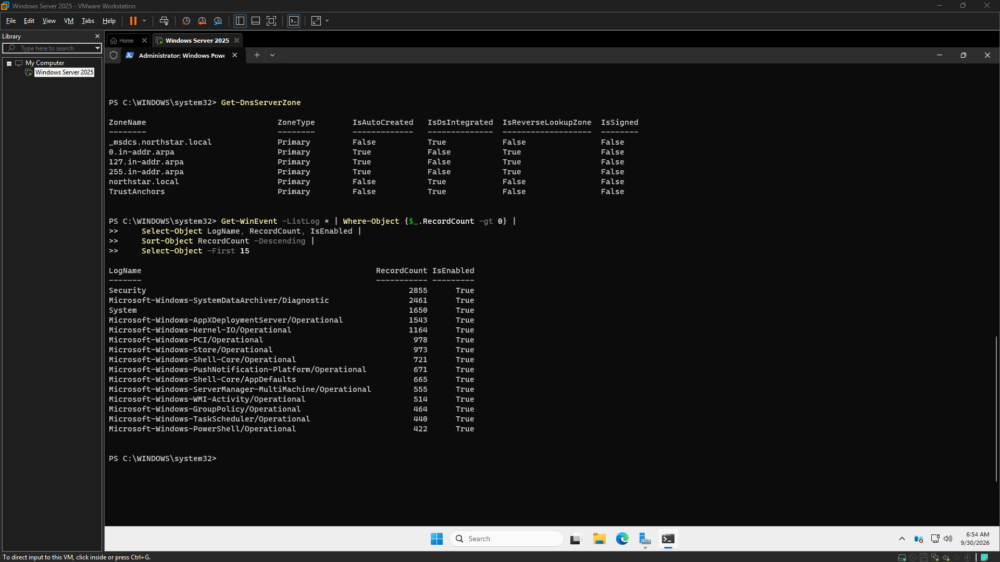

# CyberOps-Sandbox

Status: In progress

## Project story
The CyberOps-Sandbox project is establishing a robust lab environment for advanced Security Information and Event Management (SIEM) and detection engineering. Currently in progress, this initiative has systematically validated the existing virtualized infrastructure, setting a clear, evidence-based foundation for upcoming deployments. Our focus has been on understanding the baseline configuration of network segments, Windows Server domain services, and target client endpoints, ensuring a stable and well-understood platform for building sophisticated threat detection capabilities.

### 1. Project story

The CyberOps-Sandbox project is laying the essential groundwork for a dynamic lab environment dedicated to advanced SIEM and detection engineering. Our current 'in progress' phase has meticulously established a foundational understanding of the existing virtualized infrastructure, from core network segments to domain services and endpoint states. This deliberate baseline validation is crucial for ensuring a stable platform as we transition from passive inspection to active deployment of sophisticated security monitoring and analysis capabilities, ultimately enabling robust threat detection practices.

### 2. Key achievements

*   **Comprehensive Infrastructure Baseline:** Established a verified baseline of the virtualized environment, including OPNsense network configuration, the Windows Server 2025 domain controller (NS-DC01) with Active Directory and DNS roles, and a target Windows client (WIN11-CLIENT01).
*   **Endpoint Telemetry Readiness:** Confirmed active Windows Security, System, and PowerShell Operational logging on the target endpoint, providing initial data sources and highlighting the critical immediate need for deploying dedicated endpoint telemetry agents.
*   **Preserved Environment Integrity:** All baseline validation activities were conducted without modifying existing system or network configurations, maintaining the integrity and stability of the lab environment.
*   **Identified Reusable Assets:** Documented existing administrative and PowerShell capabilities from prior projects, identifying potential for reuse in future SIEM and detection engineering efforts.

### 3. Lessons learned

*   **Privilege Management is Key:** Accessing critical security logs (e.g., Windows Security log) often requires elevated privileges, which must be accounted for in planning and automation.
*   **Verify System Identity:** Hostnames and expected OS versions can differ from reality; deeper investigation into operating system identification is crucial for compatibility and accurate planning.
*   **Proactive Resource Planning:** Early identification and addressing of host resource constraints (e.g., memory) are essential to prevent bottlenecks for future SIEM and detection component deployments.
*   **Telemetry is Foundational:** A robust detection engineering strategy hinges on comprehensive endpoint telemetry; recognizing this visibility gap early effectively prioritizes subsequent technical milestones.

### 4. Next steps

The immediate focus for CyberOps-Sandbox is on deploying and configuring essential endpoint telemetry agents (e.g., Wazuh, Sysmon) on WIN11-CLIENT01 to establish robust data collection. Concurrently, we will address identified host memory constraints to ensure adequate resources for upcoming SIEM and detection engineering tools. Further investigation into the endpoint's reported operating system identification will also be prioritized to confirm compatibility and avoid future issues, paving the way for active SIEM deployment.

### 5. Proof points

*   **Visual Documentation:** Screenshots titled 'Endpoint Baseline Initial Audit' and 'Security Log Baseline' (2026-10-25) illustrate the initial state and active logging on the target endpoint.
*   **Network & Endpoint Verification:** Confirmed WIN11-CLIENT01 network identity (IPv4 192.168.20.165, gateway 192.168.20.1) and verified active Windows logging sources, including 29,072 Security records, 1,792 System records, and 483 PowerShell Operational records observed.
*   **Server Configuration:** NS-DC01 verified running Windows Server 2025 with Active Directory Domain Services and DNS roles for the `northstar.local` domain, operating within a VMware NAT network configuration.
*   **Telemetry Gap Identified:** Explicit identification of the absence of dedicated endpoint telemetry agents as a critical technical milestone underscores the project's data-driven approach.

## Project timeline
### 2026-10-25 • 18:32 to 18:48
- Goal
Establish the current CyberOps infrastructure baseline and identify the technical prerequisites for the November SIEM build, verify host resources, confirm existing VM and network state, identify blockers before installing anything.

- Definition of Done
Record available host RAM and disk capacity, identify the relevant VMware VMs and their current resource allocations, confirm the intended Windows endpoint and server roles, establish whether a Wazuh deployment is feasible without unnecessary lab changes.

- Goal Achieved
✅ Yes

Summary:
Initial validation of the existing lab infrastructure was performed to establish an evidence-based starting point for the November CyberOps SIEM and detection engineering work. This involved reviewing network baselines, verifying endpoint network identity and connectivity, and confirming the status of core Windows event logging sources on a target workstation. A key finding was the absence of dedicated endpoint telemetry agents, identifying telemetry collection as the next critical technical milestone. No system or network configuration changes were made, preserving the existing infrastructure.

Tasks Completed:
*   Reviewed the existing OPNsense WAN, LAN, and SERVERS network baseline.
*   Verified WIN11-CLIENT01 network identity and connectivity configuration.
*   Confirmed WIN11-CLIENT01 endpoint IPv4 address (192.168.20.165) with gateway (192.168.20.1).
*   Checked for existing Wazuh and Sysmon service installations on the endpoint; neither were found.
*   Verified Windows Security logging is enabled (29,072 records observed).
*   Verified Windows System logging is enabled (1,792 records observed).
*   Verified Windows PowerShell Operational logging is enabled (483 records observed).
*   Established that elevated PowerShell privileges are required for inspecting the Security log.
*   Made no system or network configuration changes to the existing environment.

Issues Encountered:
*   Initial attempts to inspect the Windows Security log via PowerShell failed due to insufficient privileges, necessitating elevation.
*   The endpoint's operating system identification differed from the expected Windows 11 designation.
*   Available host memory is constrained while the existing virtual machines are running, potentially impacting future resource allocation for SIEM components.

Next Steps:
*   Deploy and configure endpoint telemetry agents (e.g., Wazuh, Sysmon) on WIN11-CLIENT01.
*   Further investigate the discrepancy in the endpoint's reported operating system identification.
*   Address host memory constraints to ensure adequate resources for upcoming SIEM and detection engineering tools.

Notes:
This initial validation effort successfully confirmed the foundational status of the lab environment prior to new deployments. The existing infrastructure, including network configuration, was preserved without modification. Confirmation of active Windows event sources provides a baseline for initial detection capabilities, pending the deployment of advanced telemetry agents.

- Working Story
Validated the existing lab before deployment, confirmed available Windows event sources, identified endpoint telemetry collection as the next technical milestone, preserved existing infrastructure, established an evidence-based starting point for the November CyberOps SIEM and detection engineering work.

- Friction and AI Gaps
Initial Security log inspection failed because PowerShell lacked sufficient privileges, endpoint operating system identification differed from the expected Windows 11 designation, available host memory is constrained while the existing virtual machines are running.

- What the AI Missed
None

- AI Peer Review
Status: Approved
Reviewer: human
Reviewed At: 2026-10-25 18:49:34
Reviewer Notes: The endpoint's reported OS identity is Windows 10 Pro 26H2, build 26300.9711, despite its WIN11-CLIENT01 hostname. Preserve the existing configuration and investigate further only if OS compatibility becomes a real blocker. Wazuh and Sysmon installation status remains unconfirmed beyond the initial service-name checks.

- Duration
16 minutes (Planned: 20 minutes)

- Notes
### 2026-10-11 • 10:55 to 11:07
- Goal
Preserve and verify existing CyberOps documentation and repository state, passively inspect the existing VMware/Windows Server environment, identify Project 1 capabilities that Project 2 can reuse, document the handover and CyberOps resumption point.

- Definition of Done
Existing NS-DC01 environment is inspected without modifying or testing it

- Goal Achieved
✅ Yes

Summary:
Current efforts focused on establishing a verified baseline configuration for NS-DC01, documenting its existing state, and identifying reusable administrative assets from Project 1. This foundational work is crucial for preparing the environment for Project 2, with a strong emphasis on preserving current capabilities and avoiding premature changes.

Tasks Completed:
*   Verified and documented the configuration of NS-DC01, confirming it runs Windows Server 2025.
*   Confirmed the presence and configuration of Active Directory Domain Services (AD DS) and DNS roles on NS-DC01.
*   Documented the `northstar.local` domain and its associated network settings.
*   Confirmed VMware NAT network mode is in use for the environment.
*   Identified existing Project 1 administration and PowerShell capabilities with potential for reuse in future projects.
*   Reviewed the high-level scope and requirements for Project 2.

Issues Encountered:
None

Next Steps:
*   Continue analysis of Project 2 requirements against the established baseline to identify integration points and potential impact.
*   Further evaluate the identified reusable Project 1 administrative and PowerShell capabilities for direct application or adaptation in Project 2.
*   Develop a preliminary design or plan for Project 2 that leverages the existing environment without introducing breaking changes.

Notes:
The primary focus of this phase was to meticulously document and understand the current state of the environment, particularly NS-DC01, without making any modifications. This ensures a stable baseline is established before initiating Project 2 activities. A key guiding principle is to preserve existing capabilities and assets from Project 1 wherever possible, streamlining future efforts. This preparatory work is essential for a smooth transition into Project 2 planning and implementation.

- Working Story
Preserving existing capabilities, establishing the baseline, preparing for Project 2 without changing the environment.

- Friction and AI Gaps
None

- What the AI Missed
None

- AI Peer Review
Status: Approved
Reviewer: human
Reviewed At: 2026-10-11 11:09:12
Reviewer Notes: NS-DC01 uses 192.168.148.10/24, gateway 192.168.148.2, loopback DNS, VMware NAT, workstation Group Policy application remains unverified.

- Duration
12 minutes (Planned: 60 minutes)

- Notes
### 2026-10-08 • 05:19 to 05:30
- Goal
Generate a small amount of intentional, benign activity on NS-DC01 and determine how that activity appears in Windows security telemetry.

- Definition of Done
NS-DC01 is accessible, One or two controlled administrative actions are performed, Resulting Windows events are queried, At least one event can be associated with an action you intentionally performed, You understand the basic relationship: Action ↓ Windows records event ↓ PowerShell retrieves event ↓ Analyst investigates

- Goal Achieved
✅ Yes

Summary:
An initial experimental session was conducted within the CyberOps Sandbox on NS-DC01 to evaluate the reliability of existing Windows Security telemetry in observing intentional, simple process and file activities. The session established that the current Security log configuration does not reliably expose the tested activities, identifying significant visibility gaps. This work underscores a hands-on, experimental methodology focused on understanding and improving telemetry from the ground up, treating failures to observe expected activity as critical engineering findings.

Tasks Completed:
*   Tested the ability of existing Windows Security telemetry to observe intentional process and simple file creation/removal activities on NS-DC01.
*   Attempted to observe `Notepad.exe` process creation using Event ID 4688 within the Windows Security log.
*   Confirmed that the current Windows Security log configuration does not reliably expose the simple process/file activity tested.

Issues Encountered:
*   **Conceptual Clarity:** Initial struggle to clearly define "telemetry" until directly linked to observable Windows events, and differentiating between an event occurring versus an activity being reliably observable.
*   **Interpretation Bias:** Initial tendency to misinterpret ambient events as direct evidence of specific test activity rather than requiring explicit observations.
*   **Audit Policy Oversight:** Initially assumed that simple folder creation/removal would inherently generate useful Security events without first verifying configured audit policies for such activity.
*   **Event ID 4688 Misinterpretation:**
    *   The test for `Notepad.exe` via Event ID 4688 did not produce the expected observation, necessitating the interpretation of a negative result instead of a successful detection.
    *   Initially overemphasized the mere existence of Event ID 4688, failing to adequately consider the specific audit policy configurations required for comprehensive process visibility.
    *   Experienced issues with incorrect `Properties[]` indexes during earlier field extraction attempts for Event ID 4688, leading to misleading field labels and values.
*   **Focus on Success vs. Gaps:** Initial tendency to focus too heavily on finding successful event detections, rather than recognizing that the failure to observe an expected action is itself a valuable telemetry finding that highlights a visibility gap.

Next Steps:
*   Investigate and implement necessary audit policy changes on NS-DC01 to ensure reliable observation of basic process creation (e.g., Event ID 4688) and relevant file system activities.
*   Re-run tests after audit policy adjustments to confirm improved telemetry visibility and validate expected event generation.
*   Document specific audit policies and event IDs identified as crucial for observing common adversary techniques within the environment.

Notes:
This experimental session is foundational to the CyberOps Sandbox's development, emphasizing a hands-on, iterative construction methodology:
*   **Experimental Build-Out:** The sandbox is being built from the ground up by performing controlled activities, observing what the environment actually sees, identifying visibility gaps, and then improving the environment based on empirical evidence.
*   **Learning Through Experimentation:** Prioritizing hands-on construction and learning through controlled experiments over deploying pre-built SOC stacks.
*   **Leveraging Existing Infrastructure:** Utilizing existing Windows infrastructure, PowerShell, and Windows Event Logs as the initial investigation tools.
*   **Valuing Negative Results:** Explicitly treating the distinction between activity occurring and activity being observable, and recognizing visibility gaps as legitimate and crucial engineering findings.
*   **Telemetry-First Approach:** Building towards robust detection capabilities by first understanding, improving, and validating the underlying telemetry sources.
*   **Transparent Documentation:** A commitment to documenting both successful discoveries and encountered challenges/mistakes as part of the continuous learning and improvement process.

- Working Story
The CyberOps Sandbox is being built experimentally from the ground up: perform controlled activity, observe what the environment can actually see, identify visibility gaps, and then improve the environment based on evidence, Hands-on construction rather than a prebuilt SOC stack, Learning through controlled experimentation, Existing infrastructure being reused as the foundation, PowerShell and Windows Event Logs as the first investigation tools, The distinction between activity occurring and activity being observable, Treating negative results and visibility gaps as legitimate engineering findings, Building toward detection by first understanding and improving telemetry, Documentation of both discoveries and mistakes

- Friction and AI Gaps
The concept of telemetry initially wasn't clear until it was connected directly to the Windows events being observed, It was initially tempting to interpret events occurring around the test activity as evidence that the activity caused them, Understanding the difference between an event existing and a particular activity being reliably observable was the main conceptual challenge, The Event ID 4688 test did not produce the expected Notepad observation, requiring interpretation of a negative result rather than a successful detection

- What the AI Missed
The session initially assumed that simple folder creation/removal might produce useful Security events without first establishing whether the configured audit policies covered that activity, - The AI initially treated the existence of Event ID 4688 as stronger evidence of process visibility than was warranted, - The earlier 4688 field extraction used incorrect Properties[] indexes, producing misleading field labels/values, - The AI initially focused too heavily on finding a successful event rather than recognizing that failure to observe an expected action is itself a valuable telemetry finding

- AI Peer Review
Status: Approved
Reviewer: human
Reviewed At: 2026-10-08 05:34:39
Reviewer Notes: The current Security Event Log is not yet sufficient for reliable process/file activity visibility. Must understand Windows Auditing behavior before adding new security tooling.

- Duration
11 minutes (Planned: 15 minutes)

- Notes
Important terminology learned Telemetry: observable information generated by a system that can be used to understand and investigate activity, Important investigation lesson Correlation ≠ causation, An event occurring at approximately the same time as an action does not prove that the action caused the event
### 2026-10-07 • 05:12 to 05:17
- Goal
Establish the documentation foundation for the existing Northstar environment.

- Definition of Done
Document the existing state of NS-DC01, Windows Server, Active Directory, DNS, Network foundation, Current virtualization environment

- Goal Achieved
❌ No

Summary:
The previous work session has been deemed unsatisfactory and requires a complete re-execution. No tasks from this session can be considered successfully completed at this time.

Tasks Completed:
None

Issues Encountered:
The recently completed work session requires a full redo due to unsatisfactory outcomes.

Next Steps:
Re-execute the entire session to achieve the desired results.

Notes:
*   No specific struggles were encountered during the initial attempt, despite the need for re-work.
*   No discrepancies or errors related to AI tools were identified.
*   No particular emphasis or narrative is required for this update.

- Working Story
None

- Friction and AI Gaps
None

- What the AI Missed
None

- AI Peer Review
Status: Approved
Reviewer: human
Reviewed At: 2026-10-07 05:18:06
Reviewer Notes: 

- Duration
4 minutes (Planned: 20 minutes)

- Notes

## Screenshot – Process Creation Telemetry

## Screenshot – Security Event Distribution

---

## Session – 05:22 to 05:37
- Goal
Establish what security telemetry Northstar already has

- Definition of Done
NS-DC01 is confirmed operational., Existing DNS/event-log baseline is acknowledged rather than recreated., Windows Security Event Log is inspected., Recent security events are identified., At least one useful event type is recognized for future investigation.

- Goal Achieved
✅ Yes

Summary:
The current phase of the CyberOps Sandbox development focused on incrementally building security operational capabilities from existing Windows infrastructure, specifically NS-DC01. This involved establishing the available security telemetry and confirming that Windows Security Event Logs are a queryable data source for investigations, aligning with a hands-on learning approach rather than deploying a pre-configured SOC solution.

Tasks Completed:
*   Identified existing security telemetry on NS-DC01.
*   Confirmed that Windows Security Event Logs can be queried as an investigation data source.

Issues Encountered:
*   Initial lack of clarity regarding the practical definition of "telemetry."
*   Misconception that an additional infrastructure baseline was required, despite previous baselining.
*   Ongoing learning challenges related to understanding Windows Event IDs and their provided information.
*   Difficulty experienced in extracting useful fields from Event ID 4688.

Next Steps:
(No specific next steps were provided in the rough notes.)

Notes:
The overarching strategy for the CyberOps Sandbox is to build it incrementally from an existing Windows infrastructure foundation. This approach is designed to foster learning security operations through direct investigation of the environment, contrasting with the installation of a prebuilt SOC stack.
AI did not miss or misinterpret any information provided.

- Working Story
Built the CyberOps Sandbox incrementally from an existing Windows infrastructure foundation, learning security operations by directly investigating the environment rather than installing a prebuilt SOC stack.

- Friction and AI Gaps
Initially unclear what "telemetry" meant in practical terms, the session initially appeared to require another infrastructure baseline even though the environment had already been baselined previously, understanding Windows Event IDs and what information they provide is still new, extracting useful fields from Event ID 4688 was less straightforward than expected.

- What the AI Missed
None

- AI Peer Review
Status: Approved
Reviewer: human
Reviewed At: 2026-10-07 05:38:34
Reviewer Notes: 

- Duration
14 minutes (Planned: 10 minutes)

- Notes
### 2026-09-30 • 06:46 to 06:55
- Goal
Baseline the Existing Northstar Environment

- Definition of Done
all information, specs and working information is gathered

- Goal Achieved
✅ Yes

Summary:
Initial project baselining activities have been completed, with key specifications documented.

Tasks Completed:
* Noted baseline specifications for the project.

Issues Encountered:
No issues or significant struggles were encountered during this period.

Next Steps:
Next steps are not detailed in the current notes. Further planning will be required to define upcoming tasks.

Notes:
No additional notes were provided for this update.

- Working Story
None

- Friction and AI Gaps
None

- What the AI Missed
None

- AI Peer Review
Status: Approved
Reviewer: human
Reviewed At: 2026-09-30 06:58:14
Reviewer Notes: Host OS: Windows 11 Home, build 26200

- Duration
9 minutes (Planned: 180 minutes)

- Notes
Gaming PC: your primary Windows host for the Help Desk Lab / future homelab

## Screenshots and proof
### Highlight: Telemetry Visibility Gap

This screenshot shows the telemetry or evidence being reviewed to understand the current system behavior and validate what the environment is actually recording. It highlights the key detail the viewer should notice in this stage of the project.
### Highlight: Security Event Distribution

This screenshot shows the telemetry or evidence being reviewed to understand the current system behavior and validate what the environment is actually recording. It highlights the key detail the viewer should notice in this stage of the project.
### Highlight: Security Log Baseline

This screenshot shows the telemetry or evidence being reviewed to understand the current system behavior and validate what the environment is actually recording. It highlights the key detail the viewer should notice in this stage of the project.

## Trials and tribulations
### 2026-10-25 • 18:32 to 18:48
### Goal
Establish the current CyberOps infrastructure baseline and identify the technical prerequisites for the November SIEM build, verify host resources, confirm existing VM and network state, identify blockers before installing anything.

### Definition of Done
Record available host RAM and disk capacity, identify the relevant VMware VMs and their current resource allocations, confirm the intended Windows endpoint and server roles, establish whether a Wazuh deployment is feasible without unnecessary lab changes.

### Goal Achieved
✅ Yes

Summary:
Initial validation of the existing lab infrastructure was performed to establish an evidence-based starting point for the November CyberOps SIEM and detection engineering work. This involved reviewing network baselines, verifying endpoint network identity and connectivity, and confirming the status of core Windows event logging sources on a target workstation. A key finding was the absence of dedicated endpoint telemetry agents, identifying telemetry collection as the next critical technical milestone. No system or network configuration changes were made, preserving the existing infrastructure.

Tasks Completed:
*   Reviewed the existing OPNsense WAN, LAN, and SERVERS network baseline.
*   Verified WIN11-CLIENT01 network identity and connectivity configuration.
*   Confirmed WIN11-CLIENT01 endpoint IPv4 address (192.168.20.165) with gateway (192.168.20.1).
*   Checked for existing Wazuh and Sysmon service installations on the endpoint; neither were found.
*   Verified Windows Security logging is enabled (29,072 records observed).
*   Verified Windows System logging is enabled (1,792 records observed).
*   Verified Windows PowerShell Operational logging is enabled (483 records observed).
*   Established that elevated PowerShell privileges are required for inspecting the Security log.
*   Made no system or network configuration changes to the existing environment.

Issues Encountered:
*   Initial attempts to inspect the Windows Security log via PowerShell failed due to insufficient privileges, necessitating elevation.
*   The endpoint's operating system identification differed from the expected Windows 11 designation.
*   Available host memory is constrained while the existing virtual machines are running, potentially impacting future resource allocation for SIEM components.

Next Steps:
*   Deploy and configure endpoint telemetry agents (e.g., Wazuh, Sysmon) on WIN11-CLIENT01.
*   Further investigate the discrepancy in the endpoint's reported operating system identification.
*   Address host memory constraints to ensure adequate resources for upcoming SIEM and detection engineering tools.

Notes:
This initial validation effort successfully confirmed the foundational status of the lab environment prior to new deployments. The existing infrastructure, including network configuration, was preserved without modification. Confirmation of active Windows event sources provides a baseline for initial detection capabilities, pending the deployment of advanced telemetry agents.

### Working Story
Validated the existing lab before deployment, confirmed available Windows event sources, identified endpoint telemetry collection as the next technical milestone, preserved existing infrastructure, established an evidence-based starting point for the November CyberOps SIEM and detection engineering work.

### Friction and AI Gaps
Initial Security log inspection failed because PowerShell lacked sufficient privileges, endpoint operating system identification differed from the expected Windows 11 designation, available host memory is constrained while the existing virtual machines are running.

### What the AI Missed
None

### AI Peer Review
Status: Approved
Reviewer: human
Reviewed At: 2026-10-25 18:49:34
Reviewer Notes: The endpoint's reported OS identity is Windows 10 Pro 26H2, build 26300.9711, despite its WIN11-CLIENT01 hostname. Preserve the existing configuration and investigate further only if OS compatibility becomes a real blocker. Wazuh and Sysmon installation status remains unconfirmed beyond the initial service-name checks.

### Duration
16 minutes (Planned: 20 minutes)

### Notes
### 2026-10-11 • 10:55 to 11:07
### Goal
Preserve and verify existing CyberOps documentation and repository state, passively inspect the existing VMware/Windows Server environment, identify Project 1 capabilities that Project 2 can reuse, document the handover and CyberOps resumption point.

### Definition of Done
Existing NS-DC01 environment is inspected without modifying or testing it

### Goal Achieved
✅ Yes

Summary:
Current efforts focused on establishing a verified baseline configuration for NS-DC01, documenting its existing state, and identifying reusable administrative assets from Project 1. This foundational work is crucial for preparing the environment for Project 2, with a strong emphasis on preserving current capabilities and avoiding premature changes.

Tasks Completed:
*   Verified and documented the configuration of NS-DC01, confirming it runs Windows Server 2025.
*   Confirmed the presence and configuration of Active Directory Domain Services (AD DS) and DNS roles on NS-DC01.
*   Documented the `northstar.local` domain and its associated network settings.
*   Confirmed VMware NAT network mode is in use for the environment.
*   Identified existing Project 1 administration and PowerShell capabilities with potential for reuse in future projects.
*   Reviewed the high-level scope and requirements for Project 2.

Issues Encountered:
None

Next Steps:
*   Continue analysis of Project 2 requirements against the established baseline to identify integration points and potential impact.
*   Further evaluate the identified reusable Project 1 administrative and PowerShell capabilities for direct application or adaptation in Project 2.
*   Develop a preliminary design or plan for Project 2 that leverages the existing environment without introducing breaking changes.

Notes:
The primary focus of this phase was to meticulously document and understand the current state of the environment, particularly NS-DC01, without making any modifications. This ensures a stable baseline is established before initiating Project 2 activities. A key guiding principle is to preserve existing capabilities and assets from Project 1 wherever possible, streamlining future efforts. This preparatory work is essential for a smooth transition into Project 2 planning and implementation.

### Working Story
Preserving existing capabilities, establishing the baseline, preparing for Project 2 without changing the environment.

### Friction and AI Gaps
None

### What the AI Missed
None

### AI Peer Review
Status: Approved
Reviewer: human
Reviewed At: 2026-10-11 11:09:12
Reviewer Notes: NS-DC01 uses 192.168.148.10/24, gateway 192.168.148.2, loopback DNS, VMware NAT, workstation Group Policy application remains unverified.

### Duration
12 minutes (Planned: 60 minutes)

### Notes
### 2026-10-08 • 05:19 to 05:30
### Goal
Generate a small amount of intentional, benign activity on NS-DC01 and determine how that activity appears in Windows security telemetry.

### Definition of Done
NS-DC01 is accessible, One or two controlled administrative actions are performed, Resulting Windows events are queried, At least one event can be associated with an action you intentionally performed, You understand the basic relationship: Action ↓ Windows records event ↓ PowerShell retrieves event ↓ Analyst investigates

### Goal Achieved
✅ Yes

Summary:
An initial experimental session was conducted within the CyberOps Sandbox on NS-DC01 to evaluate the reliability of existing Windows Security telemetry in observing intentional, simple process and file activities. The session established that the current Security log configuration does not reliably expose the tested activities, identifying significant visibility gaps. This work underscores a hands-on, experimental methodology focused on understanding and improving telemetry from the ground up, treating failures to observe expected activity as critical engineering findings.

Tasks Completed:
*   Tested the ability of existing Windows Security telemetry to observe intentional process and simple file creation/removal activities on NS-DC01.
*   Attempted to observe `Notepad.exe` process creation using Event ID 4688 within the Windows Security log.
*   Confirmed that the current Windows Security log configuration does not reliably expose the simple process/file activity tested.

Issues Encountered:
*   **Conceptual Clarity:** Initial struggle to clearly define "telemetry" until directly linked to observable Windows events, and differentiating between an event occurring versus an activity being reliably observable.
*   **Interpretation Bias:** Initial tendency to misinterpret ambient events as direct evidence of specific test activity rather than requiring explicit observations.
*   **Audit Policy Oversight:** Initially assumed that simple folder creation/removal would inherently generate useful Security events without first verifying configured audit policies for such activity.
*   **Event ID 4688 Misinterpretation:**
    *   The test for `Notepad.exe` via Event ID 4688 did not produce the expected observation, necessitating the interpretation of a negative result instead of a successful detection.
    *   Initially overemphasized the mere existence of Event ID 4688, failing to adequately consider the specific audit policy configurations required for comprehensive process visibility.
    *   Experienced issues with incorrect `Properties[]` indexes during earlier field extraction attempts for Event ID 4688, leading to misleading field labels and values.
*   **Focus on Success vs. Gaps:** Initial tendency to focus too heavily on finding successful event detections, rather than recognizing that the failure to observe an expected action is itself a valuable telemetry finding that highlights a visibility gap.

Next Steps:
*   Investigate and implement necessary audit policy changes on NS-DC01 to ensure reliable observation of basic process creation (e.g., Event ID 4688) and relevant file system activities.
*   Re-run tests after audit policy adjustments to confirm improved telemetry visibility and validate expected event generation.
*   Document specific audit policies and event IDs identified as crucial for observing common adversary techniques within the environment.

Notes:
This experimental session is foundational to the CyberOps Sandbox's development, emphasizing a hands-on, iterative construction methodology:
*   **Experimental Build-Out:** The sandbox is being built from the ground up by performing controlled activities, observing what the environment actually sees, identifying visibility gaps, and then improving the environment based on empirical evidence.
*   **Learning Through Experimentation:** Prioritizing hands-on construction and learning through controlled experiments over deploying pre-built SOC stacks.
*   **Leveraging Existing Infrastructure:** Utilizing existing Windows infrastructure, PowerShell, and Windows Event Logs as the initial investigation tools.
*   **Valuing Negative Results:** Explicitly treating the distinction between activity occurring and activity being observable, and recognizing visibility gaps as legitimate and crucial engineering findings.
*   **Telemetry-First Approach:** Building towards robust detection capabilities by first understanding, improving, and validating the underlying telemetry sources.
*   **Transparent Documentation:** A commitment to documenting both successful discoveries and encountered challenges/mistakes as part of the continuous learning and improvement process.

### Working Story
The CyberOps Sandbox is being built experimentally from the ground up: perform controlled activity, observe what the environment can actually see, identify visibility gaps, and then improve the environment based on evidence, Hands-on construction rather than a prebuilt SOC stack, Learning through controlled experimentation, Existing infrastructure being reused as the foundation, PowerShell and Windows Event Logs as the first investigation tools, The distinction between activity occurring and activity being observable, Treating negative results and visibility gaps as legitimate engineering findings, Building toward detection by first understanding and improving telemetry, Documentation of both discoveries and mistakes

### Friction and AI Gaps
The concept of telemetry initially wasn't clear until it was connected directly to the Windows events being observed, It was initially tempting to interpret events occurring around the test activity as evidence that the activity caused them, Understanding the difference between an event existing and a particular activity being reliably observable was the main conceptual challenge, The Event ID 4688 test did not produce the expected Notepad observation, requiring interpretation of a negative result rather than a successful detection

### What the AI Missed
The session initially assumed that simple folder creation/removal might produce useful Security events without first establishing whether the configured audit policies covered that activity, - The AI initially treated the existence of Event ID 4688 as stronger evidence of process visibility than was warranted, - The earlier 4688 field extraction used incorrect Properties[] indexes, producing misleading field labels/values, - The AI initially focused too heavily on finding a successful event rather than recognizing that failure to observe an expected action is itself a valuable telemetry finding

### AI Peer Review
Status: Approved
Reviewer: human
Reviewed At: 2026-10-08 05:34:39
Reviewer Notes: The current Security Event Log is not yet sufficient for reliable process/file activity visibility. Must understand Windows Auditing behavior before adding new security tooling.

### Duration
11 minutes (Planned: 15 minutes)

### Notes
Important terminology learned Telemetry: observable information generated by a system that can be used to understand and investigate activity, Important investigation lesson Correlation ≠ causation, An event occurring at approximately the same time as an action does not prove that the action caused the event
### 2026-10-07 • 05:12 to 05:17
### Goal
Establish the documentation foundation for the existing Northstar environment.

### Definition of Done
Document the existing state of NS-DC01, Windows Server, Active Directory, DNS, Network foundation, Current virtualization environment

### Goal Achieved
❌ No

Summary:
The previous work session has been deemed unsatisfactory and requires a complete re-execution. No tasks from this session can be considered successfully completed at this time.

Tasks Completed:
None

Issues Encountered:
The recently completed work session requires a full redo due to unsatisfactory outcomes.

Next Steps:
Re-execute the entire session to achieve the desired results.

Notes:
*   No specific struggles were encountered during the initial attempt, despite the need for re-work.
*   No discrepancies or errors related to AI tools were identified.
*   No particular emphasis or narrative is required for this update.

### Working Story
None

### Friction and AI Gaps
None

### What the AI Missed
None

### AI Peer Review
Status: Approved
Reviewer: human
Reviewed At: 2026-10-07 05:18:06
Reviewer Notes: 

### Duration
4 minutes (Planned: 20 minutes)

### Notes

## Screenshot – Process Creation Telemetry

## Screenshot – Security Event Distribution

---

## Session – 05:22 to 05:37
### Goal
Establish what security telemetry Northstar already has

### Definition of Done
NS-DC01 is confirmed operational., Existing DNS/event-log baseline is acknowledged rather than recreated., Windows Security Event Log is inspected., Recent security events are identified., At least one useful event type is recognized for future investigation.

### Goal Achieved
✅ Yes

Summary:
The current phase of the CyberOps Sandbox development focused on incrementally building security operational capabilities from existing Windows infrastructure, specifically NS-DC01. This involved establishing the available security telemetry and confirming that Windows Security Event Logs are a queryable data source for investigations, aligning with a hands-on learning approach rather than deploying a pre-configured SOC solution.

Tasks Completed:
*   Identified existing security telemetry on NS-DC01.
*   Confirmed that Windows Security Event Logs can be queried as an investigation data source.

Issues Encountered:
*   Initial lack of clarity regarding the practical definition of "telemetry."
*   Misconception that an additional infrastructure baseline was required, despite previous baselining.
*   Ongoing learning challenges related to understanding Windows Event IDs and their provided information.
*   Difficulty experienced in extracting useful fields from Event ID 4688.

Next Steps:
(No specific next steps were provided in the rough notes.)

Notes:
The overarching strategy for the CyberOps Sandbox is to build it incrementally from an existing Windows infrastructure foundation. This approach is designed to foster learning security operations through direct investigation of the environment, contrasting with the installation of a prebuilt SOC stack.
AI did not miss or misinterpret any information provided.

### Working Story
Built the CyberOps Sandbox incrementally from an existing Windows infrastructure foundation, learning security operations by directly investigating the environment rather than installing a prebuilt SOC stack.

### Friction and AI Gaps
Initially unclear what "telemetry" meant in practical terms, the session initially appeared to require another infrastructure baseline even though the environment had already been baselined previously, understanding Windows Event IDs and what information they provide is still new, extracting useful fields from Event ID 4688 was less straightforward than expected.

### What the AI Missed
None

### AI Peer Review
Status: Approved
Reviewer: human
Reviewed At: 2026-10-07 05:38:34
Reviewer Notes: 

### Duration
14 minutes (Planned: 10 minutes)

### Notes
### 2026-09-30 • 06:46 to 06:55
### Goal
Baseline the Existing Northstar Environment

### Definition of Done
all information, specs and working information is gathered

### Goal Achieved
✅ Yes

Summary:
Initial project baselining activities have been completed, with key specifications documented.

Tasks Completed:
* Noted baseline specifications for the project.

Issues Encountered:
No issues or significant struggles were encountered during this period.

Next Steps:
Next steps are not detailed in the current notes. Further planning will be required to define upcoming tasks.

Notes:
No additional notes were provided for this update.

### Working Story
None

### Friction and AI Gaps
None

### What the AI Missed
None

### AI Peer Review
Status: Approved
Reviewer: human
Reviewed At: 2026-09-30 06:58:14
Reviewer Notes: Host OS: Windows 11 Home, build 26200

### Duration
9 minutes (Planned: 180 minutes)

### Notes
Gaming PC: your primary Windows host for the Help Desk Lab / future homelab

## Lessons learned
- Keep documentation close to delivery.
- Use screenshots as proof points.
- Write the project story in plain language for future reviewers.

## Next steps
- Continue from the handoff notes and current project status.
- Capture final cleanup or deployment follow-up items as they are completed.

---

# CyberOps-Sandbox

Status: In progress

## Project story
# CyberOps-Sandbox Project Summary

## 1. Project Story
The CyberOps-Sandbox is an ongoing initiative to develop and refine a robust, observable environment for Cyber Operations training and analysis. Our current focus involves meticulously baselining an existing Windows Server 2025 Active Directory environment (NS-DC01) within a VMware NAT network to preserve its capabilities while preparing it for a subsequent phase, Project 2. A critical aspect of this work involves establishing reliable security telemetry. Through hands-on experimentation, we are rigorously testing and validating the environment's ability to observe administrative activities, specifically identifying and addressing visibility gaps in Windows Security logs to ensure all critical actions are reliably detected and analyzed. This project emphasizes a principled, experimental approach, treating both successful detections and unexpected telemetry failures as valuable engineering insights to build a highly effective security operations sandbox.

## 2. Key Achievements
*   **Established Verified Baseline:** Successfully documented and verified the configuration of the NS-DC01 environment, confirming Windows Server 2025, Active Directory Domain Services, DNS roles, and network settings (`northstar.local` domain, VMware NAT), providing a stable foundation for future development.
*   **Identified Reusable Assets:** Pinpointed existing administrative and PowerShell capabilities from Project 1 for potential reuse, streamlining the transition to Project 2.
*   **Conducted Initial Telemetry Assessment:** Performed controlled administrative actions (e.g., process creation, file manipulation) on NS-DC01 and systematically queried Windows Security events to understand existing observability.
*   **Discovered Critical Visibility Gaps:** Confirmed that the default Windows Security log configuration does not reliably capture simple process creation (e.g., `Notepad.exe`) and file activities, highlighting essential areas for audit policy enhancement.
*   **Validated Telemetry Methodology:** Established a foundational understanding of the telemetry lifecycle: `Action ↓ Windows records event ↓ PowerShell retrieves event ↓ Analyst investigates`, providing a framework for future telemetry improvements.

## 3. Lessons Learned
*   **Meticulous Baselining is Paramount:** Deeply understanding and documenting the current state of an environment before making modifications is crucial for preserving existing capabilities and ensuring a smooth transition to new project phases.
*   **Telemetry is an Engineering Task:** Reliable security telemetry is not inherent; it requires deliberate configuration of audit policies. Assuming simple actions will generate observable events without verification leads to significant blind spots.
*   **Failure to Observe is a Finding:** Negative results—the absence of an expected event—are just as valuable as positive detections, serving as critical indicators of visibility gaps that require engineering attention.
*   **Clarity in Concepts:** Precise definitions of terms like "telemetry" and distinguishing between an event merely occurring versus being reliably observable are essential for accurate analysis and effective problem-solving.

## 4. Next Steps
*   Continue analyzing Project 2 requirements against the established baseline to identify integration points and potential impacts.
*   Further evaluate identified Project 1 administrative and PowerShell capabilities for direct application or adaptation within Project 2.
*   Develop a preliminary design for Project 2 that leverages the existing environment while maintaining stability and avoiding breaking changes.
*   Address identified telemetry visibility gaps by implementing and validating specific audit policy configurations to ensure comprehensive activity logging.

## 5. Proof Points
*   **Engineering Log – 2026-10-11:** Details the goal, tasks, and successful outcome of establishing a verified baseline configuration for NS-DC01, including documented Windows Server 2025, AD DS, DNS, and network settings.
*   **Engineering Log – 2026-10-08:** Documents the experimental session, tasks completed, and critical issues encountered, specifically noting: "Confirmed that the current Windows Security log configuration does not reliably expose the simple process/file activity tested."
*   **Screenshot: Telemetry Visibility Gap:** Visually confirms the findings of unreliable event logging during the initial telemetry assessment.
*   **Screenshot: CyberOps Baseline v0.1:** Provides visual evidence of the initial baselining effort for the CyberOps environment.
*   **Screenshot: Process Creation Telemetry & Security Event Distribution:** Illustrate the attempts and challenges in capturing and distributing security events related to process creation.

## Project timeline
### 2026-10-11 • 10:55 to 11:07
- Goal
Preserve and verify existing CyberOps documentation and repository state, passively inspect the existing VMware/Windows Server environment, identify Project 1 capabilities that Project 2 can reuse, document the handover and CyberOps resumption point.

- Definition of Done
Existing NS-DC01 environment is inspected without modifying or testing it

- Goal Achieved
✅ Yes

Summary:
Current efforts focused on establishing a verified baseline configuration for NS-DC01, documenting its existing state, and identifying reusable administrative assets from Project 1. This foundational work is crucial for preparing the environment for Project 2, with a strong emphasis on preserving current capabilities and avoiding premature changes.

Tasks Completed:
*   Verified and documented the configuration of NS-DC01, confirming it runs Windows Server 2025.
*   Confirmed the presence and configuration of Active Directory Domain Services (AD DS) and DNS roles on NS-DC01.
*   Documented the `northstar.local` domain and its associated network settings.
*   Confirmed VMware NAT network mode is in use for the environment.
*   Identified existing Project 1 administration and PowerShell capabilities with potential for reuse in future projects.
*   Reviewed the high-level scope and requirements for Project 2.

Issues Encountered:
None

Next Steps:
*   Continue analysis of Project 2 requirements against the established baseline to identify integration points and potential impact.
*   Further evaluate the identified reusable Project 1 administrative and PowerShell capabilities for direct application or adaptation in Project 2.
*   Develop a preliminary design or plan for Project 2 that leverages the existing environment without introducing breaking changes.

Notes:
The primary focus of this phase was to meticulously document and understand the current state of the environment, particularly NS-DC01, without making any modifications. This ensures a stable baseline is established before initiating Project 2 activities. A key guiding principle is to preserve existing capabilities and assets from Project 1 wherever possible, streamlining future efforts. This preparatory work is essential for a smooth transition into Project 2 planning and implementation.

- Working Story
Preserving existing capabilities, establishing the baseline, preparing for Project 2 without changing the environment.

- Friction and AI Gaps
None

- What the AI Missed
None

- AI Peer Review
Status: Approved
Reviewer: human
Reviewed At: 2026-10-11 11:09:12
Reviewer Notes: NS-DC01 uses 192.168.148.10/24, gateway 192.168.148.2, loopback DNS, VMware NAT, workstation Group Policy application remains unverified.

- Duration
12 minutes (Planned: 60 minutes)

- Notes
### 2026-10-08 • 05:19 to 05:30
- Goal
Generate a small amount of intentional, benign activity on NS-DC01 and determine how that activity appears in Windows security telemetry.

- Definition of Done
NS-DC01 is accessible, One or two controlled administrative actions are performed, Resulting Windows events are queried, At least one event can be associated with an action you intentionally performed, You understand the basic relationship: Action ↓ Windows records event ↓ PowerShell retrieves event ↓ Analyst investigates

- Goal Achieved
✅ Yes

Summary:
An initial experimental session was conducted within the CyberOps Sandbox on NS-DC01 to evaluate the reliability of existing Windows Security telemetry in observing intentional, simple process and file activities. The session established that the current Security log configuration does not reliably expose the tested activities, identifying significant visibility gaps. This work underscores a hands-on, experimental methodology focused on understanding and improving telemetry from the ground up, treating failures to observe expected activity as critical engineering findings.

Tasks Completed:
*   Tested the ability of existing Windows Security telemetry to observe intentional process and simple file creation/removal activities on NS-DC01.
*   Attempted to observe `Notepad.exe` process creation using Event ID 4688 within the Windows Security log.
*   Confirmed that the current Windows Security log configuration does not reliably expose the simple process/file activity tested.

Issues Encountered:
*   **Conceptual Clarity:** Initial struggle to clearly define "telemetry" until directly linked to observable Windows events, and differentiating between an event occurring versus an activity being reliably observable.
*   **Interpretation Bias:** Initial tendency to misinterpret ambient events as direct evidence of specific test activity rather than requiring explicit observations.
*   **Audit Policy Oversight:** Initially assumed that simple folder creation/removal would inherently generate useful Security events without first verifying configured audit policies for such activity.
*   **Event ID 4688 Misinterpretation:**
    *   The test for `Notepad.exe` via Event ID 4688 did not produce the expected observation, necessitating the interpretation of a negative result instead of a successful detection.
    *   Initially overemphasized the mere existence of Event ID 4688, failing to adequately consider the specific audit policy configurations required for comprehensive process visibility.
    *   Experienced issues with incorrect `Properties[]` indexes during earlier field extraction attempts for Event ID 4688, leading to misleading field labels and values.
*   **Focus on Success vs. Gaps:** Initial tendency to focus too heavily on finding successful event detections, rather than recognizing that the failure to observe an expected action is itself a valuable telemetry finding that highlights a visibility gap.

Next Steps:
*   Investigate and implement necessary audit policy changes on NS-DC01 to ensure reliable observation of basic process creation (e.g., Event ID 4688) and relevant file system activities.
*   Re-run tests after audit policy adjustments to confirm improved telemetry visibility and validate expected event generation.
*   Document specific audit policies and event IDs identified as crucial for observing common adversary techniques within the environment.

Notes:
This experimental session is foundational to the CyberOps Sandbox's development, emphasizing a hands-on, iterative construction methodology:
*   **Experimental Build-Out:** The sandbox is being built from the ground up by performing controlled activities, observing what the environment actually sees, identifying visibility gaps, and then improving the environment based on empirical evidence.
*   **Learning Through Experimentation:** Prioritizing hands-on construction and learning through controlled experiments over deploying pre-built SOC stacks.
*   **Leveraging Existing Infrastructure:** Utilizing existing Windows infrastructure, PowerShell, and Windows Event Logs as the initial investigation tools.
*   **Valuing Negative Results:** Explicitly treating the distinction between activity occurring and activity being observable, and recognizing visibility gaps as legitimate and crucial engineering findings.
*   **Telemetry-First Approach:** Building towards robust detection capabilities by first understanding, improving, and validating the underlying telemetry sources.
*   **Transparent Documentation:** A commitment to documenting both successful discoveries and encountered challenges/mistakes as part of the continuous learning and improvement process.

- Working Story
The CyberOps Sandbox is being built experimentally from the ground up: perform controlled activity, observe what the environment can actually see, identify visibility gaps, and then improve the environment based on evidence, Hands-on construction rather than a prebuilt SOC stack, Learning through controlled experimentation, Existing infrastructure being reused as the foundation, PowerShell and Windows Event Logs as the first investigation tools, The distinction between activity occurring and activity being observable, Treating negative results and visibility gaps as legitimate engineering findings, Building toward detection by first understanding and improving telemetry, Documentation of both discoveries and mistakes

- Friction and AI Gaps
The concept of telemetry initially wasn't clear until it was connected directly to the Windows events being observed, It was initially tempting to interpret events occurring around the test activity as evidence that the activity caused them, Understanding the difference between an event existing and a particular activity being reliably observable was the main conceptual challenge, The Event ID 4688 test did not produce the expected Notepad observation, requiring interpretation of a negative result rather than a successful detection

- What the AI Missed
The session initially assumed that simple folder creation/removal might produce useful Security events without first establishing whether the configured audit policies covered that activity, - The AI initially treated the existence of Event ID 4688 as stronger evidence of process visibility than was warranted, - The earlier 4688 field extraction used incorrect Properties[] indexes, producing misleading field labels/values, - The AI initially focused too heavily on finding a successful event rather than recognizing that failure to observe an expected action is itself a valuable telemetry finding

- AI Peer Review
Status: Approved
Reviewer: human
Reviewed At: 2026-10-08 05:34:39
Reviewer Notes: The current Security Event Log is not yet sufficient for reliable process/file activity visibility. Must understand Windows Auditing behavior before adding new security tooling.

- Duration
11 minutes (Planned: 15 minutes)

- Notes
Important terminology learned Telemetry: observable information generated by a system that can be used to understand and investigate activity, Important investigation lesson Correlation ≠ causation, An event occurring at approximately the same time as an action does not prove that the action caused the event
### 2026-10-07 • 05:12 to 05:17
- Goal
Establish the documentation foundation for the existing Northstar environment.

- Definition of Done
Document the existing state of NS-DC01, Windows Server, Active Directory, DNS, Network foundation, Current virtualization environment

- Goal Achieved
❌ No

Summary:
The previous work session has been deemed unsatisfactory and requires a complete re-execution. No tasks from this session can be considered successfully completed at this time.

Tasks Completed:
None

Issues Encountered:
The recently completed work session requires a full redo due to unsatisfactory outcomes.

Next Steps:
Re-execute the entire session to achieve the desired results.

Notes:
*   No specific struggles were encountered during the initial attempt, despite the need for re-work.
*   No discrepancies or errors related to AI tools were identified.
*   No particular emphasis or narrative is required for this update.

- Working Story
None

- Friction and AI Gaps
None

- What the AI Missed
None

- AI Peer Review
Status: Approved
Reviewer: human
Reviewed At: 2026-10-07 05:18:06
Reviewer Notes: 

- Duration
4 minutes (Planned: 20 minutes)

- Notes

## Screenshot – Process Creation Telemetry

## Screenshot – Security Event Distribution

---

## Session – 05:22 to 05:37
- Goal
Establish what security telemetry Northstar already has

- Definition of Done
NS-DC01 is confirmed operational., Existing DNS/event-log baseline is acknowledged rather than recreated., Windows Security Event Log is inspected., Recent security events are identified., At least one useful event type is recognized for future investigation.

- Goal Achieved
✅ Yes

Summary:
The current phase of the CyberOps Sandbox development focused on incrementally building security operational capabilities from existing Windows infrastructure, specifically NS-DC01. This involved establishing the available security telemetry and confirming that Windows Security Event Logs are a queryable data source for investigations, aligning with a hands-on learning approach rather than deploying a pre-configured SOC solution.

Tasks Completed:
*   Identified existing security telemetry on NS-DC01.
*   Confirmed that Windows Security Event Logs can be queried as an investigation data source.

Issues Encountered:
*   Initial lack of clarity regarding the practical definition of "telemetry."
*   Misconception that an additional infrastructure baseline was required, despite previous baselining.
*   Ongoing learning challenges related to understanding Windows Event IDs and their provided information.
*   Difficulty experienced in extracting useful fields from Event ID 4688.

Next Steps:
(No specific next steps were provided in the rough notes.)

Notes:
The overarching strategy for the CyberOps Sandbox is to build it incrementally from an existing Windows infrastructure foundation. This approach is designed to foster learning security operations through direct investigation of the environment, contrasting with the installation of a prebuilt SOC stack.
AI did not miss or misinterpret any information provided.

- Working Story
Built the CyberOps Sandbox incrementally from an existing Windows infrastructure foundation, learning security operations by directly investigating the environment rather than installing a prebuilt SOC stack.

- Friction and AI Gaps
Initially unclear what "telemetry" meant in practical terms, the session initially appeared to require another infrastructure baseline even though the environment had already been baselined previously, understanding Windows Event IDs and what information they provide is still new, extracting useful fields from Event ID 4688 was less straightforward than expected.

- What the AI Missed
None

- AI Peer Review
Status: Approved
Reviewer: human
Reviewed At: 2026-10-07 05:38:34
Reviewer Notes: 

- Duration
14 minutes (Planned: 10 minutes)

- Notes
### 2026-09-30 • 06:46 to 06:55
- Goal
Baseline the Existing Northstar Environment

- Definition of Done
all information, specs and working information is gathered

- Goal Achieved
✅ Yes

Summary:
Initial project baselining activities have been completed, with key specifications documented.

Tasks Completed:
* Noted baseline specifications for the project.

Issues Encountered:
No issues or significant struggles were encountered during this period.

Next Steps:
Next steps are not detailed in the current notes. Further planning will be required to define upcoming tasks.

Notes:
No additional notes were provided for this update.

- Working Story
None

- Friction and AI Gaps
None

- What the AI Missed
None

- AI Peer Review
Status: Approved
Reviewer: human
Reviewed At: 2026-09-30 06:58:14
Reviewer Notes: Host OS: Windows 11 Home, build 26200

- Duration
9 minutes (Planned: 180 minutes)

- Notes
Gaming PC: your primary Windows host for the Help Desk Lab / future homelab

## Screenshots and proof
### Highlight: Telemetry Visibility Gap

This screenshot shows the telemetry or evidence being reviewed to understand the current system behavior and validate what the environment is actually recording. It highlights the key detail the viewer should notice in this stage of the project.
### Highlight: Security Event Distribution

This screenshot shows the telemetry or evidence being reviewed to understand the current system behavior and validate what the environment is actually recording. It highlights the key detail the viewer should notice in this stage of the project.
### Highlight: Process Creation Telemetry

This screenshot shows the telemetry or evidence being reviewed to understand the current system behavior and validate what the environment is actually recording. It highlights the key detail the viewer should notice in this stage of the project.

## Trials and tribulations
### 2026-10-11 • 10:55 to 11:07
### Goal
Preserve and verify existing CyberOps documentation and repository state, passively inspect the existing VMware/Windows Server environment, identify Project 1 capabilities that Project 2 can reuse, document the handover and CyberOps resumption point.

### Definition of Done
Existing NS-DC01 environment is inspected without modifying or testing it

### Goal Achieved
✅ Yes

Summary:
Current efforts focused on establishing a verified baseline configuration for NS-DC01, documenting its existing state, and identifying reusable administrative assets from Project 1. This foundational work is crucial for preparing the environment for Project 2, with a strong emphasis on preserving current capabilities and avoiding premature changes.

Tasks Completed:
*   Verified and documented the configuration of NS-DC01, confirming it runs Windows Server 2025.
*   Confirmed the presence and configuration of Active Directory Domain Services (AD DS) and DNS roles on NS-DC01.
*   Documented the `northstar.local` domain and its associated network settings.
*   Confirmed VMware NAT network mode is in use for the environment.
*   Identified existing Project 1 administration and PowerShell capabilities with potential for reuse in future projects.
*   Reviewed the high-level scope and requirements for Project 2.

Issues Encountered:
None

Next Steps:
*   Continue analysis of Project 2 requirements against the established baseline to identify integration points and potential impact.
*   Further evaluate the identified reusable Project 1 administrative and PowerShell capabilities for direct application or adaptation in Project 2.
*   Develop a preliminary design or plan for Project 2 that leverages the existing environment without introducing breaking changes.

Notes:
The primary focus of this phase was to meticulously document and understand the current state of the environment, particularly NS-DC01, without making any modifications. This ensures a stable baseline is established before initiating Project 2 activities. A key guiding principle is to preserve existing capabilities and assets from Project 1 wherever possible, streamlining future efforts. This preparatory work is essential for a smooth transition into Project 2 planning and implementation.

### Working Story
Preserving existing capabilities, establishing the baseline, preparing for Project 2 without changing the environment.

### Friction and AI Gaps
None

### What the AI Missed
None

### AI Peer Review
Status: Approved
Reviewer: human
Reviewed At: 2026-10-11 11:09:12
Reviewer Notes: NS-DC01 uses 192.168.148.10/24, gateway 192.168.148.2, loopback DNS, VMware NAT, workstation Group Policy application remains unverified.

### Duration
12 minutes (Planned: 60 minutes)

### Notes
### 2026-10-08 • 05:19 to 05:30
### Goal
Generate a small amount of intentional, benign activity on NS-DC01 and determine how that activity appears in Windows security telemetry.

### Definition of Done
NS-DC01 is accessible, One or two controlled administrative actions are performed, Resulting Windows events are queried, At least one event can be associated with an action you intentionally performed, You understand the basic relationship: Action ↓ Windows records event ↓ PowerShell retrieves event ↓ Analyst investigates

### Goal Achieved
✅ Yes

Summary:
An initial experimental session was conducted within the CyberOps Sandbox on NS-DC01 to evaluate the reliability of existing Windows Security telemetry in observing intentional, simple process and file activities. The session established that the current Security log configuration does not reliably expose the tested activities, identifying significant visibility gaps. This work underscores a hands-on, experimental methodology focused on understanding and improving telemetry from the ground up, treating failures to observe expected activity as critical engineering findings.

Tasks Completed:
*   Tested the ability of existing Windows Security telemetry to observe intentional process and simple file creation/removal activities on NS-DC01.
*   Attempted to observe `Notepad.exe` process creation using Event ID 4688 within the Windows Security log.
*   Confirmed that the current Windows Security log configuration does not reliably expose the simple process/file activity tested.

Issues Encountered:
*   **Conceptual Clarity:** Initial struggle to clearly define "telemetry" until directly linked to observable Windows events, and differentiating between an event occurring versus an activity being reliably observable.
*   **Interpretation Bias:** Initial tendency to misinterpret ambient events as direct evidence of specific test activity rather than requiring explicit observations.
*   **Audit Policy Oversight:** Initially assumed that simple folder creation/removal would inherently generate useful Security events without first verifying configured audit policies for such activity.
*   **Event ID 4688 Misinterpretation:**
    *   The test for `Notepad.exe` via Event ID 4688 did not produce the expected observation, necessitating the interpretation of a negative result instead of a successful detection.
    *   Initially overemphasized the mere existence of Event ID 4688, failing to adequately consider the specific audit policy configurations required for comprehensive process visibility.
    *   Experienced issues with incorrect `Properties[]` indexes during earlier field extraction attempts for Event ID 4688, leading to misleading field labels and values.
*   **Focus on Success vs. Gaps:** Initial tendency to focus too heavily on finding successful event detections, rather than recognizing that the failure to observe an expected action is itself a valuable telemetry finding that highlights a visibility gap.

Next Steps:
*   Investigate and implement necessary audit policy changes on NS-DC01 to ensure reliable observation of basic process creation (e.g., Event ID 4688) and relevant file system activities.
*   Re-run tests after audit policy adjustments to confirm improved telemetry visibility and validate expected event generation.
*   Document specific audit policies and event IDs identified as crucial for observing common adversary techniques within the environment.

Notes:
This experimental session is foundational to the CyberOps Sandbox's development, emphasizing a hands-on, iterative construction methodology:
*   **Experimental Build-Out:** The sandbox is being built from the ground up by performing controlled activities, observing what the environment actually sees, identifying visibility gaps, and then improving the environment based on empirical evidence.
*   **Learning Through Experimentation:** Prioritizing hands-on construction and learning through controlled experiments over deploying pre-built SOC stacks.
*   **Leveraging Existing Infrastructure:** Utilizing existing Windows infrastructure, PowerShell, and Windows Event Logs as the initial investigation tools.
*   **Valuing Negative Results:** Explicitly treating the distinction between activity occurring and activity being observable, and recognizing visibility gaps as legitimate and crucial engineering findings.
*   **Telemetry-First Approach:** Building towards robust detection capabilities by first understanding, improving, and validating the underlying telemetry sources.
*   **Transparent Documentation:** A commitment to documenting both successful discoveries and encountered challenges/mistakes as part of the continuous learning and improvement process.

### Working Story
The CyberOps Sandbox is being built experimentally from the ground up: perform controlled activity, observe what the environment can actually see, identify visibility gaps, and then improve the environment based on evidence, Hands-on construction rather than a prebuilt SOC stack, Learning through controlled experimentation, Existing infrastructure being reused as the foundation, PowerShell and Windows Event Logs as the first investigation tools, The distinction between activity occurring and activity being observable, Treating negative results and visibility gaps as legitimate engineering findings, Building toward detection by first understanding and improving telemetry, Documentation of both discoveries and mistakes

### Friction and AI Gaps
The concept of telemetry initially wasn't clear until it was connected directly to the Windows events being observed, It was initially tempting to interpret events occurring around the test activity as evidence that the activity caused them, Understanding the difference between an event existing and a particular activity being reliably observable was the main conceptual challenge, The Event ID 4688 test did not produce the expected Notepad observation, requiring interpretation of a negative result rather than a successful detection

### What the AI Missed
The session initially assumed that simple folder creation/removal might produce useful Security events without first establishing whether the configured audit policies covered that activity, - The AI initially treated the existence of Event ID 4688 as stronger evidence of process visibility than was warranted, - The earlier 4688 field extraction used incorrect Properties[] indexes, producing misleading field labels/values, - The AI initially focused too heavily on finding a successful event rather than recognizing that failure to observe an expected action is itself a valuable telemetry finding

### AI Peer Review
Status: Approved
Reviewer: human
Reviewed At: 2026-10-08 05:34:39
Reviewer Notes: The current Security Event Log is not yet sufficient for reliable process/file activity visibility. Must understand Windows Auditing behavior before adding new security tooling.

### Duration
11 minutes (Planned: 15 minutes)

### Notes
Important terminology learned Telemetry: observable information generated by a system that can be used to understand and investigate activity, Important investigation lesson Correlation ≠ causation, An event occurring at approximately the same time as an action does not prove that the action caused the event
### 2026-10-07 • 05:12 to 05:17
### Goal
Establish the documentation foundation for the existing Northstar environment.

### Definition of Done
Document the existing state of NS-DC01, Windows Server, Active Directory, DNS, Network foundation, Current virtualization environment

### Goal Achieved
❌ No

Summary:
The previous work session has been deemed unsatisfactory and requires a complete re-execution. No tasks from this session can be considered successfully completed at this time.

Tasks Completed:
None

Issues Encountered:
The recently completed work session requires a full redo due to unsatisfactory outcomes.

Next Steps:
Re-execute the entire session to achieve the desired results.

Notes:
*   No specific struggles were encountered during the initial attempt, despite the need for re-work.
*   No discrepancies or errors related to AI tools were identified.
*   No particular emphasis or narrative is required for this update.

### Working Story
None

### Friction and AI Gaps
None

### What the AI Missed
None

### AI Peer Review
Status: Approved
Reviewer: human
Reviewed At: 2026-10-07 05:18:06
Reviewer Notes: 

### Duration
4 minutes (Planned: 20 minutes)

### Notes

## Screenshot – Process Creation Telemetry

## Screenshot – Security Event Distribution

---

## Session – 05:22 to 05:37
### Goal
Establish what security telemetry Northstar already has

### Definition of Done
NS-DC01 is confirmed operational., Existing DNS/event-log baseline is acknowledged rather than recreated., Windows Security Event Log is inspected., Recent security events are identified., At least one useful event type is recognized for future investigation.

### Goal Achieved
✅ Yes

Summary:
The current phase of the CyberOps Sandbox development focused on incrementally building security operational capabilities from existing Windows infrastructure, specifically NS-DC01. This involved establishing the available security telemetry and confirming that Windows Security Event Logs are a queryable data source for investigations, aligning with a hands-on learning approach rather than deploying a pre-configured SOC solution.

Tasks Completed:
*   Identified existing security telemetry on NS-DC01.
*   Confirmed that Windows Security Event Logs can be queried as an investigation data source.

Issues Encountered:
*   Initial lack of clarity regarding the practical definition of "telemetry."
*   Misconception that an additional infrastructure baseline was required, despite previous baselining.
*   Ongoing learning challenges related to understanding Windows Event IDs and their provided information.
*   Difficulty experienced in extracting useful fields from Event ID 4688.

Next Steps:
(No specific next steps were provided in the rough notes.)

Notes:
The overarching strategy for the CyberOps Sandbox is to build it incrementally from an existing Windows infrastructure foundation. This approach is designed to foster learning security operations through direct investigation of the environment, contrasting with the installation of a prebuilt SOC stack.
AI did not miss or misinterpret any information provided.

### Working Story
Built the CyberOps Sandbox incrementally from an existing Windows infrastructure foundation, learning security operations by directly investigating the environment rather than installing a prebuilt SOC stack.

### Friction and AI Gaps
Initially unclear what "telemetry" meant in practical terms, the session initially appeared to require another infrastructure baseline even though the environment had already been baselined previously, understanding Windows Event IDs and what information they provide is still new, extracting useful fields from Event ID 4688 was less straightforward than expected.

### What the AI Missed
None

### AI Peer Review
Status: Approved
Reviewer: human
Reviewed At: 2026-10-07 05:38:34
Reviewer Notes: 

### Duration
14 minutes (Planned: 10 minutes)

### Notes
### 2026-09-30 • 06:46 to 06:55
### Goal
Baseline the Existing Northstar Environment

### Definition of Done
all information, specs and working information is gathered

### Goal Achieved
✅ Yes

Summary:
Initial project baselining activities have been completed, with key specifications documented.

Tasks Completed:
* Noted baseline specifications for the project.

Issues Encountered:
No issues or significant struggles were encountered during this period.

Next Steps:
Next steps are not detailed in the current notes. Further planning will be required to define upcoming tasks.

Notes:
No additional notes were provided for this update.

### Working Story
None

### Friction and AI Gaps
None

### What the AI Missed
None

### AI Peer Review
Status: Approved
Reviewer: human
Reviewed At: 2026-09-30 06:58:14
Reviewer Notes: Host OS: Windows 11 Home, build 26200

### Duration
9 minutes (Planned: 180 minutes)

### Notes
Gaming PC: your primary Windows host for the Help Desk Lab / future homelab

## Lessons learned
- Keep documentation close to delivery.
- Use screenshots as proof points.
- Write the project story in plain language for future reviewers.

## Next steps
- Continue from the handoff notes and current project status.
- Capture final cleanup or deployment follow-up items as they are completed.

---

# CyberOps Sandbox

Status: Current focus: telemetry visibility gaps and operational logging validation

## Project story
CyberOps Sandbox is being built as a real tactical lab for learning security operations from the ground up. The project is driven by a simple principle: watch what the environment actually records, identify the gaps, and improve the system based on what is observable. The latest work focused on validating the quality of Windows security telemetry and recognizing that “no useful event observed” is itself a meaningful finding.

## Current focus
- telemetry validation in Windows Security logs
- process and file activity observability
- audit policy understanding and log quality improvement
- evidence-based detection workflow development

## Key milestones and evidence
### Baseline environment snapshot

### Process creation telemetry review

### Security event distribution review

### Telemetry visibility gap

## Trials and tribulations
The biggest challenge was that the environment looked active, but the useful telemetry was not actually visible. The test actions were happening, yet the expected Windows Security events were not giving a clear operational picture. This forced a more disciplined approach: validate the logging model first, understand the detection gaps, and treat visibility problems as a system design issue rather than a failed test.

## Significant contributions
- Structured the repo as a practical operational lab with logs, screenshots, and project notes.
- Tested basic process and file activity visibility in Windows Security telemetry.
- Identified a real gap between action and observable evidence.
- Framed negative results as valuable engineering outputs rather than failures.
- Built a repeatable model for future detections and telemetry tuning work.

## Lessons learned
- Telemetry quality matters more than the number of tools in the environment.
- A detection workflow is only as strong as the evidence it can actually see.
- Observation quality, audit configuration, and interpretation discipline are all part of the work.
- The lab is strongest when every session documents both what worked and what did not.

## Next steps
- Adjust audit policy on NS-DC01 to make process and file activity measurable.
- Validate the improved telemetry with targeted controlled activity.
- Capture a fresh baseline after the fixes are in place.
- Continue documenting the project as a live, hands-on operations lab rather than a static build.
