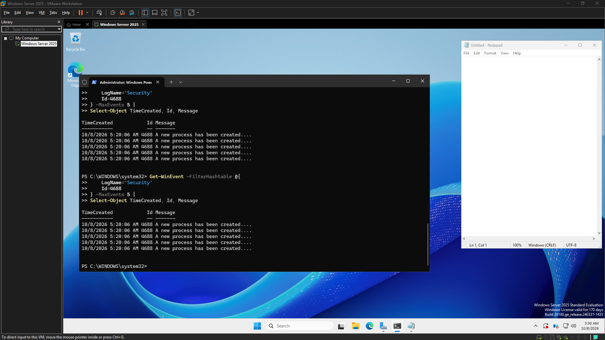
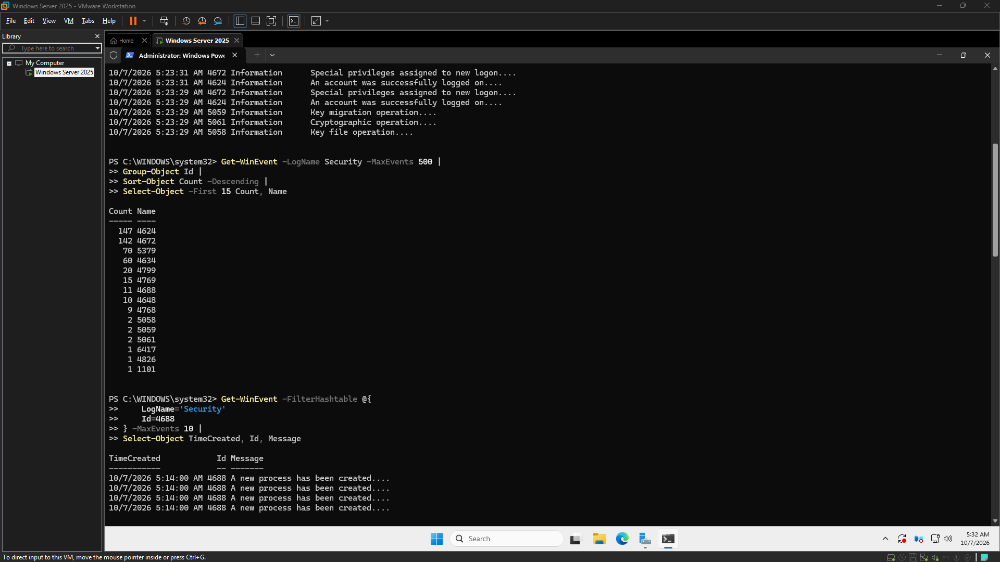
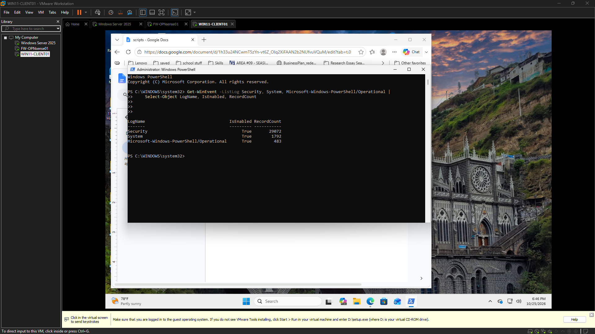

# CyberOps-Sandbox

Status: In progress

## Project story
Here is a concise project summary for 'CyberOps-Sandbox', reflecting its ongoing status.

---

# CyberOps-Sandbox: Building a Centralized Security Monitoring Environment

## 1. Project Story

The **CyberOps-Sandbox** project is actively establishing a dedicated, robust virtual environment for centralized security monitoring, designed to provide hands-on experience and demonstrate practical cyber operations capabilities. The project initiated by provisioning a foundational Ubuntu Server within VMware, strategically integrating it into a segmented virtual network (OPNsense LAN via VMnet2).

Currently, the primary focus is on the crucial deployment of **Wazuh**, a leading open-source security platform, to serve as the core Security Information and Event Management (SIEM) solution. This involves meticulous selection and installation of the correct Ubuntu Server version (24.04.5 LTS) to ensure optimal compatibility and stability for Wazuh. Once Wazuh is operational, the sandbox will enable comprehensive security telemetry collection, baseline establishment, and incident analysis, laying the groundwork for advanced cyber defense practices.

## 2. Key Achievements

*   **Foundational Server Provisioning:** Successfully provisioned and configured an Ubuntu Server virtual machine in VMware, establishing the essential operating system foundation for the security monitoring solution.
*   **Network Segmentation & Integration:** Seamlessly integrated the server into a segmented virtual network (OPNsense LAN via VMnet2), ensuring proper isolation and controlled communication crucial for security operations.
*   **Remote Administration Enabled:** Established and verified remote SSH access from the host machine to the Ubuntu Server, streamlining management and configuration tasks.
*   **Critical OS Version Alignment:** Through proactive compatibility review, identified and prepared for the correct Ubuntu Server 24.04.5 LTS version necessary for a stable Wazuh deployment, avoiding potential issues with an initially considered newer release.
*   **Initial Setup Challenge Resolution:** Demonstrated effective problem-solving by navigating and resolving initial setup challenges, including forgotten login credentials via recovery mode and adapting to host resource constraints for VM memory allocation.
*   **Wazuh Deployment Readiness:** Progressed to the point of acquiring necessary Wazuh components (e.g., signing key) and preparing the VM for the all-in-one Wazuh installation, signifying readiness for the core SIEM deployment phase.

## 3. Lessons Learned

*   **Pre-emptive Version Compatibility is Key:** The importance of thoroughly verifying operating system compatibility with target applications (Wazuh) *before* deployment became evident, as an initial incorrect Ubuntu version choice necessitated an OS replacement, highlighting the value of upfront planning.
*   **Systematic Troubleshooting & Recovery:** Encountering and successfully resolving issues like forgotten login credentials reinforced the necessity of methodical troubleshooting and leveraging system recovery mechanisms.
*   **Iterative Resource Allocation:** Acknowledged that initial conservative VM resource allocations, driven by host limitations, require ongoing review and potential adjustment as project requirements and performance demands evolve, particularly with the introduction of resource-intensive applications like Wazuh.
*   **Distinguishing ISO vs. Booted OS:** Learned the critical distinction between an attached ISO and the *actually booted* operating system version to ensure correct configurations and avoid future deployment roadblocks.

## 4. Next Steps

*   Complete the Ubuntu Server 24.04.5 LTS installation and verification on the virtual machine.
*   Proceed with the all-in-one deployment and configuration of the Wazuh Manager, Indexer, and Dashboard.
*   Validate Wazuh services are fully operational, accessible, and ready for agent enrollment.
*   Begin ingesting security telemetry from various endpoints and establishing initial monitoring baselines within Wazuh.
*   Continuously review and potentially increase VM memory allocation based on Wazuh performance and host resource availability.

## 5. Proof Points

**Project Logs:**
*   `2026-11-03.md`: Documents the successful provisioning of the Ubuntu Server, its integration into the segmented network, establishment of SSH access, and initial configuration.
*   `2026-11-04.md`: Details the proactive compatibility review, the identification and procurement of the correct Ubuntu Server 24.04.5 LTS for Wazuh, and the ongoing preparatory steps for the Wazuh deployment.

**Screenshot Captions (Evidencing foundational work and future intent):**
*   **Foundational Setup:** "Ubuntu Storage Configuration," "Ubuntu Username Recovery after forgetting," "Ubuntu Server First Login," "Ubuntu SSH Service Running"
*   **Security Monitoring Objectives:** "Endpoint Baseline Initial Audit," "Security Log Baseline," "Telemetry Visibility Gap," "Process Creation Telemetry," "Security Event Distribution," "CyberOps Baseline v0.1" (Indicating the strategic intent to build comprehensive security monitoring and analysis capabilities).

## What we shipped
- The project was completed with a clear objective, technical execution, and proof captured in the logs.
- The implementation and project records are documented in the repository for future context.
- The work can be reviewed quickly by anyone familiar with the project.

## Key proof moments
### Highlight: Telemetry Visibility Gap

This screenshot shows the telemetry or evidence being reviewed to understand the current system behavior and validate what the environment is actually recording. It highlights the key detail the viewer should notice in this stage of the project.
### Highlight: Security Event Distribution

This screenshot shows the telemetry or evidence being reviewed to understand the current system behavior and validate what the environment is actually recording. It highlights the key detail the viewer should notice in this stage of the project.
### Highlight: Security Log Baseline

This screenshot shows the telemetry or evidence being reviewed to understand the current system behavior and validate what the environment is actually recording. It highlights the key detail the viewer should notice in this stage of the project.

## Lessons learned
- Keep documentation close to delivery.
- Use screenshots as proof points.
- Write the project story in plain language for future reviewers.

## Next steps
- Continue from the handoff notes and current project status.
- Capture final cleanup or deployment follow-up items as they are completed.
