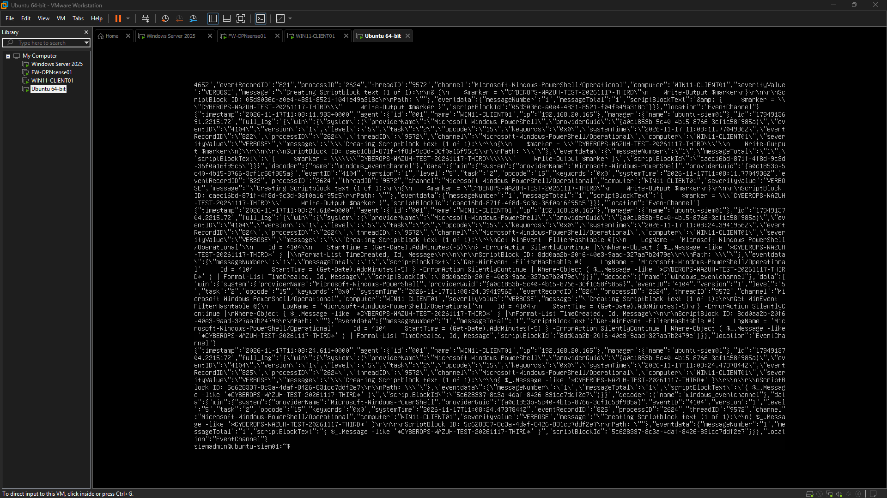
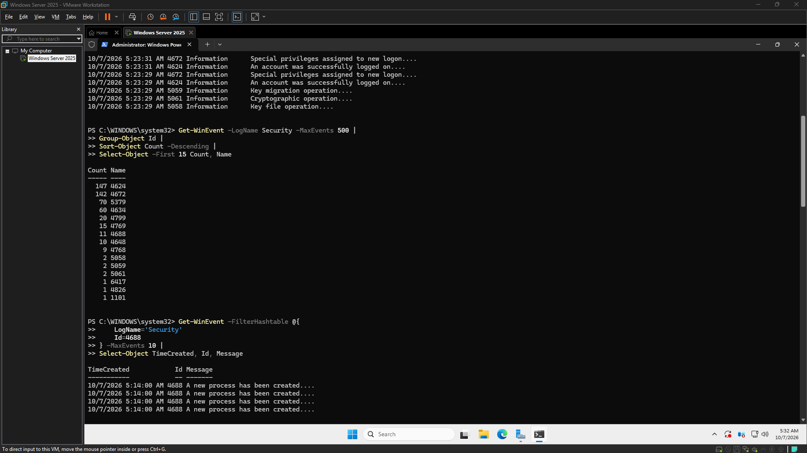

# CyberOps-Sandbox

Status: In progress

## Project story
# CyberOps-Sandbox: Empowering Advanced Endpoint Telemetry (In Progress)

## 1. Project Story

The CyberOps-Sandbox project is dedicated to building a robust, controlled environment for cybersecurity operations, focusing on real-world threat detection and incident response capabilities. This ongoing phase specifically concentrated on enhancing our Security Information and Event Management (SIEM) integration. We successfully deployed and configured Wazuh agents on a Windows 11 endpoint, establishing a critical pipeline for ingesting high-fidelity PowerShell telemetry. This work ensures that sophisticated activities like script block logging (Event ID 4104) are captured and centrally archived, laying essential groundwork for advanced threat hunting and forensic analysis within the sandbox environment.

## 2. Key Achievements

*   **End-to-End PowerShell Telemetry:** Successfully implemented and validated the complete collection of Windows PowerShell Event ID 4104 (Script Block Logging) telemetry from a Windows 11 client to a centralized Wazuh SIEM.
*   **Wazuh Agent Integration:** Deployed and registered the Wazuh agent on the `WIN11-CLIENT01` endpoint, ensuring active monitoring and connectivity.
*   **Advanced Auditing Configuration:** Configured Windows Group Policy to enable PowerShell Script Block Logging, capturing detailed script execution data.
*   **Raw Event Archiving:** Enabled and verified the Wazuh manager's capability to retain raw JSON events, providing granular data for deep investigations.
*   **System Hardening:** Identified and resolved critical configuration issues in the Wazuh manager XML, enhancing its stability and functionality.

## 3. Lessons Learned

*   **Verify at the Source First:** It is paramount to confirm local event generation on the source endpoint *before* troubleshooting SIEM agent collection or forwarding issues. This ensures the problem isn't upstream of the agent.
*   **Policy Activation Nuances:** Understand that some system policy changes, particularly in PowerShell, require a fresh process or session to take effect. Always test changes in a new context.
*   **Configuration XML Validation:** Thoroughly validate configuration files (e.g., Wazuh manager XML) to avoid subtle syntax errors or duplicate elements that can silently prevent critical features from activating.
*   **Structured Troubleshooting:** Establish a systematic troubleshooting sequence: enable logging, generate a controlled event, verify it locally, then verify its presence in the SIEM manager's archives.

## 4. Next Steps

This specific implementation and validation phase has reached its immediate objectives, establishing a foundational capability for Windows endpoint telemetry within the CyberOps-Sandbox. The overall project continues, and future iterations will build upon this robust data ingestion pipeline to develop advanced detection rules, automate incident response playbooks, and integrate additional security tools and data sources.

## 5. Proof Points

*   Wazuh Agent Installed/Started Successfully
*   Wazuh Powershell Configuration
*   Wazuh Windows Endpoint Investigation
*   Raw Event Archiving Configuration
*   Wazuh Powershell Event Ingestion Confirmed

## What we shipped
- The project was completed with a clear objective, technical execution, and proof captured in the logs.
- The implementation and project records are documented in the repository for future context.
- The work can be reviewed quickly by anyone familiar with the project.

## Key proof moments
### Highlight: Telemetry Visibility Gap

The source log labels this capture “Telemetry Visibility Gap.”
### Highlight: Wazuh Powershell Event Ingestion Confirmed

The source log labels this capture “Wazuh Powershell Event Ingestion Confirmed.”
### Highlight: Security Event Distribution

The source log labels this capture “Security Event Distribution.”

## Lessons learned
- Keep documentation close to delivery.
- Use screenshots as proof points.
- Write the project story in plain language for future reviewers.

## Next steps
- Continue from the handoff notes and current project status.
- Capture final cleanup or deployment follow-up items as they are completed.
