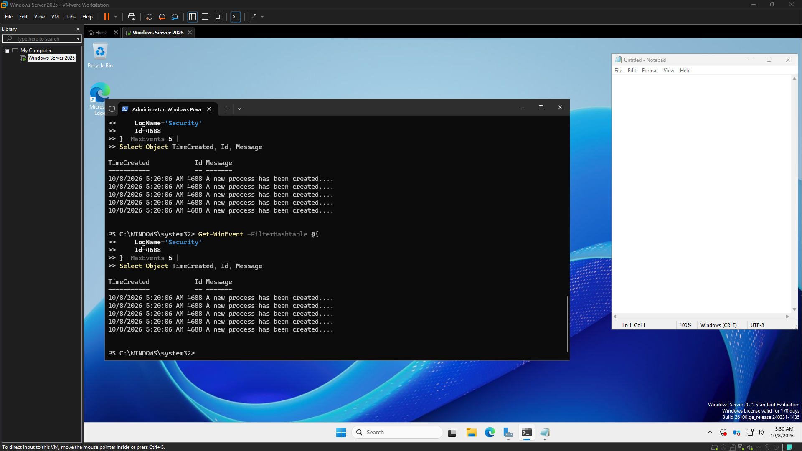
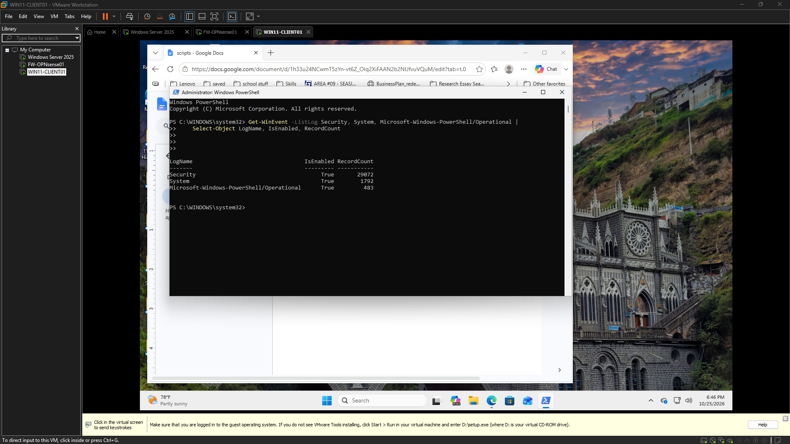

# CyberOps-Sandbox

Status: In progress

## Project story
# CyberOps-Sandbox: Building a Resilient SIEM Foundation

## 1. Project Story

The CyberOps-Sandbox project is establishing a robust, centralized Security Information and Event Management (SIEM) environment to enable advanced cyber operations and telemetry analysis. This ongoing initiative focuses on building a resilient and scalable security monitoring infrastructure.

Initial efforts focused on deploying the core SIEM stack and exploring endpoint telemetry, but faced significant infrastructure compatibility and resource challenges. This led to an iterative approach, necessitating a full re-establishment of the core SIEM server environment. Through this process, we meticulously rebuilt the Ubuntu server infrastructure, successfully deployed the Wazuh SIEM stack, and overcame critical constraints, including OS versioning and host storage limitations. The project has now achieved a stable, operational SIEM foundation, ready for deeper endpoint integration and security use case development.

## 2. Key Achievements

*   **Resilient SIEM Deployment:** Successfully re-established and deployed a functional Wazuh 4.14.10 all-in-one SIEM stack on Ubuntu Server 24.04.5 LTS within a VMware environment, demonstrating iterative problem-solving and recovery capabilities.
*   **Robust Infrastructure Foundation:** Configured secure remote administration via OpenSSH and expanded virtual machine resources (LVM root filesystem) to meet application requirements.
*   **Overcoming Critical Hurdles:** Addressed significant infrastructure challenges, including initial OS compatibility issues (necessitating a rollback), complex VM boot configurations, and physical host storage exhaustion during deployment.

## 3. Lessons Learned

*   **Thorough Pre-flight Checks:** The critical importance of comprehensive pre-deployment checks, particularly for host disk capacity and component compatibility, to prevent costly interruptions.
*   **Independent Validation:** Emphasized the need for independent validation of AI-generated guidance for critical infrastructure components to avoid compatibility issues.
*   **Systematic Troubleshooting:** Reinforced the value of explicit package installation verification before checking service status, and meticulous command entry to prevent diagnostic delays.
*   **Resilience in Practice:** Demonstrated the ability to recover from unexpected system-level issues, such as full operating system reinstallation and interrupted deployments, and continue progress effectively.

## 4. Next Steps

*   Integrate Windows endpoints into the Wazuh SIEM for comprehensive log collection and security monitoring.
*   Begin ingesting and analyzing telemetry data from integrated endpoints to identify security visibility gaps and establish baseline security logs.
*   Develop initial security use cases and alerts based on the collected security data.

## 5. Proof Points

*   **Wazuh Services Operational:** Screenshot evidence confirms Wazuh Indexer, Manager, and Dashboard services are actively running.
*   **Wazuh Dashboard Accessible:** Screenshot evidence verifies successful web access to the Wazuh SIEM dashboard over HTTPS.
*   **Core Configuration:** Wazuh version 4.14.10 deployed on Ubuntu Server 24.04.5 LTS (VM configured with 4 vCPU, 8 GB RAM, 50 GB virtual disk, with root filesystem expanded to 48 GB).
*   **Remote Access:** OpenSSH is installed and active, confirming secure remote administration capabilities.
*   **Early Telemetry Exploration:** Prior efforts included initial audit and collection of security logs, process creation telemetry, and identification of telemetry visibility gaps, providing a foundation for upcoming endpoint integration.

## What we shipped
- The project was completed with a clear objective, technical execution, and proof captured in the logs.
- The implementation and project records are documented in the repository for future context.
- The work can be reviewed quickly by anyone familiar with the project.

## Key proof moments
### Highlight: Telemetry Visibility Gap

The source log labels this capture “Telemetry Visibility Gap.”
### Highlight: Security Event Distribution

The source log labels this capture “Security Event Distribution.”
### Highlight: Security Log Baseline

The source log labels this capture “Security Log Baseline.”

## Lessons learned
- Keep documentation close to delivery.
- Use screenshots as proof points.
- Write the project story in plain language for future reviewers.

## Next steps
- Continue from the handoff notes and current project status.
- Capture final cleanup or deployment follow-up items as they are completed.
