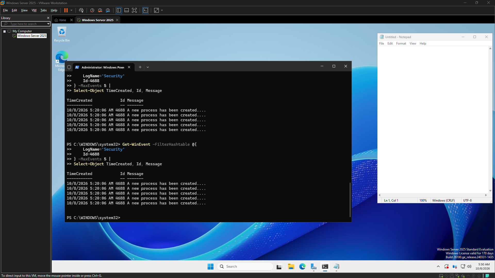
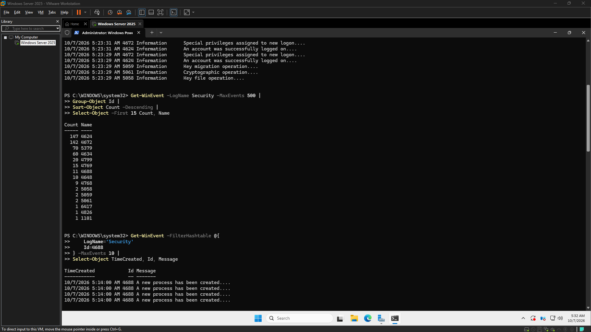

# CyberOps-Sandbox

Status: In progress

## Project story
The CyberOps-Sandbox project is establishing a robust lab environment for advanced Security Information and Event Management (SIEM) and detection engineering. Currently in progress, this initiative has systematically validated the existing virtualized infrastructure, setting a clear, evidence-based foundation for upcoming deployments. Our focus has been on understanding the baseline configuration of network segments, Windows Server domain services, and target client endpoints, ensuring a stable and well-understood platform for building sophisticated threat detection capabilities.

### 1. Project story

The CyberOps-Sandbox project is laying the essential groundwork for a dynamic lab environment dedicated to advanced SIEM and detection engineering. Our current 'in progress' phase has meticulously established a foundational understanding of the existing virtualized infrastructure, from core network segments to domain services and endpoint states. This deliberate baseline validation is crucial for ensuring a stable platform as we transition from passive inspection to active deployment of sophisticated security monitoring and analysis capabilities, ultimately enabling robust threat detection practices.

### 2. Key achievements

*   **Comprehensive Infrastructure Baseline:** Established a verified baseline of the virtualized environment, including OPNsense network configuration, the Windows Server 2025 domain controller (NS-DC01) with Active Directory and DNS roles, and a target Windows client (WIN11-CLIENT01).
*   **Endpoint Telemetry Readiness:** Confirmed active Windows Security, System, and PowerShell Operational logging on the target endpoint, providing initial data sources and highlighting the critical immediate need for deploying dedicated endpoint telemetry agents.
*   **Preserved Environment Integrity:** All baseline validation activities were conducted without modifying existing system or network configurations, maintaining the integrity and stability of the lab environment.
*   **Identified Reusable Assets:** Documented existing administrative and PowerShell capabilities from prior projects, identifying potential for reuse in future SIEM and detection engineering efforts.

### 3. Lessons learned

*   **Privilege Management is Key:** Accessing critical security logs (e.g., Windows Security log) often requires elevated privileges, which must be accounted for in planning and automation.
*   **Verify System Identity:** Hostnames and expected OS versions can differ from reality; deeper investigation into operating system identification is crucial for compatibility and accurate planning.
*   **Proactive Resource Planning:** Early identification and addressing of host resource constraints (e.g., memory) are essential to prevent bottlenecks for future SIEM and detection component deployments.
*   **Telemetry is Foundational:** A robust detection engineering strategy hinges on comprehensive endpoint telemetry; recognizing this visibility gap early effectively prioritizes subsequent technical milestones.

### 4. Next steps

The immediate focus for CyberOps-Sandbox is on deploying and configuring essential endpoint telemetry agents (e.g., Wazuh, Sysmon) on WIN11-CLIENT01 to establish robust data collection. Concurrently, we will address identified host memory constraints to ensure adequate resources for upcoming SIEM and detection engineering tools. Further investigation into the endpoint's reported operating system identification will also be prioritized to confirm compatibility and avoid future issues, paving the way for active SIEM deployment.

### 5. Proof points

*   **Visual Documentation:** Screenshots titled 'Endpoint Baseline Initial Audit' and 'Security Log Baseline' (2026-10-25) illustrate the initial state and active logging on the target endpoint.
*   **Network & Endpoint Verification:** Confirmed WIN11-CLIENT01 network identity (IPv4 192.168.20.165, gateway 192.168.20.1) and verified active Windows logging sources, including 29,072 Security records, 1,792 System records, and 483 PowerShell Operational records observed.
*   **Server Configuration:** NS-DC01 verified running Windows Server 2025 with Active Directory Domain Services and DNS roles for the `northstar.local` domain, operating within a VMware NAT network configuration.
*   **Telemetry Gap Identified:** Explicit identification of the absence of dedicated endpoint telemetry agents as a critical technical milestone underscores the project's data-driven approach.

## What we shipped
- The project was completed with a clear objective, technical execution, and proof captured in the logs.
- The implementation and project records are documented in the repository for future context.
- The work can be reviewed quickly by anyone familiar with the project.

## Key proof moments
### Highlight: Telemetry Visibility Gap

This screenshot shows the telemetry or evidence being reviewed to understand the current system behavior and validate what the environment is actually recording. It highlights the key detail the viewer should notice in this stage of the project.
### Highlight: Security Event Distribution

This screenshot shows the telemetry or evidence being reviewed to understand the current system behavior and validate what the environment is actually recording. It highlights the key detail the viewer should notice in this stage of the project.
### Highlight: Security Log Baseline

This screenshot shows the telemetry or evidence being reviewed to understand the current system behavior and validate what the environment is actually recording. It highlights the key detail the viewer should notice in this stage of the project.

## Lessons learned
- Keep documentation close to delivery.
- Use screenshots as proof points.
- Write the project story in plain language for future reviewers.

## Next steps
- Continue from the handoff notes and current project status.
- Capture final cleanup or deployment follow-up items as they are completed.
