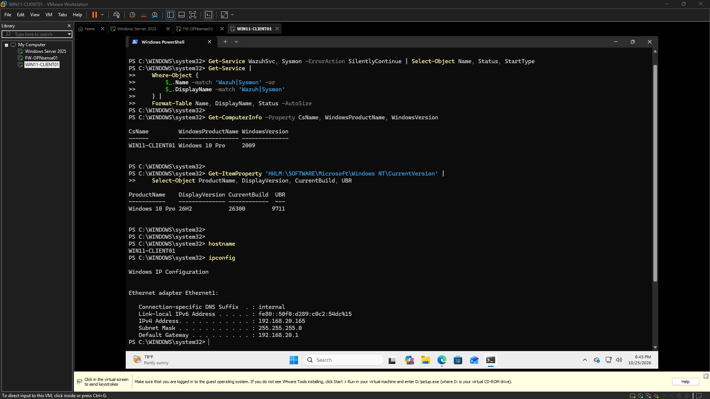

# Engineering Log – 2026-10-25

## Screenshot – Endpoint Baseline Initial Audit

## Screenshot – Security Log Baseline

---

## Session – 18:32 to 18:48
### Goal
Establish the current CyberOps infrastructure baseline and identify the technical prerequisites for the November SIEM build, verify host resources, confirm existing VM and network state, identify blockers before installing anything.

### Definition of Done
Record available host RAM and disk capacity, identify the relevant VMware VMs and their current resource allocations, confirm the intended Windows endpoint and server roles, establish whether a Wazuh deployment is feasible without unnecessary lab changes.

### Goal Achieved
✅ Yes

Summary:
Initial validation of the existing lab infrastructure was performed to establish an evidence-based starting point for the November CyberOps SIEM and detection engineering work. This involved reviewing network baselines, verifying endpoint network identity and connectivity, and confirming the status of core Windows event logging sources on a target workstation. A key finding was the absence of dedicated endpoint telemetry agents, identifying telemetry collection as the next critical technical milestone. No system or network configuration changes were made, preserving the existing infrastructure.

Tasks Completed:
*   Reviewed the existing OPNsense WAN, LAN, and SERVERS network baseline.
*   Verified WIN11-CLIENT01 network identity and connectivity configuration.
*   Confirmed WIN11-CLIENT01 endpoint IPv4 address (192.168.20.165) with gateway (192.168.20.1).
*   Checked for existing Wazuh and Sysmon service installations on the endpoint; neither were found.
*   Verified Windows Security logging is enabled (29,072 records observed).
*   Verified Windows System logging is enabled (1,792 records observed).
*   Verified Windows PowerShell Operational logging is enabled (483 records observed).
*   Established that elevated PowerShell privileges are required for inspecting the Security log.
*   Made no system or network configuration changes to the existing environment.

Issues Encountered:
*   Initial attempts to inspect the Windows Security log via PowerShell failed due to insufficient privileges, necessitating elevation.
*   The endpoint's operating system identification differed from the expected Windows 11 designation.
*   Available host memory is constrained while the existing virtual machines are running, potentially impacting future resource allocation for SIEM components.

Next Steps:
*   Deploy and configure endpoint telemetry agents (e.g., Wazuh, Sysmon) on WIN11-CLIENT01.
*   Further investigate the discrepancy in the endpoint's reported operating system identification.
*   Address host memory constraints to ensure adequate resources for upcoming SIEM and detection engineering tools.

Notes:
This initial validation effort successfully confirmed the foundational status of the lab environment prior to new deployments. The existing infrastructure, including network configuration, was preserved without modification. Confirmation of active Windows event sources provides a baseline for initial detection capabilities, pending the deployment of advanced telemetry agents.

### Working Story
Validated the existing lab before deployment, confirmed available Windows event sources, identified endpoint telemetry collection as the next technical milestone, preserved existing infrastructure, established an evidence-based starting point for the November CyberOps SIEM and detection engineering work.

### Friction and AI Gaps
Initial Security log inspection failed because PowerShell lacked sufficient privileges, endpoint operating system identification differed from the expected Windows 11 designation, available host memory is constrained while the existing virtual machines are running.

### What the AI Missed
None

### AI Peer Review
Status: Approved
Reviewer: human
Reviewed At: 2026-10-25 18:49:34
Reviewer Notes: The endpoint's reported OS identity is Windows 10 Pro 26H2, build 26300.9711, despite its WIN11-CLIENT01 hostname. Preserve the existing configuration and investigate further only if OS compatibility becomes a real blocker. Wazuh and Sysmon installation status remains unconfirmed beyond the initial service-name checks.

### Duration
16 minutes (Planned: 20 minutes)

### Notes

