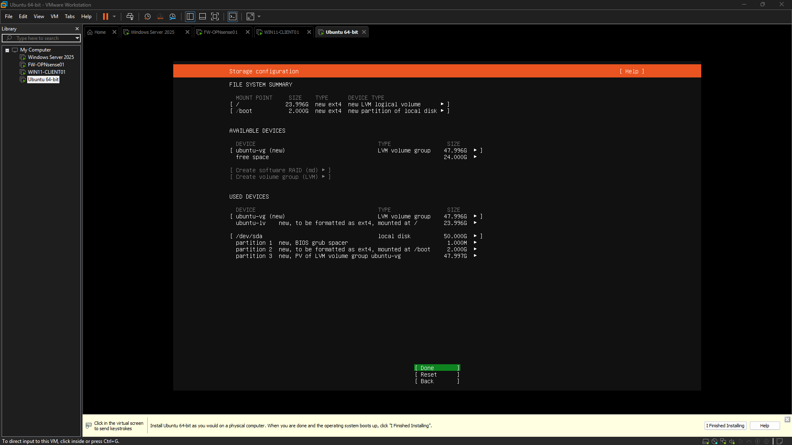
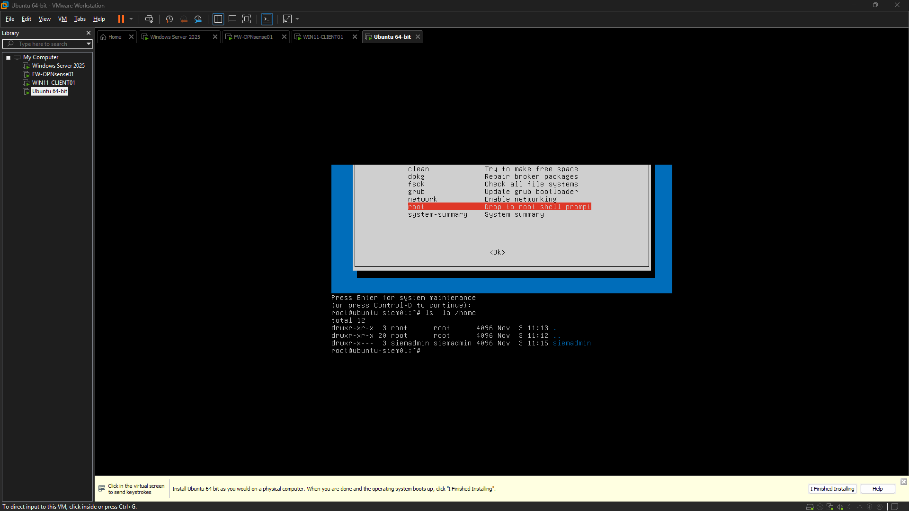
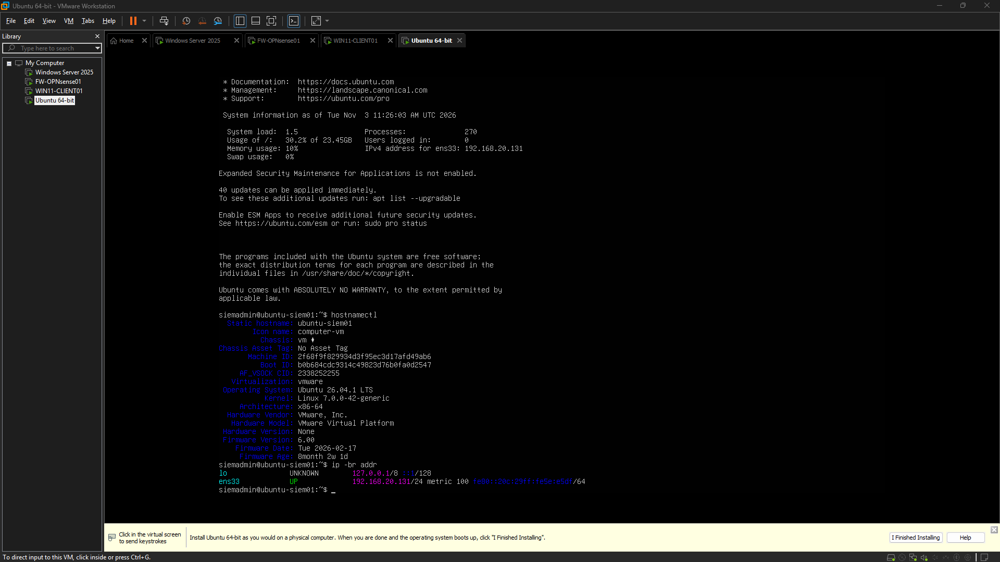
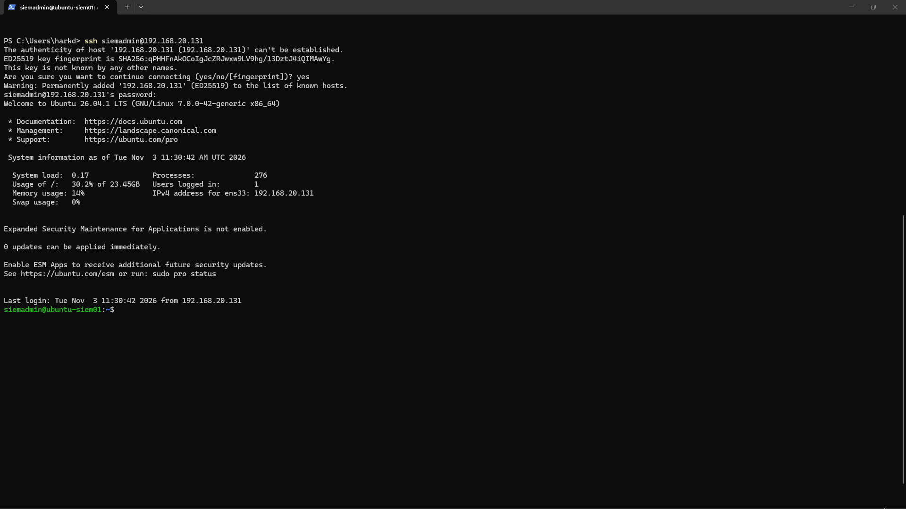

# Engineering Log – 2026-11-03

## Screenshot – Ubuntu Storage Configuration

## Screenshot – Ubuntu Username Recovery after forgetting

## Screenshot – Ubuntu Server First Login

## Screenshot – Ubuntu SSH Service Running

---

## Session – 05:57 to 06:34
### Goal
Deploy and establish the Ubuntu Server foundation for centralized security monitoring.

### Definition of Done
The session is complete when Ubuntu Server is installed and operational, the VM has a working network connection, resource allocation is documented, and the environment is ready for Wazuh installation.

### Goal Achieved
✅ Yes

Summary:
A dedicated Ubuntu Server 26.04.1 LTS virtual machine has been successfully provisioned in VMware, establishing a foundational Linux server for centralized security monitoring. The VM was integrated into the existing segmented OPNsense LAN, with core system configuration, network validation, and remote administration capabilities established. This prepares the environment for future Wazuh deployment without requiring a rebuild of existing infrastructure.

Tasks Completed:
*   Provisioned a dedicated Ubuntu Server 26.04.1 LTS virtual machine in VMware.
*   Configured the VM with 2 CPU cores, 4 GB RAM, and a 50 GB virtual disk.
*   Integrated the VM into the existing OPNsense LAN via VMnet2.
*   Completed the Ubuntu installation process.
*   Successfully performed an account recovery and password reset.
*   Updated all system packages to the latest versions.
*   Verified hostname and network configuration (IP address, subnet mask).
*   Confirmed gateway connectivity and external internet access.
*   Validated DNS resolution.
*   Enabled the OpenSSH Server.
*   Established successful remote SSH access from the physical Windows host.

Issues Encountered:
*   Initial Ubuntu login failed due to an incorrect or forgotten password, necessitating entry into recovery mode to identify the existing account and perform a password reset.
*   Conservative VM memory allocation was required due to initial host resource availability constraints.

Next Steps:
*   Proceed with the installation and configuration of Wazuh on the newly provisioned Ubuntu server.
*   Review host resource availability to potentially increase VM memory allocation if performance bottlenecks are observed or future requirements demand it.

Notes:
*   The current VM memory allocation of 4 GB is functional but was influenced by host resource limitations. Performance should be monitored during Wazuh deployment and operation, and memory adjusted as needed to ensure optimal security monitoring performance.
*   The successful integration into the OPNsense LAN through VMnet2 ensures proper network segmentation and controlled communication for the security monitoring solution.

### Working Story
Establishing a dedicated Linux server foundation for centralized security monitoring, integrating the new server into the existing segmented virtual network, validating connectivity and remote administration, preparing the environment for Wazuh deployment without rebuilding existing infrastructure.

### Friction and AI Gaps
The Ubuntu login initially failed because the configured password was incorrect or had been forgotten, requiring recovery mode to identify the existing account and reset its password. Initial host resource availability also required conservative VM memory allocation.

### What the AI Missed
None

### AI Peer Review
Status: Approved
Reviewer: human
Reviewed At: 2026-11-03 06:35:12
Reviewer Notes: Ubuntu Server installation and baseline validation were completed successfully. The server is operational and accessible remotely from the physical Windows host. Network connectivity, DNS resolution, package updates, and SSH functionality were verified.

### Duration
36 minutes (Planned: 40 minutes)

### Notes
Hostname: ubuntu-siem01, operating system: Ubuntu 26.04.1 LTS, kernel: Linux 7.0.0-42-generic, architecture: x86_64, network interface: ens33, IPv4 address: 192.168.20.131/24, gateway: 192.168.20.1, VM network: VMnet2, VM allocation: 2 CPU cores, 4 GB RAM, 50 GB disk, SSH service: enabled and active, remote access: verified from Windows PowerShell.
