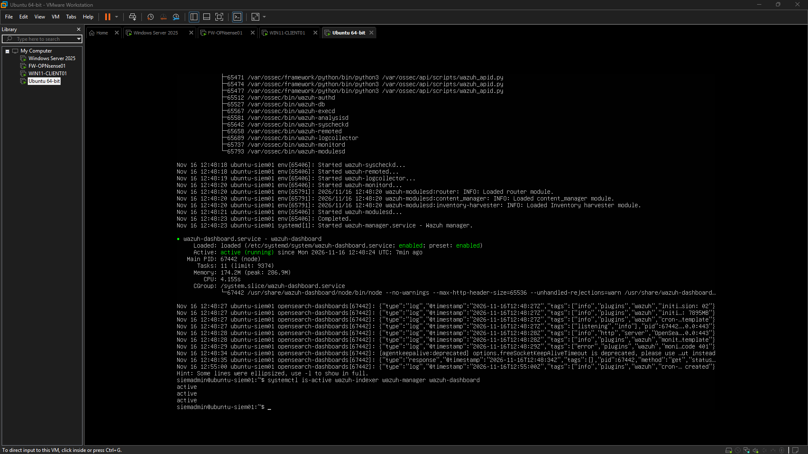
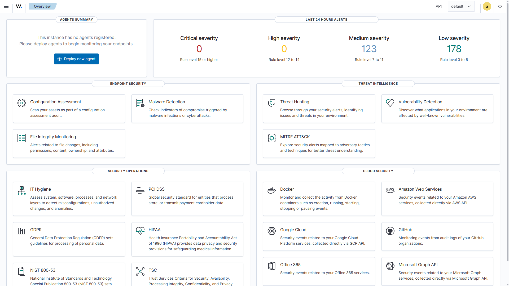

# Engineering Log – 2026-11-16

## Screenshot – Wazuh Services Operational

## Screenshot – Wazuh Dashboard Accessible

---

## Session – 07:12 to 08:01
### Goal
Establish the Wazuh SIEM infrastructure on ubuntu-siem01, validate the Ubuntu Server environment, deploy the all-in-one Wazuh stack, confirm dashboard accessibility, prepare the environment for Windows endpoint integration.

### Definition of Done
Ubuntu LTS install confirmed & Wazuh deployment completed

### Goal Achieved
✅ Yes

**Summary:**
This documentation details the process of re-establishing a compatible Ubuntu server environment within VMware, configuring secure remote administration, and deploying a functional Wazuh Security Information and Event Management (SIEM) stack. The initiative focused on rebuilding the infrastructure while preserving existing VMware hardware configurations, addressing initial operating system compatibility issues, overcoming critical resource constraints, and ensuring the accessibility and health of the deployed security monitoring services.

**Tasks Completed:**
*   Reinstallation of Ubuntu Server 24.04.5 LTS.
*   Configuration of VMware boot settings to ensure proper virtual disk boot.
*   Execution of comprehensive Ubuntu package updates.
*   Expansion of the LVM root filesystem to accommodate application requirements.
*   Installation and configuration of OpenSSH for secure remote access.
*   Validation of remote SSH connectivity.
*   Deployment of the Wazuh Indexer component.
*   Deployment of the Wazuh Manager component.
*   Deployment of the Wazuh Dashboard component.
*   Verification of all deployed Wazuh service health.
*   Validation of Wazuh Dashboard accessibility.

**Issues Encountered:**
*   Initial attempt to use Ubuntu 26.04 resulted in compatibility issues, necessitating a rollback to 24.04.5 LTS.
*   Difficulty ensuring the virtual machine booted from the existing virtual disk rather than the replacement ISO after OS reinstallation.
*   An unexpected full operating system reinstallation was required due to prior issues, consuming additional time.
*   The OpenSSH server package was initially missing, leading to failed SSH connection attempts.
*   Stale SSH host identification entries caused connection warnings and required manual client-side cleanup.
*   Physical Windows host storage exhaustion occurred during the Wazuh installation, interrupting the deployment process.
*   Recovery and continuation of the interrupted Wazuh installation required additional troubleshooting and resource management.

**Next Steps:**
No explicit next steps were provided in the rough notes.

**Notes:**
*   Initial OS compatibility guidance obtained via AI was not sufficiently validated, leading to a need for OS reinstallation. This highlights the importance of independent verification of critical infrastructure compatibility.
*   The VMware ISO boot configuration required more intensive troubleshooting than anticipated, indicating a need for clearer instructions or pre-validation in future similar tasks.
*   The initial SSH service check assumed OpenSSH was installed, which was incorrect. Future diagnostic steps should explicitly confirm package installation before checking service status.
*   A typo in a package inspection command led to wasted diagnostic time. Emphasize careful command entry and validation.
*   A critical oversight was not checking the host disk capacity *before* beginning the Wazuh deployment, directly leading to installation interruption and recovery efforts. Future deployments must include thorough pre-flight checks of all system resources.

### Working Story
Establishing a compatible SIEM server environment, rebuilding the Ubuntu infrastructure while preserving VMware hardware configuration, configuring secure remote administration, deploying and recovering a centralized security monitoring stack, validating service health and dashboard accessibility, overcoming infrastructure resource constraints.

### Friction and AI Gaps
Initial Ubuntu 26.04 compatibility issue, booting from the replacement ISO instead of the existing virtual disk, reinstalling the operating system, missing OpenSSH server package, stale SSH host identification, physical Windows host storage exhaustion during Wazuh installation, recovering the interrupted installation.

### What the AI Missed
Initial OS compatibility guidance was insufficiently validated, the ISO boot configuration required additional troubleshooting, the initial SSH service check assumed OpenSSH was installed, one package inspection command contained a typo, host disk capacity was not checked before beginning the Wazuh deployment.

### AI Peer Review
Status: Approved
Reviewer: human
Reviewed At: 2026-11-16 08:02:57
Reviewer Notes: Ubuntu Server 24.04.5 LTS is installed on ubuntu-siem01, Wazuh components are version 4.14.10, all three core services report active, dashboard access over HTTPS is confirmed.

### Duration
49 minutes (Planned: 50 minutes)

### Notes
VM configuration: 4 vCPU, 8 GB RAM, 50 GB virtual disk, VMnet2 network. Ubuntu root filesystem expanded to 48 GB, approximately 23 GB available at final verification. Ubuntu IP address: 192.168.20.131. OpenSSH is installed and active. Physical Windows D: drive storage was recovered, leaving approximately 112 GB available.
