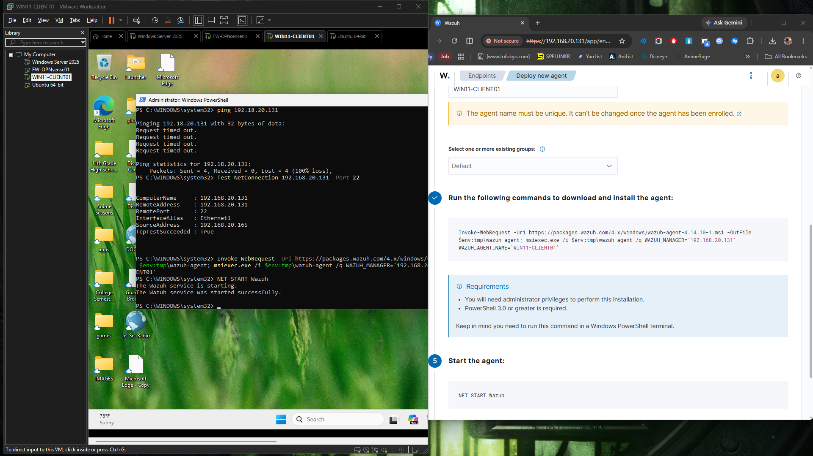
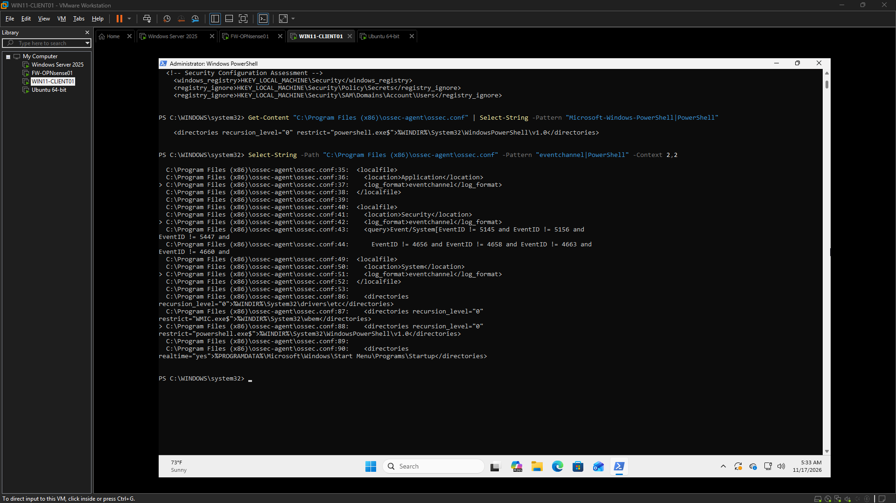
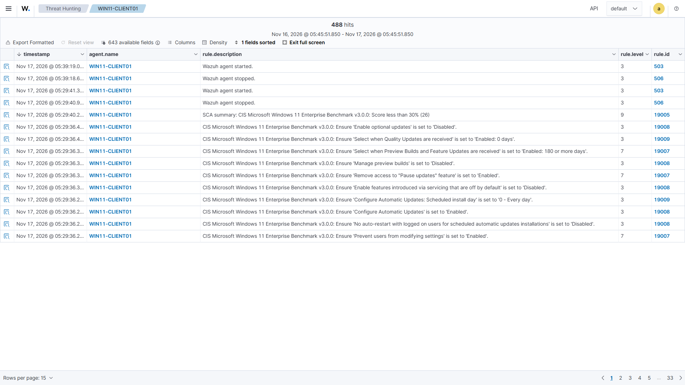
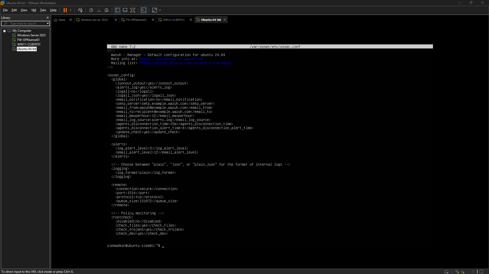
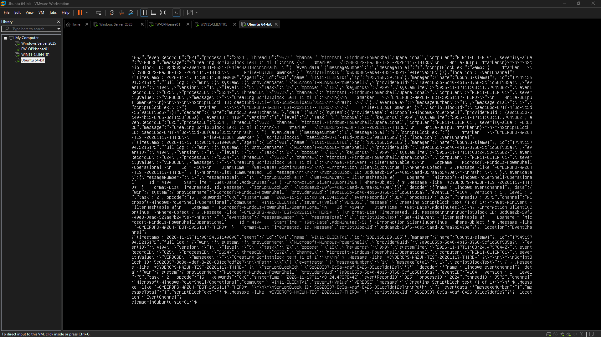

# Engineering Log – 2026-11-17

## Screenshot – Wazuh Agent Installed/Started Successfully

## Screenshot – Wazuh Powershell Configuration

## Screenshot – Wazuh Windows Endpoint Investigation

## Screenshot – Raw Event Archiving Configuration

## Screenshot – Wazuh Powershell Event Ingestion Confirmed

---

## Session – 05:05 to 06:11
### Goal
Integrate WIN11-CLIENT01 into the Wazuh monitoring environment, register its Wazuh agent with ubuntu-siem01, verify agent connectivity, generate controlled Windows activity, confirm centralized telemetry ingestion.

### Definition of Done
[ ] Windows endpoint powered on and network connectivity verified, [ ] Wazuh agent installed on WIN11-CLIENT01, [ ] Agent registered with ubuntu-siem01, [ ] Endpoint appears as active in Wazuh, [ ] Windows Security telemetry received by Wazuh, [ ] PowerShell activity successfully collected, [ ] At least one controlled event located and verified in the dashboard.

### Goal Achieved
✅ Yes

**Summary:**
Successfully implemented and validated end-to-end collection of Windows PowerShell Event ID 4104 (Script Block Logging) telemetry. This involved enabling script-block auditing on a Windows endpoint via the registry, configuring the Wazuh agent to collect these events, and setting up the Wazuh manager to retain raw JSON events in its archives. Key issues encountered during configuration, including incorrect manager XML and policy activation nuances, were identified and resolved, culminating in the successful verification of controlled PowerShell events reaching the centralized SIEM and being stored in JSON format.

**Tasks Completed:**
*   Configured Windows PowerShell Script Block Logging through the Windows registry.
*   Verified local generation of PowerShell Event ID 4104 on the Windows endpoint.
*   Confirmed the Wazuh agent was successfully collecting the PowerShell Operational event channel.
*   Enabled Wazuh JSON event archiving on the manager.
*   Corrected the Wazuh manager configuration XML to enable archiving.
*   Validated the corrected Wazuh manager configuration.
*   Successfully restarted the Wazuh manager service.
*   Verified that controlled PowerShell test events reached the `ubuntu-siem01` Wazuh manager.
*   Confirmed that these events were written to `/var/ossec/logs/archives/archives.json`.

**Issues Encountered:**
*   **Wazuh Event Visibility:** PowerShell events were initially visible locally on the Windows endpoint but were not appearing in Wazuh, suggesting a collection or forwarding issue.
*   **Script Block Logging Activation:** Script Block Logging was not enabled through the initially expected registry policy, requiring a specific registry key modification.
*   **PowerShell Session Refresh:** After enabling the Script Block Logging policy, a fresh PowerShell process was required before controlled events would appear, a detail initially overlooked.
*   **Wazuh Manager Configuration Errors:** The Wazuh manager configuration XML contained duplicate root elements, which prevented JSON archiving from being enabled successfully until corrected.
*   **Troubleshooting Focus:** Initial troubleshooting efforts were misdirected, focusing too heavily on Wazuh agent collection and manager forwarding before adequately confirming the Windows endpoint was generating the specific controlled PowerShell events.

**Next Steps:**
No further next steps were outlined for this specific implementation and validation phase.

**Notes:**
*   A key lesson learned during troubleshooting was the critical importance of verifying local event generation on the source endpoint *before* investigating collection or forwarding issues with the SIEM agent.
*   The correct sequence for verifying end-to-end telemetry was established: enable logging, generate a controlled event, verify the event locally on the source, then verify its presence in the manager's archives.
*   Careful attention must be paid to PowerShell policy activation, as some changes (like Script Block Logging via registry) require opening a fresh PowerShell process to take effect.

### Working Story
Successful implementation and validation of end-to-end Windows PowerShell telemetry collection, enabling script-block auditing on the endpoint, configuring Wazuh to retain raw JSON events, troubleshooting and correcting the manager configuration, proving that controlled Event ID 4104 records traveled from the Windows endpoint to the centralized SIEM.

### Friction and AI Gaps
PowerShell events were initially visible locally but not appearing in Wazuh, Script Block Logging was not enabled through the expected registry policy, the policy change required opening a fresh PowerShell process before the controlled event appeared, the Wazuh manager configuration also contained duplicate root XML elements that needed correction before archiving could be enabled successfully.

### What the AI Missed
The initial troubleshooting focused too heavily on Wazuh collection and forwarding before confirming that Windows was generating the specific controlled PowerShell events, the first test commands did not account for Script Block Logging being disabled, the need to open a fresh PowerShell process after enabling the policy was identified later. The troubleshooting ultimately established the correct sequence: enable logging, generate a controlled event, verify it locally, then verify it in the manager archive.

### AI Peer Review
Status: Approved
Reviewer: human
Reviewed At: 2026-11-17 06:12:58
Reviewer Notes: The session achieved a significant infrastructure milestone. The evidence establishes that PowerShell Script Block Logging is enabled, Event ID 4104 records are generated locally, the Wazuh agent forwards those records, and the Wazuh manager stores them in its raw event archive.

### Duration
65 minutes (Planned: 40 minutes)

### Notes

