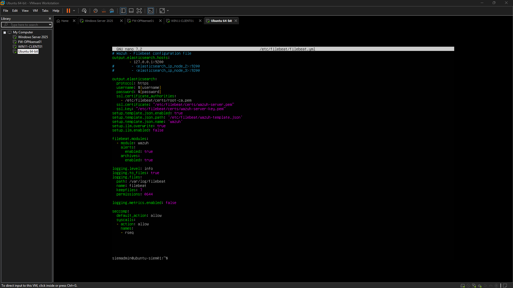
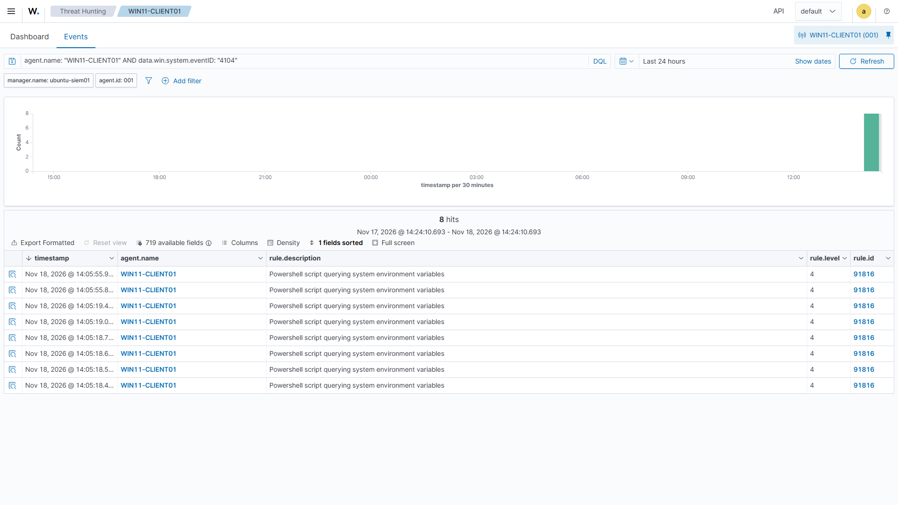

# Engineering Log – 2026-11-18

## Screenshot – Wazuh Filebeat Archive Forwarding Enabled

## Screenshot – Wazuh Powershell Event Dashboard Visibility

---

## Session – 14:08 to 14:40
### Goal
Verify that PowerShell Script Block Logging events (Event ID 4104) collected from WIN11-CLIENT01 are searchable in the Wazuh Dashboard, establish a reliable workflow for inspecting endpoint telemetry, prepare to transition into detection engineering.

### Definition of Done
All required virtual machines pass the pre-session readiness check, Wazuh Dashboard is accessible, WIN11-CLIENT01 appears as an active agent, PowerShell Event ID 4104 events are searchable in the dashboard, the controlled test marker CYBEROPS-WAZUH-TEST-20261117-THIRD can be located if available in the indexed data, relevant event fields are inspected including endpoint name, event ID, channel, timestamp, and script-block message, findings and indexing limitations are documented, next steps for detection engineering are identified.

### Goal Achieved
❌ No

**Summary:**
This documentation outlines the successful establishment and validation of centralized PowerShell Script Block Logging telemetry within Wazuh. Key activities included enabling and configuring Filebeat archive forwarding, inspecting raw PowerShell Event ID 4104 records, identifying security policy discovery activity, and validating controlled endpoint actions against raw SIEM archives. The work specifically focused on distinguishing successful event ingestion from dashboard indexing limitations, thereby laying a critical foundation for subsequent detection engineering efforts.

**Tasks Completed:**
*   Inspected existing PowerShell Event ID 4104 records within Wazuh Threat Hunting.
*   Examined event JSON and script-block contents to understand current telemetry.
*   Identified security-policy discovery activity using `secedit` and `PasswordHistorySize` commands.
*   Enabled Filebeat Wazuh archive forwarding to ensure all raw events are stored.
*   Validated the Filebeat configuration for correctness.
*   Successfully restarted the Filebeat service.
*   Generated controlled `Get-LocalUser` activity on the designated endpoint, WIN11-CLIENT01, to create new events.
*   Verified the resulting Event ID 4104 records locally on WIN11-CLIENT01.
*   Confirmed that the generated events successfully reached `/var/ossec/logs/archives/archives.json` on the Wazuh manager.

**Issues Encountered:**
*   Difficulty in distinguishing between successful raw event ingestion into archives and their subsequent indexing for dashboard visibility.
*   Initial generation of test activity occurred on the physical Windows host rather than the intended monitored Windows client.
*   Challenges in determining why newly archived events were not appearing in the expected dashboard search results despite successful archival.
*   Time spent on isolating and troubleshooting the telemetry pipeline, diverting focus from direct progression into detection engineering.

**Next Steps:**
*   Investigate and resolve the discrepancy between raw archive ingestion and dashboard visibility for the new Event ID 4104 records.
*   Develop new detection rules or dashboards utilizing the validated PowerShell Script Block Logging telemetry.
*   Expand controlled activity generation to cover additional PowerShell-based attack techniques.

**Notes:**
The AI assistant's guidance led to several inefficiencies during this process. Specifically, it did not emphasize establishing the correct execution host early enough, allowing initial testing to proceed on an unmonitored physical Windows host. Furthermore, the AI treated dashboard visibility and raw archive ingestion too closely as a single validation step. A more effective approach would have been to explicitly separate and validate the distinct stages of the telemetry pipeline: endpoint event generation, agent forwarding, manager archiving, and finally, indexer/dashboard visibility.

### Working Story
Improving centralized PowerShell telemetry visibility, identifying and correcting disabled Filebeat archive forwarding, inspecting actual Windows Script Block Logging records, validating controlled endpoint activity through raw SIEM archives, distinguishing successful ingestion from dashboard indexing limitations, establishing a foundation for subsequent detection engineering.

### Friction and AI Gaps
Distinguishing raw event ingestion from dashboard indexing, initially generating test activity on the physical Windows host instead of the monitored Windows client, determining why newly archived events were not appearing in the expected dashboard search results, spending additional time isolating the telemetry pipeline rather than progressing directly into detection engineering.

### What the AI Missed
The AI did not establish the execution host early enough and initially allowed testing to proceed on the physical Windows host. It also treated dashboard visibility and raw archive ingestion too closely as one validation step. The investigation should have separated endpoint event generation, agent forwarding, manager archiving, and indexer/dashboard visibility from the beginning.

### AI Peer Review
Status: Approved
Reviewer: human
Reviewed At: 2026-11-18 14:42:53
Reviewer Notes: The session made meaningful infrastructure progress but did not complete the full detection-engineering objective. Filebeat archive forwarding was disabled and was successfully enabled. Existing PowerShell events were searchable in the dashboard, with eight matching records observed. Newly generated Get-LocalUser events were confirmed in the manager's raw archive, but their appearance in the dashboard remains unresolved.

### Duration
31 minutes (Planned: 60 minutes)

### Notes

